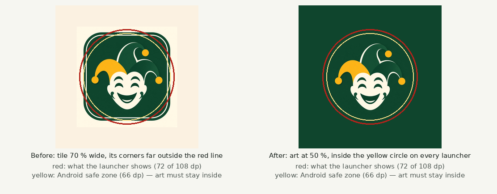
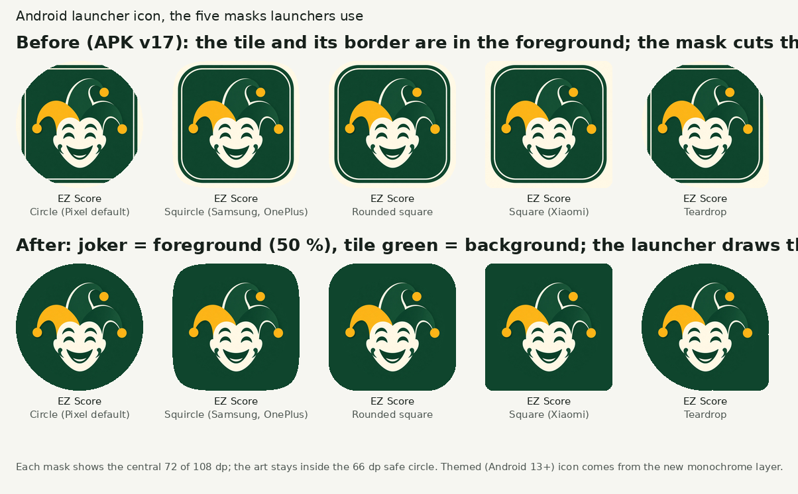
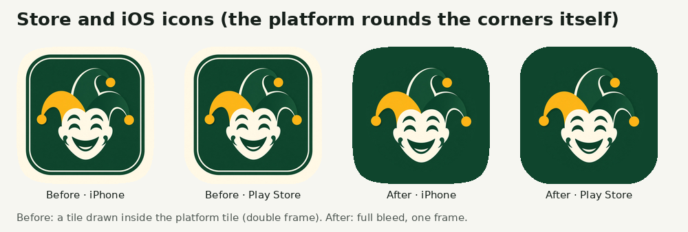

# The app icon on every surface (Nov 21, 2026)

Sree, installing APK v17: "You see the icon, the Joker icon … it's like a square shape, but then it's a circle,
so it's not very clean. Maybe you should zoom it out to make it look better. I don't know if this is the only
place or if there are other places."

## What was wrong

Android launcher icons are **adaptive**: the app ships two 108 dp layers (foreground + background) and the
*launcher* cuts them to its own shape — a circle on Pixel, a squircle on Samsung and OnePlus, a rounded square or
a plain square elsewhere, a teardrop on some. Only the central 72 dp is ever shown, and only a **66 dp circle
(61 % of the canvas) is guaranteed** to survive every mask.

Our foreground was the whole tile — rounded square, cream double border and the joker — drawn 70 % wide, so its
corners sat at 99 % of the half-width. The Pixel's circle cut straight through the tile's own border; Samsung's
squircle showed cream corners. "Zoom out" alone would not fix it: a tile inside the launcher's tile is a frame
inside a frame on every mask.

## The fix (industry standard: the art is the foreground, the launcher draws the shape)

| Layer | Before (v17) | After |
| --- | --- | --- |
| `android.adaptiveIcon.foregroundImage` | the tile with border, 70 % wide | **the joker only**, 50 % wide, inside the 66 dp safe circle (a disc of the tile green carries it; the disc is the background colour, so no launcher ever shows an edge) |
| `android.adaptiveIcon.backgroundColor` | cream `#FBF1E1` | **tile green `#0F452D`** — the launcher's mask *is* the tile |
| `android.adaptiveIcon.monochromeImage` | none | **new**: the joker silhouette for Android 13+ themed icons (Material You tints it) |
| `icon` (iOS, Play, Expo) | tile on a cream square (double frame once iOS / Play round the corners) | **full bleed** green with the joker at 74 % |
| `splash.image` | `icon.png` (tile on cream) | `splash-icon.png`, the **same v17 tile picture** — the splash does not change |
| `docs/play-listing/assets/icon-512.png` | the tile with its inner border line, full bleed | resized from the new `icon.png` |

## Where the icon appears, and which file each place uses

| Place | File | Changed by this PR |
| --- | --- | --- |
| Launcher (home screen, app drawer), **install dialog**, recents, Settings › Apps, share-sheet target, long-press shortcuts, notification badge | adaptive foreground + background (+ monochrome when the phone uses themed icons) | **yes** — the problem Sree saw |
| Splash | `splash-icon.png` on `#FBF1E1` | no (same picture, new file name) |
| Play Store listing | `docs/play-listing/assets/icon-512.png`, uploaded by Sree in the Console | regenerated — **Sree re-uploads** with the next listing update |
| iPhone home screen (later) | `icon.png` | yes — full bleed, no double frame |
| In-app brand marks: tab bar, Home, sign-in, PDF header | `icon-small.png` (tile on cream, 320 px) | no — these are drawn by us at a fixed size, never masked |
| Web pages | `favicon.png` | no |

## How to rebuild

`python3 docs/app-icon/make-icons.py` (Pillow, numpy, scipy) reads `source/adaptive-icon-v17.png` and `assets/icon-options/joker-1.png` — the approved joker tile —
and writes the four `assets/*.png` files and the three pictures here. `tests/app-icon.test.ts` fails if any
non-background pixel of the foreground or monochrome layer leaves the 66 dp safe circle, if the store icon grows a
margin again, or if the splash stops pointing at the tile.

A new APK is needed to see it (the icon is baked at build time); the first one is the next preview build Sree asks
for. Launchers cache icons — after installing, a long-press › remove › re-add, or a reboot, shows the new one.
