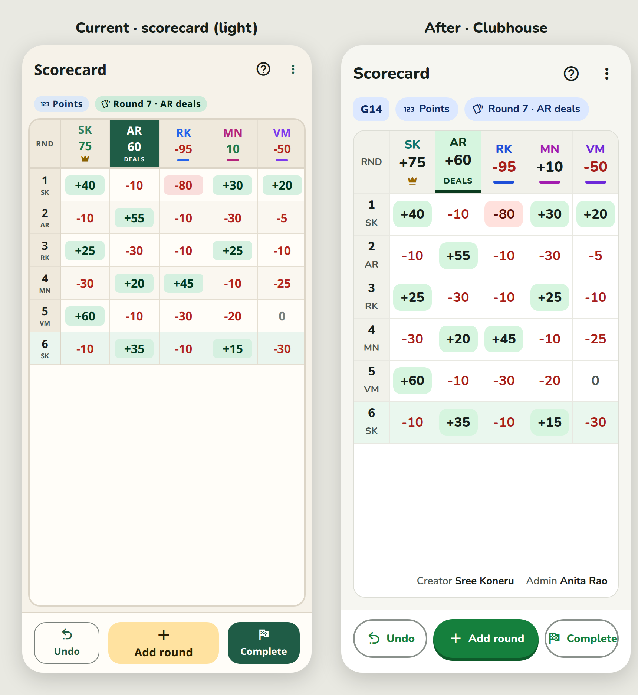

# EZ Score: Rummy · Design review and proposal

Research and proposal only. No app code, theme or behaviour was changed in this PR. Round 1: 11 Nov 2026. Round 2 (this revision): Sree's feedback of 11 Nov 4:40 PM PT, applied on top of `cursor/ezscore-apk-ready` at `414b570`.

Direction: keep the screens and flows, make the app look fresh, modern and polished (Duolingo-like), fun only in small doses, light and dark from the phone setting, large readable type and big targets for older players, WCAG AA everywhere and AAA for scores where practical, one obvious primary action per screen, no meaning by colour alone. Round 2 adds a hard standard: **the button green is only for buttons.**

## Contents

| Doc | What is in it |
|---|---|
| [01-audit.md](01-audit.md) | Every screen audited from code and the running web build: colours, buttons, type sizes, spacing, icons, information shown, cross-screen inconsistencies; inventories of every colour, button treatment and font size, with contrast ratios. (Round 1; still accurate for the restyle targets. Round-2 captures below show the newer flows.) |
| [02-design-system.md](02-design-system.md) | The proposed "Clubhouse" system: §0 lists the round-2 changes; then light/dark tokens with contrast ratios, type scale (Nunito), spacing, radius, elevation, button variants with states, chips/badges, cards, avatars, score styling, the confetti moment. |
| [03-implementation-plan.md](03-implementation-plan.md) | Phased plan, files touched, size per step, risks, verification checklist. Phase 2b holds the round-2 items. Nothing implemented. |
| [04-palette-alternatives.md](04-palette-alternatives.md) | Two alternative palettes (Indigo & Marigold, Teal & Coral) with contrast tables and a sample screen each. |
| [initials-options.md](initials-options.md) | Options doc for player initials (unique per My players, conflict resolution, Refresh from database), with mockups. Ideas only. |
| [mocks/](mocks/README.md) | HTML mock, render and capture scripts, contrast calculator. |

## Round 2: what changed in the proposal

1. **Role tags.** A viewer who is only a player sees no role chips except Creator (and "You"). Creators and admins still see Creator and Admin. "Player" / "View only" chips are gone. Mocks: `after/game-players-*.png` (creator's view) vs `after/game-players-player-view-*.png` (player's view); Home row G15 shows a game where Sree is a plain player.
2. **Design standard: dark green only on tappables.** Removed from: dealer column head, logo, avatars (seat 1 is now teal), positive scores and Totals (now near-black, bigger), the "You" chip, the round/dealer strip. Buttons all have a fill or a 2 px border and a pill shape.
3. **Complete** is now an outlined button with the flag icon next to the filled Add round; Undo outlined. Three buttons fit at 15 px labels.
4. **Tabs as buttons.** Home / My players / profile are three pill buttons (active filled green with the pressable edge). Feasible with expo-router's `tabBar` prop; see plan Phase 2b.
5. **Scorecard** shows the game number (`G14` badge) and the Creator and Admin names bottom-right inside the table card; with many rounds the footer follows the last row (`after/scorecard-big-*.png`).

Not done, by design: nothing in the app code; the alternatives (B, C) were not re-rendered with the round-2 rules (they share the same rules, only hues differ).

## Screenshots of the current app (as of `414b570`)

All in `mockups/current/`, 390×844 at 2×, light and dark (`-light.png` / `-dark.png`). Captured from the Expo web build in local prototype mode with seeded demo data (Sree Koneru #7 is the signed-in user; games G12–G16). `-full` files are full-page scrolls.

| # | File (append `-light.png` / `-dark.png`) | What it shows |
|---|---|---|
| 1 | `01-sign-in` | Sign-in screen |
| 1 | `01-sign-up` | Create account |
| 2 | `02-home` | Home: Results button, Live games (G16, G15 with 9 players, G14), Recent |
| 2 | `02-home-full` | Home, full page |
| 2 | `02-home-help` | Help dialog opened from the Home `?` |
| 3 | `03-new-game` | New game: type, rules, seats |
| 3 | `03-new-game-selected` | New game with three players picked |
| 3 | `03-player-picker-my-players` | Player picker: from My players |
| 3 | `03-player-picker-database` | Player picker: find in database by Player ID |
| 4 | `04-scorecard-4p-2-rounds` | Scorecard, 4 players, 2 rounds (fresh game G16) |
| 4 | `04-scorecard-5p-6-rounds` | Scorecard, 5 players, 6 rounds (G14) |
| 4 | `04-scorecard-menu` | Scorecard ⋮ menu (Game settings, Players/Admins, Edit round, Register players, Share…) |
| 4 | `04-scorecard-edit-round-picker` | "Edit which round?" dialog |
| 4 | `04-scorecard-9p-16-rounds` | Scorecard, 9 players, 16 rounds (G15, Pool); note S2 / A2 initials fallback |
| 4 | `04-scorecard-9p-scrolled` | Same, scrolled right |
| 5 | `05-add-round-empty` | Add round, nothing entered |
| 5 | `05-add-round-in-progress` | Add round: two scores saved, one cell selected, balance -90 |
| 5 | `05-add-round-balanced` | Add round: all cells filled, balance 0, Save round enabled |
| 5 | `05-edit-round` | Edit round 3 with existing scores in the cells |
| 6 | `06-game-players-admins` | Players/Admins: Creator, Admin, Registered/Pending chips, Add admin, Add new player |
| 6 | `06-game-players-row-menu` | Row ⋮ menu: Make admin, Remove player |
| 7 | `07-results-pick-games` | Results: pick games (Completed / Closed / Active filters), Past results |
| 7 | `07-results-pick-games-selected` | Two games selected (when the Closed filter tap succeeds; see note) |
| 7 | `07-results-view` / `07-results-view-full` | Result view before saving: reuse warning for G12, Save result, Totals, grid |
| 7 | `07-results-saved` / `07-results-saved-full` | Saved result (G13 now Closed), Share enabled, Top 3 |
| 8 | `08-share-results-dialog` | Share dialog with the results image card and PDF option |
| 8 | `08-share-final-scores` | Share final scores screen (image preview for a completed game) |
| 9 | `09-dialog-stale-scorecard` | "Round already saved" (another admin saved round 7 first) |
| 9 | `09-dialog-remove-blocked` | Remove player blocked because the player has non-zero scores |
| 9 | `09-dialog-remove-confirm` | Remove player confirmation (player with no scores) |
| 9 | `09-dialog-result-saved` | "Result saved" summary (Completed → Closed, reused game counted again) |
| 10 | `10-my-players` / `10-my-players-full` | My players grid with Player IDs, Registered / Pending / Unregistered |
| 10 | `10-my-players-detail` | Player detail dialog (tap a card) |
| 10 | `10-my-players-register` | Register unregistered players dialog |
| 11 | `11-profile` / `11-profile-full` | Profile (SK tab): identity card, Player ID, settings entry |
| 11 | `11-settings` | Settings (dark-mode switch, passcode) |
| 11 | `11-complete-game` | Complete game: standings, confirm |
| 11 | `11-game-settings` | Game settings dialog |

The "reused game" warning is visible on `07-results-view-*` (yellow banner: "G12 is already part of a previous result") and on `09-dialog-result-saved-*`.

## Proposed look: mockups

HTML mocks on the proposed tokens, same size. `mockups/after/` is the recommended Clubhouse palette with the round-2 rules applied.

| Screen | After (Clubhouse) | Side by side with current |
|---|---|---|
| Home | `after/home-light.png`, `home-dark.png` | `compare/home-light.png`, `home-dark.png` |
| Scorecard, 5 players | `after/scorecard-light.png`, `scorecard-dark.png` | `compare/scorecard-light.png`, `scorecard-dark.png` |
| Scorecard, 9 players × 16 rounds | `after/scorecard-big-light.png`, `scorecard-big-dark.png` | `compare/scorecard-big-light.png`, `scorecard-big-dark.png` |
| Add round | `after/add-round-light.png`, `add-round-dark.png` | `compare/add-round-light.png`, `add-round-dark.png` |
| Results (winner card, totals, grid) | `after/results-light.png`, `results-dark.png` | `compare/results-light.png`, `results-dark.png` |
| My players | `after/players-light.png`, `players-dark.png` | `compare/players-light.png`, `players-dark.png` |
| Players/Admins, creator's view | `after/game-players-light.png`, `game-players-dark.png` | `compare/game-players-light.png`, `game-players-dark.png` |
| Players/Admins, player's view (role-tag rule) | `after/game-players-player-view-light.png`, `-dark.png` | — |
| Confetti winner moment | `confetti/results-winner-light.png`, `results-winner-dark.png` | — |
| Initials: conflict resolution | `initials/initials-conflicts-light.png`, `-dark.png` | — |
| Initials: player sheet with Refresh from database | `initials/player-refresh-light.png`, `-dark.png` | — |
| Alternative B · Indigo & Marigold | `alternatives/B-home-light.png`, `B-home-dark.png` | — |
| Alternative C · Teal & Coral | `alternatives/C-home-light.png`, `C-home-dark.png` | — |

## The recommended palette, in plain words

**Clubhouse.** A bright card-table green (`#15803D`) used **only on things you can tap**: the one main button on each screen, the Save score key, the active tab. Pages are near-white with a hint of warmth (`#F6F6F1`) and cards are pure white, so the beige-on-cream look disappears. A warm marigold (`#FFE38A`) is kept for things worth highlighting: the Results button, the leader, Pool games, Pending, the logo. A soft blue (`#DCE8FF`) carries plain information: Points games, Admin, Registered, "You", the round/dealer strip. Scores are near-black, bold and signed; a round winner's cell gets a light green tint and losses are brick red. Avatars use their own seat colours (teal, orange, blue, magenta, violet…), never the button green. In dark mode the same hues brighten (mint `#5FD68E` buttons, sunflower `#FFD45E`) on a green-black surface, and the phone's setting decides which mode you see. Type is Nunito, 16 px minimum, ExtraBold headings, tabular numbers.

## Top five changes for a modern, polished feel

1. **Surfaces and palette.** Near-white page, white cards, saturated green reserved for buttons, marigold as accent, blue for information. One colour logic on every screen.
2. **Typeface and scale.** Nunito 400/600/700/800, body 16 px, nothing under 13 px, 22–28 px ExtraBold headings, tabular 800 scores.
3. **One button system.** 52 px pills with 18 px bold labels, a fill or a 2 px border on every button, a 4 px pressable edge on filled ones, one filled button per screen (Add round on the scorecard, Add new player on Players/Admins); tabs are pill buttons too.
4. **Consistent chips and roles.** One 32 px chip with icon + word, one status→colour map shared by all screens, role chips reduced to Creator / Admin / You with the player's-view rule.
5. **Scorecard and results polish.** Game number and Creator/Admin names on the scorecard, dealer column tinted not filled, near-black scores with a winner tint, a winner card with crown and a single confetti burst on Results.
