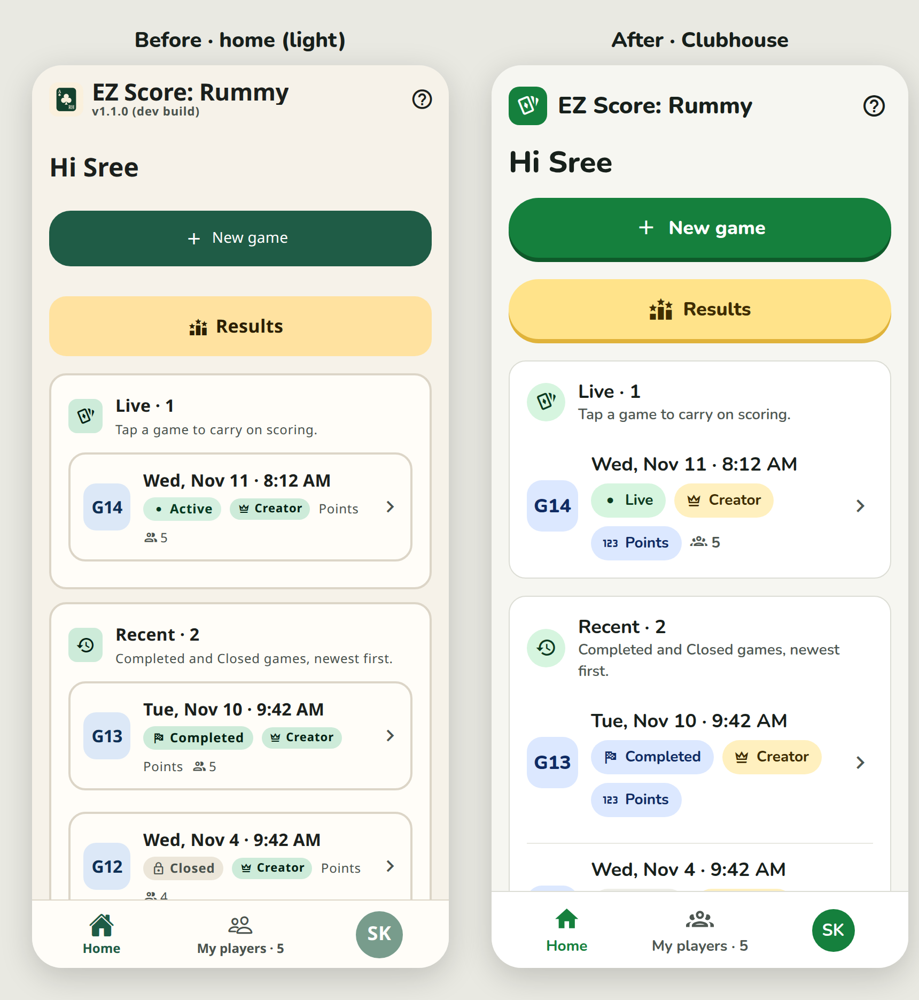

# EZ Score: Rummy · Design review and proposal

Research and proposal only. No app code, theme or behaviour was changed in this PR. Date: 11 Nov 2026. Direction from Sree's design interview: keep the screens and flows, make the app look fresh, modern and polished (Duolingo-like: playful, rounded, bold but clean), fun only in small doses, light and dark from the phone setting, large readable type and big targets for older players, WCAG AA everywhere and AAA for scores where practical, one obvious primary action per screen, no meaning by colour alone.

## Contents

| Doc | What is in it |
|---|---|
| [01-audit.md](01-audit.md) | Every screen audited from code and from the running web build: colours, buttons, type sizes, spacing, icons, information shown, and cross-screen inconsistencies. Full inventories of every colour, button treatment and font size in use, with contrast ratios for the current theme. |
| [02-design-system.md](02-design-system.md) | The proposed "Clubhouse" system: light/dark tokens with contrast ratios, type scale (Nunito), spacing, radius, elevation, button variants with states, chips/badges, cards, avatars, score styling, the confetti moment. |
| [03-implementation-plan.md](03-implementation-plan.md) | Phased plan, files touched (~55), size per step, risks, verification checklist. Nothing implemented. |
| [04-palette-alternatives.md](04-palette-alternatives.md) | Two alternative palettes (Indigo & Marigold, Teal & Coral) with contrast tables and a sample screen each. |
| [mocks/](mocks/README.md) | HTML mock, render and capture scripts, contrast calculator. |

## Mockups

All PNGs are 390×844 at 2× (iPhone 14-class portrait). "Before" images are the current app captured in Expo web with seeded demo data; "after" images are HTML mocks built on the proposed tokens.

| Screen | Before | After (Clubhouse) | Side by side |
|---|---|---|---|
| Home | `mockups/before/home-light.png`, `home-dark.png` | `mockups/after/home-light.png`, `home-dark.png` | `mockups/compare/home-light.png`, `home-dark.png` |
| Game scorecard | `mockups/before/scorecard-light.png`, `scorecard-dark.png` | `mockups/after/scorecard-light.png`, `scorecard-dark.png` | `mockups/compare/scorecard-light.png`, `scorecard-dark.png` |
| Add round | `mockups/before/add-round-light.png`, `add-round-dark.png` | `mockups/after/add-round-light.png`, `add-round-dark.png` | `mockups/compare/add-round-light.png`, `add-round-dark.png` |
| Results | `mockups/before/results-view-light.png`, `results-view-dark.png` | `mockups/after/results-light.png`, `results-dark.png` | `mockups/compare/results-light.png`, `results-dark.png` |
| My players | `mockups/before/players-light.png`, `players-dark.png` | `mockups/after/players-light.png`, `players-dark.png` | `mockups/compare/players-light.png`, `players-dark.png` |
| Confetti winner moment | — | `mockups/confetti/results-winner-light.png`, `results-winner-dark.png` | — |
| Alternative B · Indigo & Marigold | — | `mockups/alternatives/B-home-light.png`, `B-home-dark.png` | — |
| Alternative C · Teal & Coral | — | `mockups/alternatives/C-home-light.png`, `C-home-dark.png` | — |

Additional "before" captures (not mocked, audited in 01): `login`, `new-game`, `game-players`, `complete`, `results-picker`, `profile`, `settings`, each in light and dark under `mockups/before/`.

## The recommended palette, in plain words

**Clubhouse.** A bright card-table green (`#15803D`) as the one brand colour, used for the single main button on each screen, the active tab and anything that means "go" or "win". Pages are near-white with a hint of warmth (`#F6F6F1`) and cards are pure white, so the beige-on-cream look disappears. A warm marigold (`#FFE38A`) is kept only for things worth highlighting: the Results button, the leader, Pool games, Pending. A soft blue (`#DCE8FF`) carries plain information: Points games, Admin, Registered. Wins are deep green and losses are brick red, both AAA on white. In dark mode the same hues brighten (mint green `#5FD68E`, sunflower `#FFD45E`) on a green-black surface, and the phone's setting decides which mode you see. Type is Nunito, a rounded friendly face, 16 px minimum with bold 800 headings and tabular numbers for scores.

## Top five changes for a modern, polished feel

1. **Surfaces and palette.** Near-white page, white cards, saturated green primary, marigold only as an accent. Removes the dated beige/forest-green cast and gives every screen the same three-colour logic (green go/win, marigold highlight, blue info, red loss).
2. **Typeface and scale.** Nunito 400/600/700/800 through Paper's font config, body 16 px, nothing under 13 px, headings 22–28 px ExtraBold, tabular 800 scores. Biggest single lever for "looks like a current app" and for older eyes.
3. **One button system.** 52 px pill buttons with an 18 px bold label and a 4 px solid bottom edge that presses down (the Duolingo signature); exactly one filled green button per screen (Add round becomes the primary on the scorecard); the Results button is the only marigold button in the app. Replaces 13 ad-hoc treatments.
4. **Consistent chips and selection.** One 32 px chip with icon + word for every status, one status→colour map shared by all screens (Registered is green everywhere, Pending marigold, Unregistered grey, Completed blue, Live green), and selection shown as a green ring + check instead of yellow fill. Ends the "yellow means five things" problem.
5. **Cards, avatars and the winner moment.** Flat white cards with hairline dividers instead of frames inside frames; seat-coloured avatars with white initials and dark-mode text variants; a winner card with crown, 40 px total and a 1.8 s confetti burst on Results (reduce-motion aware). Small, contained fun that makes finishing a game feel like something.
