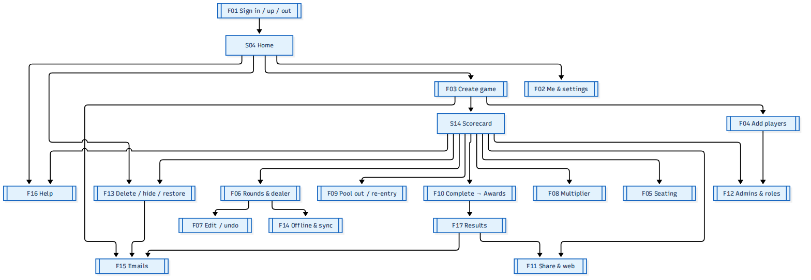
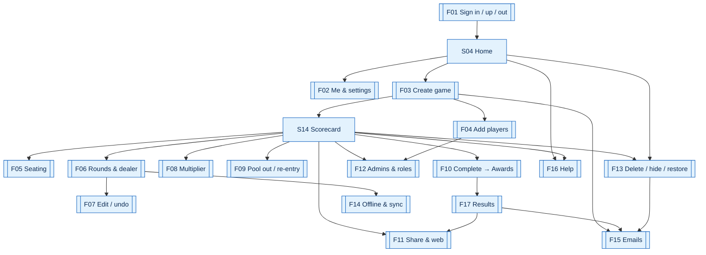

# User flows & scenarios (PR 23)

One Mermaid flowchart per flow (boxes = screens / steps, diamonds = decisions, every arrow a path), nodes labelled with the IDs from [`inventory.md`](inventory.md); **red node = no test touches it**. Under each flow: numbered scenarios (happy / edge / misuse) with the tests that cover them or GAP. Matrices a–e in [`matrices.md`](matrices.md) and `csv/`. Generated by `node docs/flows/build.mjs` from `data/*.mjs`; PNGs by `mmdc` (see the foot of this page).

## Summary

| | Count | Touched by a flow | Touched by a test |
| --- | --- | --- | --- |
| Screens | 32 | 32 (100%) | 32 (100%) |
| Pop-ups | 60 | 60 (100%) | 55 (92%) |
| Warnings | 40 | 40 (100%) | 40 (100%) |
| Emails | 7 | 7 (100%) | 7 (100%) |
| Requirements | 51 | — | 50 (98%) |
| Scenarios | 145 | 17 flows | 131 (90%) |

Redirect-only routes (not counted): 8. Test corpus scanned: 167 files (unit 71, pgTAP 37, concurrency 1, smoke 19, full 15, roles 5, chaos 12, two-device 6, monkey 1).

"Touched by a test" = some test file names one of the item's signals (testID, copy, helper); a pop-up or warning touched also counts for its host screen. It says a test *reaches* the item, not that every branch is asserted — the scenario GAP list below is the stricter view.

## Map





## Coverage matrix (flow × test type = distinct test files tagged in that flow's scenarios)

| Flow | unit | pgTAP | concurrency | smoke | full | roles | chaos | two-device | monkey | volume | Scenarios | GAP scenarios |
| --- | --- | --- | --- | --- | --- | --- | --- | --- | --- | --- | --- | --- |
| [F01](flows/F01-sign-up-sign-in-sign-out.md) Sign up, sign in, sign out | 5 | 1 |  | 1 | 1 |  | 2 |  |  |  | 9 | 1 |
| [F02](flows/F02-me-profile-and-settings-cascade.md) Me, profile and settings cascade | 8 | 3 |  | 1 | 2 |  |  |  |  |  | 9 | 1 |
| [F03](flows/F03-create-a-game-points-points-with-multiplier-pool.md) Create a game (Points · Points with multiplier · Pool) | 6 | 7 |  | 4 |  |  |  |  |  |  | 11 | 1 |
| [F04](flows/F04-add-players-initials-database-player-id-codes.md) Add players (initials · database · Player ID / codes) | 8 | 6 |  | 1 | 1 |  |  |  |  |  | 12 | 2 |
| [F05](flows/F05-seating-order.md) Seating order | 2 | 1 |  | 1 | 1 |  |  |  |  |  | 6 |  |
| [F06](flows/F06-play-rounds-and-the-dealer.md) Play rounds and the dealer | 6 | 5 |  | 2 | 2 |  | 4 | 4 |  |  | 10 |  |
| [F07](flows/F07-edit-or-undo-a-round.md) Edit or undo a round | 4 | 2 |  | 1 | 1 | 1 |  |  |  |  | 7 | 1 |
| [F08](flows/F08-change-the-multiplier.md) Change the multiplier | 2 | 1 |  | 1 | 1 |  |  |  |  |  | 6 |  |
| [F09](flows/F09-pool-out-re-entry-limit.md) Pool: out, re-entry, limit | 3 | 2 |  | 2 |  | 1 | 1 |  |  |  | 7 | 1 |
| [F10](flows/F10-complete-awards-result.md) Complete → Awards → Result | 4 | 3 |  | 3 |  | 1 | 1 |  |  |  | 9 | 1 |
| [F11](flows/F11-share-picture-pdf-link-live-page-email.md) Share: picture, PDF, link, live page, email | 5 | 5 |  | 2 | 1 |  |  |  |  |  | 10 | 2 |
| [F12](flows/F12-admins-and-roles.md) Admins and roles | 3 | 4 |  |  | 2 | 4 |  |  |  |  | 9 | 1 |
| [F13](flows/F13-delete-hide-restore-deleted-games.md) Delete, hide, restore, Deleted games | 3 | 4 |  |  |  | 1 |  |  |  |  | 10 | 1 |
| [F14](flows/F14-offline-and-sync.md) Offline and sync | 5 | 1 |  |  |  |  | 5 |  |  |  | 8 | 1 |
| [F15](flows/F15-notifications-and-emails.md) Notifications and emails | 4 | 5 |  |  |  |  |  |  |  |  | 8 | 1 |
| [F16](flows/F16-help.md) Help | 6 |  |  | 1 | 1 |  |  |  |  |  | 3 |  |
| [F17](flows/F17-results-pick-save-past-delete-history.md) Results: pick, save, past, delete, history | 6 | 5 |  | 3 | 2 |  |  |  |  |  | 11 |  |
| **Total** | 51 | 35 | 0 | 15 | 13 | 5 | 12 | 4 | 0 | 0 | 145 | 14 |

## GAP list

### Screens / pop-ups / warnings no test touches (5)

- <span style="color:#c62828">**GAP**</span> P13 Player detail (initials, Close / Remove) — `app/(tabs)/players.tsx` — flows: F04
- <span style="color:#c62828">**GAP**</span> P17 Country picker (phone code) — `app/(auth)/register.tsx` — flows: F01
- <span style="color:#c62828">**GAP**</span> P29 Link copied (scorecard) — `app/(screens)/games/[id].tsx` — flows: F11
- <span style="color:#c62828">**GAP**</span> P46 Can’t remove this player (picker) — `app/(screens)/games/new.tsx` — flows: F04
- <span style="color:#c62828">**GAP**</span> P57 Link copied (result) — `app/(screens)/results/[id].tsx` — flows: F17

### In no flow (0)

- none

### Scenarios without a test (14)

- <span style="color:#c62828">**GAP**</span> F01-9 Create account on the device (register screen end to end)
- <span style="color:#c62828">**GAP**</span> F02-9 Change passcode and Delete account on the device
- <span style="color:#c62828">**GAP**</span> F03-11 Co-admin nudge and Large multiplier confirm on the device
- <span style="color:#c62828">**GAP**</span> F04-11 Unsaved letters dialog on Back
- <span style="color:#c62828">**GAP**</span> F04-12 Link to Player ID and claim flows on the device (two accounts)
- <span style="color:#c62828">**GAP**</span> F07-7 Edit which round? dialog on the device (pick an older round)
- <span style="color:#c62828">**GAP**</span> F09-7 Re-entry a second time after going out again (Unlimited) on the device
- <span style="color:#c62828">**GAP**</span> F10-9 Reopen dialog on the device
- <span style="color:#c62828">**GAP**</span> F11-9 Email a scorecard (send-email kind scorecard) end to end
- <span style="color:#c62828">**GAP**</span> F11-10 Web pages in a real browser (Playwright) — /r/, scorecard.html, link.html, unsubscribe.html
- <span style="color:#c62828">**GAP**</span> F12-9 Remove player blocked dialog and Edit name on the device
- <span style="color:#c62828">**GAP**</span> F13-10 Hidden & deleted screen on the device (Unhide, Restore, toast)
- <span style="color:#c62828">**GAP**</span> F14-8 Two phones offline then both online with the same round number
- <span style="color:#c62828">**GAP**</span> F15-8 Real delivery through Resend (staging inbox)

### Requirements with no touched item (1)

- R50 Country picker on Create account (phone code)

## Flows

- [F01 Sign up, sign in, sign out](flows/F01-sign-up-sign-in-sign-out.md) — 9 scenarios, 12 nodes, 1 red · [PNG](png/F01-sign-up-sign-in-sign-out.png)
- [F02 Me, profile and settings cascade](flows/F02-me-profile-and-settings-cascade.md) — 9 scenarios, 11 nodes, no red · [PNG](png/F02-me-profile-and-settings-cascade.png)
- [F03 Create a game (Points · Points with multiplier · Pool)](flows/F03-create-a-game-points-points-with-multiplier-pool.md) — 11 scenarios, 11 nodes, no red · [PNG](png/F03-create-a-game-points-points-with-multiplier-pool.png)
- [F04 Add players (initials · database · Player ID / codes)](flows/F04-add-players-initials-database-player-id-codes.md) — 12 scenarios, 24 nodes, 2 red · [PNG](png/F04-add-players-initials-database-player-id-codes.png)
- [F05 Seating order](flows/F05-seating-order.md) — 6 scenarios, 5 nodes, no red · [PNG](png/F05-seating-order.png)
- [F06 Play rounds and the dealer](flows/F06-play-rounds-and-the-dealer.md) — 10 scenarios, 10 nodes, no red · [PNG](png/F06-play-rounds-and-the-dealer.png)
- [F07 Edit or undo a round](flows/F07-edit-or-undo-a-round.md) — 7 scenarios, 8 nodes, no red · [PNG](png/F07-edit-or-undo-a-round.png)
- [F08 Change the multiplier](flows/F08-change-the-multiplier.md) — 6 scenarios, 10 nodes, no red · [PNG](png/F08-change-the-multiplier.png)
- [F09 Pool: out, re-entry, limit](flows/F09-pool-out-re-entry-limit.md) — 7 scenarios, 8 nodes, no red · [PNG](png/F09-pool-out-re-entry-limit.png)
- [F10 Complete → Awards → Result](flows/F10-complete-awards-result.md) — 9 scenarios, 16 nodes, no red · [PNG](png/F10-complete-awards-result.png)
- [F11 Share: picture, PDF, link, live page, email](flows/F11-share-picture-pdf-link-live-page-email.md) — 10 scenarios, 16 nodes, 1 red · [PNG](png/F11-share-picture-pdf-link-live-page-email.png)
- [F12 Admins and roles](flows/F12-admins-and-roles.md) — 9 scenarios, 13 nodes, no red · [PNG](png/F12-admins-and-roles.png)
- [F13 Delete, hide, restore, Deleted games](flows/F13-delete-hide-restore-deleted-games.md) — 10 scenarios, 15 nodes, no red · [PNG](png/F13-delete-hide-restore-deleted-games.png)
- [F14 Offline and sync](flows/F14-offline-and-sync.md) — 8 scenarios, 7 nodes, no red · [PNG](png/F14-offline-and-sync.png)
- [F15 Notifications and emails](flows/F15-notifications-and-emails.md) — 8 scenarios, 14 nodes, no red · [PNG](png/F15-notifications-and-emails.png)
- [F16 Help](flows/F16-help.md) — 3 scenarios, 7 nodes, no red · [PNG](png/F16-help.png)
- [F17 Results: pick, save, past, delete, history](flows/F17-results-pick-save-past-delete-history.md) — 11 scenarios, 20 nodes, 1 red · [PNG](png/F17-results-pick-save-past-delete-history.png)

## Legend

Blue box = screen (S) · yellow stadium = pop-up (P) · purple slant = warning (W) · green double box = email (E) · white = step · diamond = decision · **red = no test touches it**.

## Rebuild

```bash
cd rummy-home3 && node docs/flows/build.mjs
for f in docs/flows/mmd/*.mmd; do mmdc -i "$f" -o "docs/flows/png/$(basename "${f%.mmd}").png" -b white -s 2; done
```

Related: PR 16 planning tables in [`../test-plan/`](../test-plan/) (W-codes there were pre-build estimates; this folder is the code-enumerated set). Test codes per PR live in [`../testing-strategy.md`](../testing-strategy.md).
