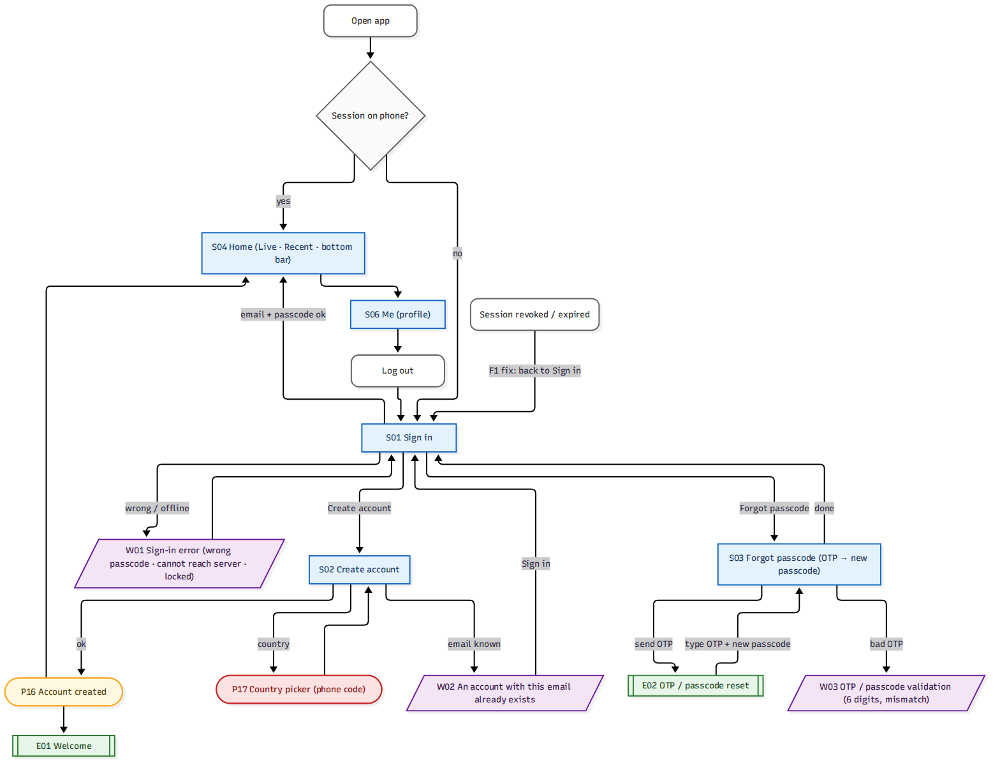
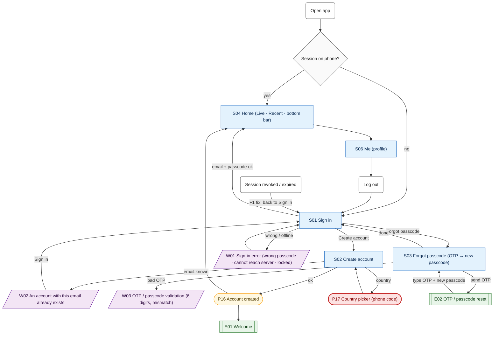

# F01 — Sign up, sign in, sign out

Requirements: R01, R02, R03 · Screens / pop-ups / warnings in this flow: 12 · untested (red): 1 — P17

## Scenarios

| # | Kind | Scenario | Tests |
| --- | --- | --- | --- |
| F01-1 | happy | Sign in with email + 6-digit passcode → Home | [`smoke/01-home.yaml`](../../../e2e/smoke/01-home.yaml) · [`lib/sign-in.yaml`](../../../e2e/lib/sign-in.yaml) · [`passcode.test.ts`](../../../tests/passcode.test.ts) |
| F01-2 | happy | Create account → Account created → welcome email → Home | [`auth-errors.test.ts`](../../../tests/auth-errors.test.ts) · [`emails-024.test.ts`](../../../tests/emails-024.test.ts) · [`pgTAP/11_email_uniqueness_021.sql`](../../../supabase/tests/11_email_uniqueness_021.sql) |
| F01-3 | edge | Sign up with an email that already has an account → "already exists", no welcome email | [`email-uniqueness-021.test.ts`](../../../tests/email-uniqueness-021.test.ts) · [`pgTAP/11_email_uniqueness_021.sql`](../../../supabase/tests/11_email_uniqueness_021.sql) |
| F01-4 | happy | Forgot passcode → OTP email → new passcode → sign in | [`passcode.test.ts`](../../../tests/passcode.test.ts) |
| F01-5 | misuse | Wrong passcode → error, stays on Sign in | [`full/10-sign-out-bad-passcode.yaml`](../../../e2e/full/10-sign-out-bad-passcode.yaml) · [`auth-errors.test.ts`](../../../tests/auth-errors.test.ts) |
| F01-6 | happy | Log out from Me → Sign in | [`full/10-sign-out-bad-passcode.yaml`](../../../e2e/full/10-sign-out-bad-passcode.yaml) · [`test-findings-pr19.test.ts`](../../../tests/test-findings-pr19.test.ts) |
| F01-7 | edge | Dead / revoked session → back to Sign in, not a spinner (F1) | [`chaos/c12-logout-dead-session--revoke-session.yaml`](../../../e2e/chaos/c12-logout-dead-session--revoke-session.yaml) · [`test-findings-pr19.test.ts`](../../../tests/test-findings-pr19.test.ts) |
| F01-8 | edge | Launch offline → cached Home, not a sign-out (F2) | [`chaos/c11-launch-offline--net-off.yaml`](../../../e2e/chaos/c11-launch-offline--net-off.yaml) · [`test-findings-pr19.test.ts`](../../../tests/test-findings-pr19.test.ts) |
| F01-9 | edge | Create account on the device (register screen end to end) | **GAP** |

## Nodes

| ID | Name | File | Tests touching it |
| --- | --- | --- | --- |
| S01 | Sign in | `app/(auth)/login.tsx` | 12 |
| S02 | Create account | `app/(auth)/register.tsx` | 4 |
| S03 | Forgot passcode (OTP → new passcode) | `app/(auth)/forgot-password.tsx` | 1 |
| W01 | Sign-in error (wrong passcode · cannot reach server · locked) | `utils/authErrors.ts` | 3 |
| W02 | An account with this email already exists | `utils/signUpOutcome.ts` | 2 |
| W03 | OTP / passcode validation (6 digits, mismatch) | `utils/passcode.ts, utils/passcodeFlow.ts` | 1 |
| P16 | Account created | `app/(auth)/register.tsx` | 1 |
| P17 | Country picker (phone code) | `app/(auth)/register.tsx` | **GAP** |
| E01 | Welcome | `supabase/functions/send-email/index.ts (kind welcome)` | 1 |
| E02 | OTP / passcode reset | `supabase/templates/recovery-passcode.html` | 1 |
| S04 | Home (Live · Recent · bottom bar) | `app/(tabs)/index.tsx` | 71 |
| S06 | Me (profile) | `app/(tabs)/me.tsx` | 27 |
