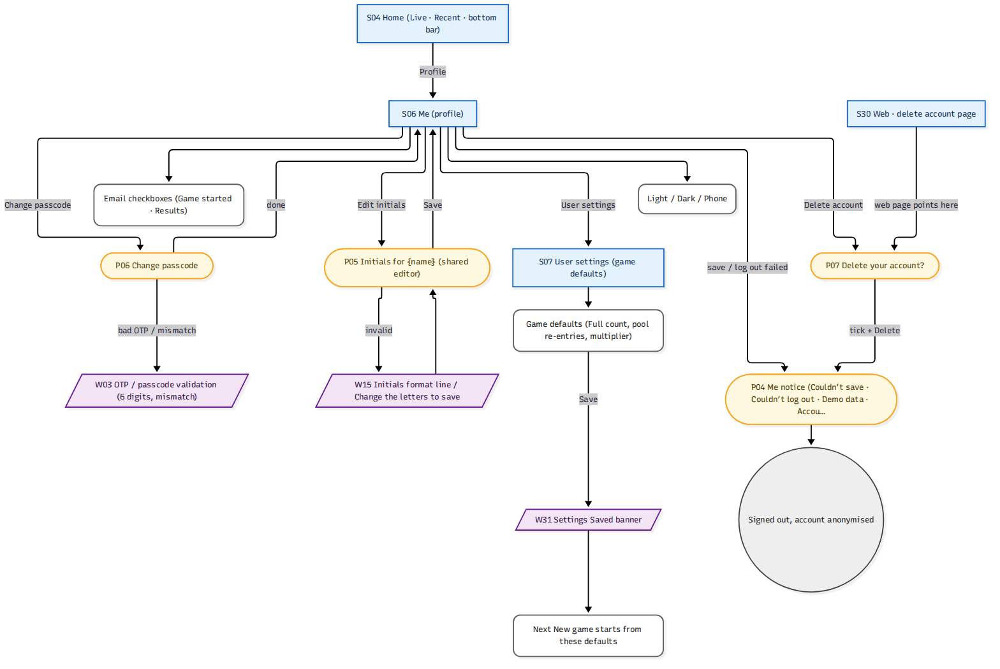
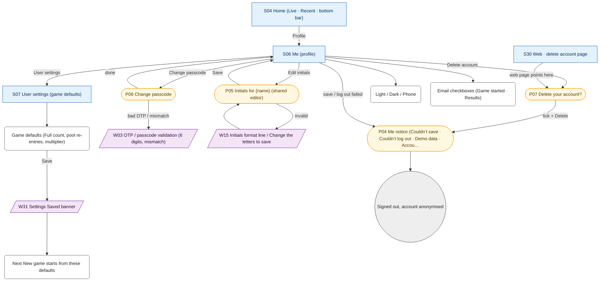

# F02 — Me, profile and settings cascade

Requirements: R04, R05, R06 · Screens / pop-ups / warnings in this flow: 11 · untested (red): 0

## Scenarios

| # | Kind | Scenario | Tests |
| --- | --- | --- | --- |
| F02-1 | happy | Open Me, see name · Player ID · version line | [`smoke/07-profile.yaml`](../../../e2e/smoke/07-profile.yaml) · [`pr10b-apk9-fixes.test.ts`](../../../tests/pr10b-apk9-fixes.test.ts) |
| F02-2 | happy | Edit own initials from Me → scorecards use them | [`smoke/07-profile.yaml`](../../../e2e/smoke/07-profile.yaml) · [`pr10b-apk9-fixes.test.ts`](../../../tests/pr10b-apk9-fixes.test.ts) · [`pgTAP/31_own_initials_040.sql`](../../../supabase/tests/31_own_initials_040.sql) |
| F02-3 | happy | User settings: pool re-entries Unlimited ↔ Limited (count field) | [`smoke/07-profile.yaml`](../../../e2e/smoke/07-profile.yaml) · [`pool-pr13.test.ts`](../../../tests/pool-pr13.test.ts) |
| F02-4 | happy | Default Full count / multiplier saved → next New game pre-filled | [`multiplier-pr14.test.ts`](../../../tests/multiplier-pr14.test.ts) · [`design-nov12.test.ts`](../../../tests/design-nov12.test.ts) |
| F02-5 | happy | Appearance Light default; Dark applies everywhere; Phone follows OS | [`full/60-dark-mode.yaml`](../../../e2e/full/60-dark-mode.yaml) · [`full/61-first-launch-light-night-phone.yaml`](../../../e2e/full/61-first-launch-light-night-phone.yaml) · [`home-pr5.test.ts`](../../../tests/home-pr5.test.ts) |
| F02-6 | happy | Change passcode with current passcode check | [`passcode.test.ts`](../../../tests/passcode.test.ts) |
| F02-7 | misuse | Delete account: dialog lists what goes / stays; tick required; RPC anonymises | [`delete-account-026.test.ts`](../../../tests/delete-account-026.test.ts) · [`pgTAP/16_delete_account_026.sql`](../../../supabase/tests/16_delete_account_026.sql) |
| F02-8 | edge | Email preferences off → no Game started / Result email | [`pgTAP/14_emails_024.sql`](../../../supabase/tests/14_emails_024.sql) · [`emails-024.test.ts`](../../../tests/emails-024.test.ts) |
| F02-9 | edge | Change passcode and Delete account on the device | **GAP** |

## Nodes

| ID | Name | File | Tests touching it |
| --- | --- | --- | --- |
| S04 | Home (Live · Recent · bottom bar) | `app/(tabs)/index.tsx` | 69 |
| S06 | Me (profile) | `app/(tabs)/me.tsx` | 26 |
| S07 | User settings (game defaults) | `app/(screens)/settings.tsx` | 27 |
| P05 | Initials for {name} (shared editor) | `components/players/InitialsDialog.tsx` | 2 |
| P06 | Change passcode | `components/auth/ChangePasscodeDialog.tsx` | 3 |
| P07 | Delete your account? | `components/account/DeleteAccountDialog.tsx` | 1 |
| P04 | Me notice (Couldn’t save · Couldn’t log out · Demo data · Account deleted) | `app/(tabs)/me.tsx` | 2 |
| W03 | OTP / passcode validation (6 digits, mismatch) | `utils/passcode.ts, utils/passcodeFlow.ts` | 1 |
| W15 | Initials format line / Change the letters to save | `components/players/InitialsDialog.tsx` | 3 |
| W31 | Settings Saved banner | `app/(screens)/settings.tsx` | 10 |
| S30 | Web · delete account page | `public/delete-account/index.html` | 1 |
