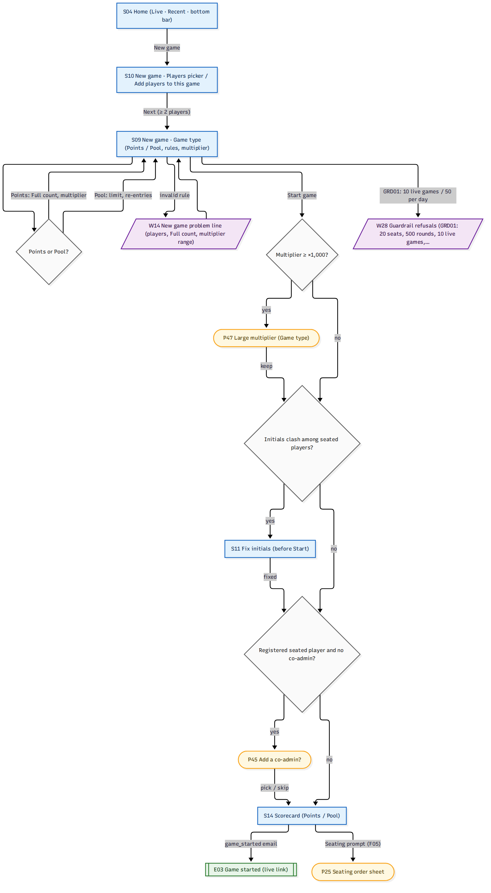
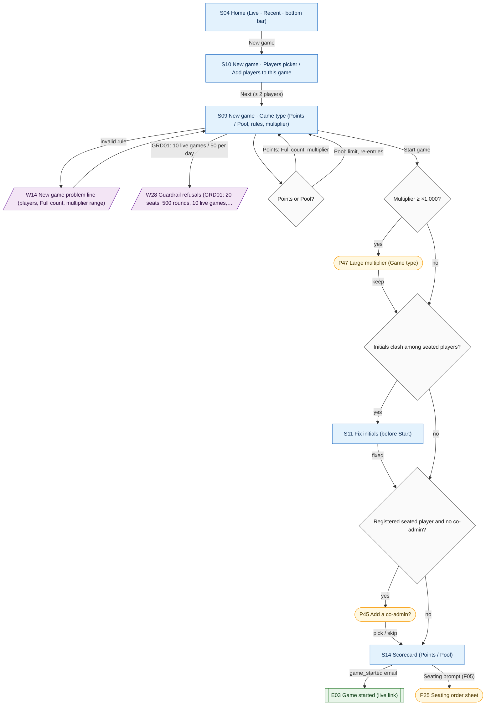

# F03 — Create a game (Points · Points with multiplier · Pool)

Requirements: R07, R08, R09, R21 · Screens / pop-ups / warnings in this flow: 11 · untested (red): 0

## Scenarios

| # | Kind | Scenario | Tests |
| --- | --- | --- | --- |
| F03-1 | happy | Points game, 4 players, Full count 80 → scorecard S-number | [`smoke/09-new-game.yaml`](../../../e2e/smoke/09-new-game.yaml) · [`pgTAP/18_game_labels_028.sql`](../../../supabase/tests/18_game_labels_028.sql) · [`pgTAP/28_game_numbers_038.sql`](../../../supabase/tests/28_game_numbers_038.sql) |
| F03-2 | happy | Pool game: two-screen New game, limit + re-entries → P-number | [`smoke/16-pool-game.yaml`](../../../e2e/smoke/16-pool-game.yaml) · [`pool-pr13.test.ts`](../../../tests/pool-pr13.test.ts) · [`pgTAP/32_pool_041.sql`](../../../supabase/tests/32_pool_041.sql) |
| F03-3 | happy | Points with multiplier ×10 → chip on card and scorecard | [`smoke/18-multiplier-change.yaml`](../../../e2e/smoke/18-multiplier-change.yaml) · [`multiplier-pr14.test.ts`](../../../tests/multiplier-pr14.test.ts) · [`pgTAP/34_multiplier_043.sql`](../../../supabase/tests/34_multiplier_043.sql) |
| F03-4 | edge | Multiplier ×1,000+ → Large multiplier confirm once | [`multiplier-pr14.test.ts`](../../../tests/multiplier-pr14.test.ts) |
| F03-5 | misuse | Multiplier outside 1–10,000 or bad K/M form → problem line, Start off | [`multiplier-pr14.test.ts`](../../../tests/multiplier-pr14.test.ts) |
| F03-6 | edge | Two seated players share initials → Fix initials before Start | [`smoke/17-pool-wide-initials-20p.yaml`](../../../e2e/smoke/17-pool-wide-initials-20p.yaml) · [`initials-022.test.ts`](../../../tests/initials-022.test.ts) · [`pgTAP/12_player_initials_022.sql`](../../../supabase/tests/12_player_initials_022.sql) |
| F03-7 | edge | Co-admin nudge when a registered player is seated | [`emails-024.test.ts`](../../../tests/emails-024.test.ts) |
| F03-8 | misuse | 11th live game / 51st game today refused by GRD01 | [`pgTAP/19_guardrails_029.sql`](../../../supabase/tests/19_guardrails_029.sql) · [`guardrails-029.test.ts`](../../../tests/guardrails-029.test.ts) |
| F03-9 | happy | Game numbers reused once a game leaves Active; share code unique | [`pgTAP/28_game_numbers_038.sql`](../../../supabase/tests/28_game_numbers_038.sql) · [`game-labels-028.test.ts`](../../../tests/game-labels-028.test.ts) |
| F03-10 | happy | Game started email with live link to seated registered players | [`pgTAP/14_emails_024.sql`](../../../supabase/tests/14_emails_024.sql) |
| F03-11 | edge | Co-admin nudge and Large multiplier confirm on the device | **GAP** |

## Nodes

| ID | Name | File | Tests touching it |
| --- | --- | --- | --- |
| S04 | Home (Live · Recent · bottom bar) | `app/(tabs)/index.tsx` | 73 |
| S10 | New game · Players picker / Add players to this game | `app/(screens)/games/new.tsx` | 41 |
| S09 | New game · Game type (Points / Pool, rules, multiplier) | `app/(screens)/games/new.tsx + components/game/GameTypeStep.tsx` | 29 |
| S11 | Fix initials (before Start) | `components/players/FixInitialsScreen.tsx` | 17 |
| W14 | New game problem line (players, Full count, multiplier range) | `components/game/GameTypeStep.tsx, components/game/RulesForm.tsx` | 3 |
| P47 | Large multiplier (Game type) | `components/game/GameTypeStep.tsx` | 1 |
| P45 | Add a co-admin? | `components/game/CoAdminNudge.tsx` | 2 |
| W28 | Guardrail refusals (GRD01: 20 seats, 500 rounds, 10 live games, 50 games/day, 100 players/day, 20 pending links) | `utils/guardrails.ts` | 5 |
| E03 | Game started (live link) | `supabase/functions/send-email/index.ts (game_started)` | 7 |
| S14 | Scorecard (Points / Pool) | `app/(screens)/games/[id].tsx` | 91 |
| P25 | Seating order sheet | `components/game/SeatingSheet.tsx` | 5 |
