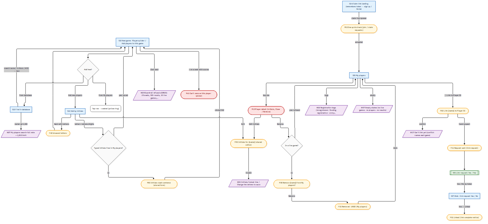
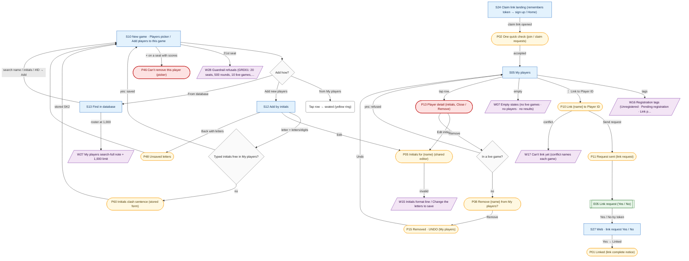

# F04 — Add players (initials · database · Player ID / codes)

Requirements: R10, R11, R12, R13 · Screens / pop-ups / warnings in this flow: 24 · untested (red): 2 — P13, P46

## Scenarios

| # | Kind | Scenario | Tests |
| --- | --- | --- | --- |
| F04-1 | happy | Pick seated players from My players (search, recent first) | [`smoke/09-new-game.yaml`](../../../e2e/smoke/09-new-game.yaml) · [`add-players-pr7.test.ts`](../../../tests/add-players-pr7.test.ts) · [`pgTAP/09_candidates_and_roster.sql`](../../../supabase/tests/09_candidates_and_roster.sql) |
| F04-2 | happy | Add new players by initials, 3 at a time; initials are the name | [`smoke/09-new-game.yaml`](../../../e2e/smoke/09-new-game.yaml) · [`initials-pr6.test.ts`](../../../tests/initials-pr6.test.ts) · [`pgTAP/29_initials_039.sql`](../../../supabase/tests/29_initials_039.sql) |
| F04-3 | edge | Initials clash → stored SK2 with the exact sentence | [`smoke/09-new-game.yaml`](../../../e2e/smoke/09-new-game.yaml) · [`initials-pr6.test.ts`](../../../tests/initials-pr6.test.ts) · [`pgTAP/29_initials_039.sql`](../../../supabase/tests/29_initials_039.sql) |
| F04-4 | misuse | Digit first / 1 character refused by all four gates | [`initials-pr6.test.ts`](../../../tests/initials-pr6.test.ts) · [`pgTAP/29_initials_039.sql`](../../../supabase/tests/29_initials_039.sql) |
| F04-5 | happy | From database: search by name, initials or #ID, add to My players and seat | [`nov10-owner.test.ts`](../../../tests/nov10-owner.test.ts) · [`pgTAP/20_my_players_scale_030.sql`](../../../supabase/tests/20_my_players_scale_030.sql) |
| F04-6 | happy | Mid-game: Add players to this game → Return to game → columns appear with zeros | [`full/32-add-players-to-game.yaml`](../../../e2e/full/32-add-players-to-game.yaml) · [`nov10-midgame.test.ts`](../../../tests/nov10-midgame.test.ts) |
| F04-7 | happy | Link a seat to a Player ID → request email + Home card → Yes → Linked pop-up | [`link-player-025.test.ts`](../../../tests/link-player-025.test.ts) · [`pgTAP/15_link_player_025.sql`](../../../supabase/tests/15_link_player_025.sql) · [`pgTAP/07_seat_takeover_017.sql`](../../../supabase/tests/07_seat_takeover_017.sql) |
| F04-8 | misuse | Link refused when the account already plays in a game with this seat (sentence names the game) | [`link-player-025.test.ts`](../../../tests/link-player-025.test.ts) · [`pgTAP/15_link_player_025.sql`](../../../supabase/tests/15_link_player_025.sql) |
| F04-9 | misuse | 21st seat / 101st new player today / 1,001st roster row refused | [`pgTAP/19_guardrails_029.sql`](../../../supabase/tests/19_guardrails_029.sql) · [`guardrails-029.test.ts`](../../../tests/guardrails-029.test.ts) · [`my-players-scale-030.test.ts`](../../../tests/my-players-scale-030.test.ts) |
| F04-10 | happy | Claim link → remember token → sign up → One quick check accepted | [`player-identity.test.ts`](../../../tests/player-identity.test.ts) |
| F04-11 | edge | Unsaved letters dialog on Back | **GAP** |
| F04-12 | edge | Link to Player ID and claim flows on the device (two accounts) | **GAP** |

## Nodes

| ID | Name | File | Tests touching it |
| --- | --- | --- | --- |
| S10 | New game · Players picker / Add players to this game | `app/(screens)/games/new.tsx` | 41 |
| S12 | Add by initials | `app/(screens)/players/add.tsx` | 37 |
| S13 | Find in database | `app/(screens)/players/new.tsx` | 25 |
| S05 | My players | `app/(tabs)/players.tsx` | 39 |
| P60 | Initials clash sentence (stored form) | `app/(screens)/players/add.tsx` | 11 |
| P48 | Unsaved letters | `app/(screens)/players/add.tsx` | 1 |
| P05 | Initials for {name} (shared editor) | `components/players/InitialsDialog.tsx` | 2 |
| W15 | Initials format line / Change the letters to save | `components/players/InitialsDialog.tsx` | 3 |
| W16 | Registration tags (Unregistered · Pending registration · Link pending) | `utils/myPlayersList.ts` | 15 |
| W27 | My players search-full note + 1,000 limit | `app/(tabs)/players.tsx, utils/guardrails.ts` | 2 |
| W28 | Guardrail refusals (GRD01: 20 seats, 500 rounds, 10 live games, 50 games/day, 100 players/day, 20 pending links) | `utils/guardrails.ts` | 5 |
| P10 | Link {name} to Player ID | `components/players/LinkPlayerDialog.tsx` | 4 |
| P11 | Request sent (link request) | `components/players/LinkRequestSentDialog.tsx` | 1 |
| E05 | Link request (Yes / No) | `supabase/functions/send-email/index.ts (link_request)` | 9 |
| S27 | Web · link request Yes / No | `public/link.html` | 5 |
| P01 | Linked (link complete notice) | `app/(tabs)/index.tsx` | 1 |
| S24 | Claim link landing (remembers token → sign up / Home) | `app/claim.tsx` | 1 |
| P02 | One quick check (join / claim requests) | `components/players/JoinRequestsDialog.tsx` | 2 |
| P13 | Player detail (initials, Close / Remove) | `app/(tabs)/players.tsx` | **GAP** |
| P08 | Remove {name} from My players? | `app/(tabs)/players.tsx` | 1 |
| P15 | Removed · UNDO (My players) | `app/(tabs)/players.tsx` | 4 |
| W17 | Can’t link yet (conflict names each game) | `components/players/LinkPlayerDialog.tsx` | 3 |
| W07 | Empty states (no live games · no players · no results) | `components/ui/EmptyState.tsx` | 1 |
| P46 | Can’t remove this player (picker) | `app/(screens)/games/new.tsx` | **GAP** |
