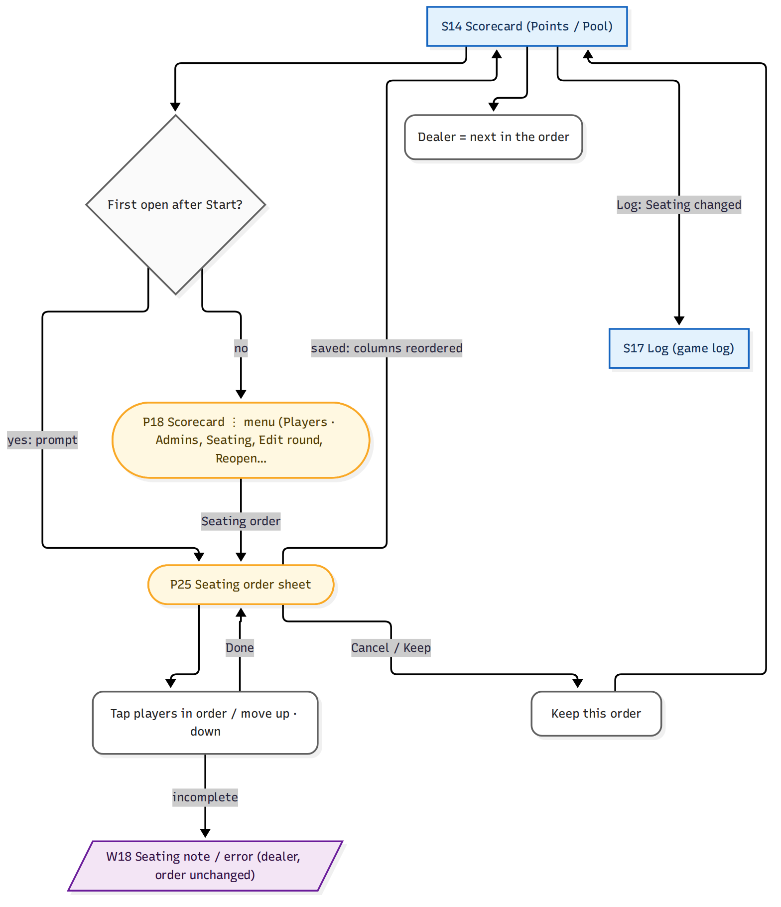
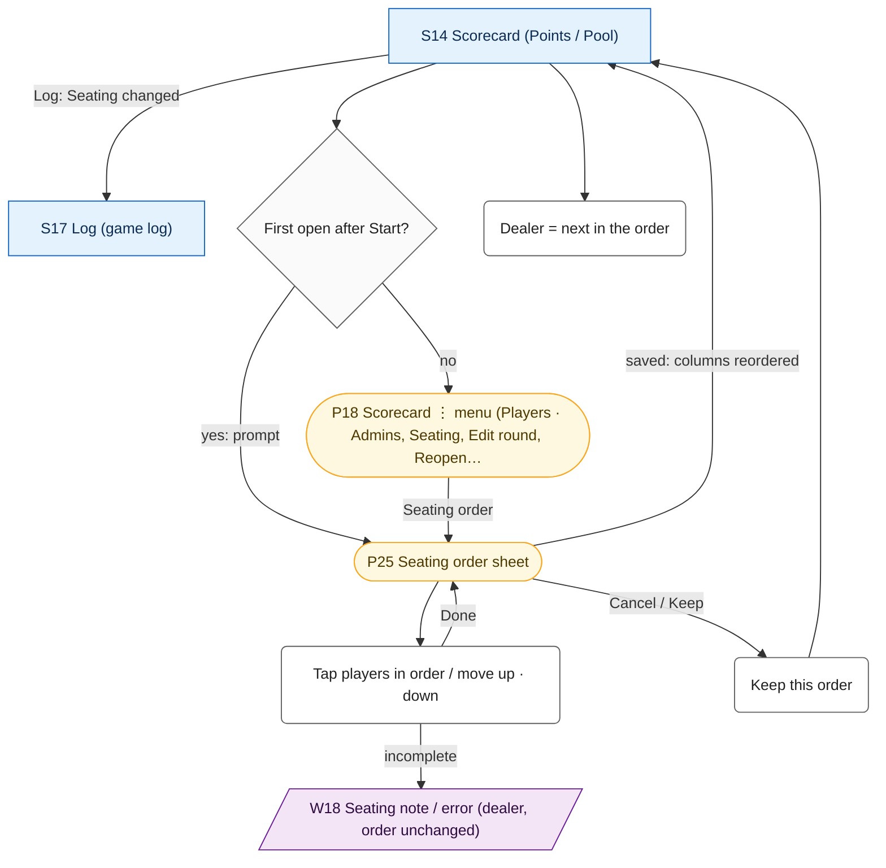

# F05 — Seating order

Requirements: R14 · Screens / pop-ups / warnings in this flow: 5 · untested (red): 0

## Scenarios

| # | Kind | Scenario | Tests |
| --- | --- | --- | --- |
| F05-1 | happy | Pop-up after Start: pick the order → columns follow it | [`smoke/19-seating-order.yaml`](../../../e2e/smoke/19-seating-order.yaml) · [`seating-pr21.test.ts`](../../../tests/seating-pr21.test.ts) · [`pgTAP/35_seating_order_044.sql`](../../../supabase/tests/35_seating_order_044.sql) |
| F05-2 | happy | Keep this order (default) → nothing changes | [`smoke/19-seating-order.yaml`](../../../e2e/smoke/19-seating-order.yaml) · [`seating-pr21.test.ts`](../../../tests/seating-pr21.test.ts) |
| F05-3 | happy | Rearrange mid-game from ⋮; dealer follows the new order | [`seating-pr21.test.ts`](../../../tests/seating-pr21.test.ts) · [`pgTAP/35_seating_order_044.sql`](../../../supabase/tests/35_seating_order_044.sql) · [`dealer-rotation-031.test.ts`](../../../tests/dealer-rotation-031.test.ts) |
| F05-4 | edge | 20 players: sheet scrolls, every chip reachable | [`full/51-seating-20p.yaml`](../../../e2e/full/51-seating-20p.yaml) |
| F05-5 | misuse | Non-admin cannot change the order (RPC refused) | [`pgTAP/35_seating_order_044.sql`](../../../supabase/tests/35_seating_order_044.sql) |
| F05-6 | happy | Log row "Seating changed" | [`pgTAP/35_seating_order_044.sql`](../../../supabase/tests/35_seating_order_044.sql) · [`seating-pr21.test.ts`](../../../tests/seating-pr21.test.ts) |

## Nodes

| ID | Name | File | Tests touching it |
| --- | --- | --- | --- |
| S14 | Scorecard (Points / Pool) | `app/(screens)/games/[id].tsx` | 87 |
| P25 | Seating order sheet | `components/game/SeatingSheet.tsx` | 4 |
| W18 | Seating note / error (dealer, order unchanged) | `components/game/SeatingSheet.tsx` | 3 |
| P18 | Scorecard ⋮ menu (Players · Admins, Seating, Edit round, Reopen, Log, Hide, Delete, Settings) | `app/(screens)/games/[id].tsx` | 15 |
| S17 | Log (game log) | `app/(screens)/games/log.tsx` | 24 |
