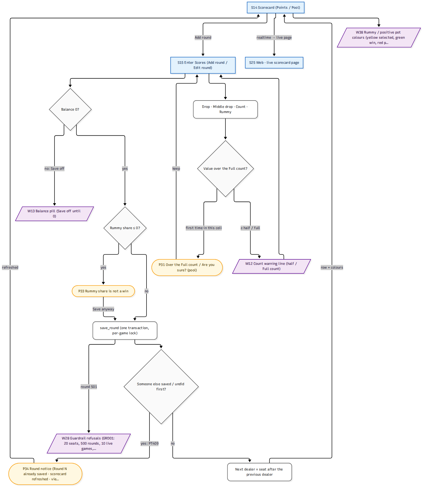
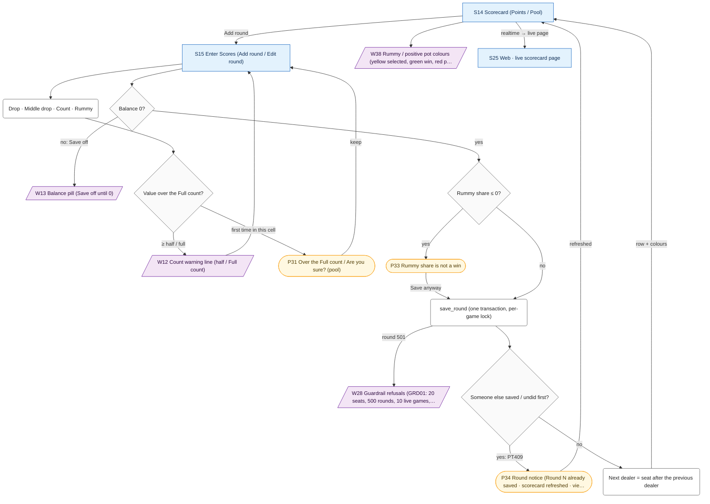

# F06 — Play rounds and the dealer

Requirements: R15, R16, R17 · Screens / pop-ups / warnings in this flow: 10 · untested (red): 0

## Scenarios

| # | Kind | Scenario | Tests |
| --- | --- | --- | --- |
| F06-1 | happy | Three drops + Rummy → Balance 0 → Save → row appears | [`smoke/04-add-round.yaml`](../../../e2e/smoke/04-add-round.yaml) · [`scoring.test.ts`](../../../tests/scoring.test.ts) · [`pgTAP/05_save_round_014.sql`](../../../supabase/tests/05_save_round_014.sql) |
| F06-2 | edge | Count ≥ half / ≥ Full → amber / red line; over the Full count asked once per cell | [`full/80-add-round-count-warnings.yaml`](../../../e2e/full/80-add-round-count-warnings.yaml) · [`add-round-pr3.test.ts`](../../../tests/add-round-pr3.test.ts) |
| F06-3 | edge | Rummy with a positive pot → share ≤ 0 → confirm → saved negative | [`smoke/14-rummy-positive-pot.yaml`](../../../e2e/smoke/14-rummy-positive-pot.yaml) · [`rummy-distribution.test.ts`](../../../tests/rummy-distribution.test.ts) · [`pgTAP/27_rummy_negative_037.sql`](../../../supabase/tests/27_rummy_negative_037.sql) |
| F06-4 | edge | Two admins save the same round: one wins, the other sees the named PT409 message | [`pgTAP/25_undo_035.sql`](../../../supabase/tests/25_undo_035.sql) · [`security-concurrency-019.test.ts`](../../../tests/security-concurrency-019.test.ts) · [`two-device/b-save-now.yaml`](../../../e2e/two-device/b-save-now.yaml) · [`two-device/c-verify-one-round.yaml`](../../../e2e/two-device/c-verify-one-round.yaml) |
| F06-5 | happy | Dealer rotates by seat / seating order; a mid-game joiner lengthens the rotation | [`dealer-rotation-031.test.ts`](../../../tests/dealer-rotation-031.test.ts) · [`pgTAP/21_round_robin_031.sql`](../../../supabase/tests/21_round_robin_031.sql) |
| F06-6 | edge | Rapid double Save taps → one round | [`chaos/c01-rapid-save-taps.yaml`](../../../e2e/chaos/c01-rapid-save-taps.yaml) · [`pgTAP/05_save_round_014.sql`](../../../supabase/tests/05_save_round_014.sql) |
| F06-7 | misuse | Round 501 refused (GRD01) | [`pgTAP/19_guardrails_029.sql`](../../../supabase/tests/19_guardrails_029.sql) · [`guardrails-029.test.ts`](../../../tests/guardrails-029.test.ts) |
| F06-8 | edge | Huge numbers / bad input in a cell | [`chaos/c04-huge-numbers.yaml`](../../../e2e/chaos/c04-huge-numbers.yaml) · [`chaos/c03-bad-input.yaml`](../../../e2e/chaos/c03-bad-input.yaml) |
| F06-9 | happy | Realtime: the other phone sees the round within a few seconds | [`two-device/t1-realtime-add.yaml`](../../../e2e/two-device/t1-realtime-add.yaml) · [`two-device/t1-a-expect.yaml`](../../../e2e/two-device/t1-a-expect.yaml) |
| F06-10 | happy | 20 players × 60 rounds scorecard stays usable | [`chaos/c09-big-scorecard-20x60.yaml`](../../../e2e/chaos/c09-big-scorecard-20x60.yaml) · [`full/20-scorecard-20-players-swipe.yaml`](../../../e2e/full/20-scorecard-20-players-swipe.yaml) |

## Nodes

| ID | Name | File | Tests touching it |
| --- | --- | --- | --- |
| S14 | Scorecard (Points / Pool) | `app/(screens)/games/[id].tsx` | 87 |
| S15 | Enter Scores (Add round / Edit round) | `app/(screens)/score-entry.tsx` | 58 |
| W12 | Count warning line (half / Full count) | `app/(screens)/score-entry.tsx` | 2 |
| W13 | Balance pill (Save off until 0) | `app/(screens)/score-entry.tsx` | 8 |
| P31 | Over the Full count / Are you sure? (pool) | `app/(screens)/score-entry.tsx` | 4 |
| P33 | Rummy share is not a win | `app/(screens)/score-entry.tsx` | 1 |
| P34 | Round notice (Round N already saved · scorecard refreshed · view only) | `app/(screens)/score-entry.tsx` | 8 |
| W38 | Rummy / positive pot colours (yellow selected, green win, red penalty) | `components/game/ScoreKeypad.tsx, utils/scoreTone.ts` | 7 |
| W28 | Guardrail refusals (GRD01: 20 seats, 500 rounds, 10 live games, 50 games/day, 100 players/day, 20 pending links) | `utils/guardrails.ts` | 5 |
| S25 | Web · live scorecard page | `public/scorecard.html` | 21 |
