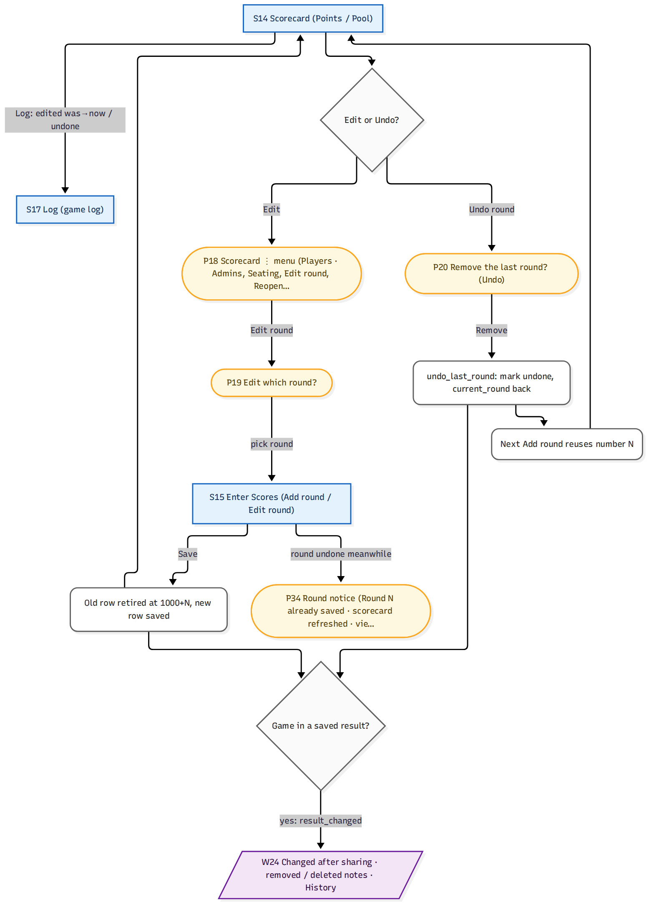
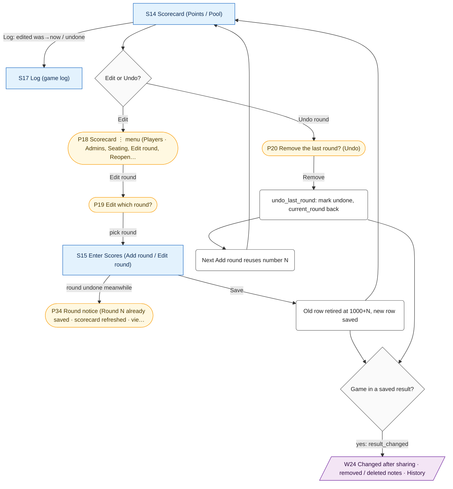

# F07 — Edit or undo a round

Requirements: R18, R19 · Screens / pop-ups / warnings in this flow: 8 · untested (red): 0

## Scenarios

| # | Kind | Scenario | Tests |
| --- | --- | --- | --- |
| F07-1 | happy | Undo last round → Add round saves the same number again | [`smoke/13-undo-then-add-round.yaml`](../../../e2e/smoke/13-undo-then-add-round.yaml) · [`undo-round-035.test.ts`](../../../tests/undo-round-035.test.ts) · [`pgTAP/25_undo_035.sql`](../../../supabase/tests/25_undo_035.sql) |
| F07-2 | happy | Edit round N → old row retired, Log shows Was / Now | [`full/70-game-log.yaml`](../../../e2e/full/70-game-log.yaml) · [`nov11-rounds.test.ts`](../../../tests/nov11-rounds.test.ts) · [`pgTAP/26_event_log_036.sql`](../../../supabase/tests/26_event_log_036.sql) |
| F07-3 | edge | Undo three times then round 1 again | [`pgTAP/25_undo_035.sql`](../../../supabase/tests/25_undo_035.sql) |
| F07-4 | edge | Undo while another admin types → their Save refused with the refresh message | [`pgTAP/25_undo_035.sql`](../../../supabase/tests/25_undo_035.sql) · [`security-concurrency-019.test.ts`](../../../tests/security-concurrency-019.test.ts) |
| F07-5 | misuse | Player (non-admin) cannot undo (42501) | [`pgTAP/25_undo_035.sql`](../../../supabase/tests/25_undo_035.sql) · [`roles/r01-player-view-only.yaml`](../../../e2e/roles/r01-player-view-only.yaml) |
| F07-6 | edge | Edit / undo a game inside a saved result → result_changed row + amber line | [`pgTAP/26_event_log_036.sql`](../../../supabase/tests/26_event_log_036.sql) · [`event-log-036.test.ts`](../../../tests/event-log-036.test.ts) |
| F07-7 | edge | Edit which round? dialog on the device (pick an older round) | **GAP** |

## Nodes

| ID | Name | File | Tests touching it |
| --- | --- | --- | --- |
| S14 | Scorecard (Points / Pool) | `app/(screens)/games/[id].tsx` | 91 |
| P18 | Scorecard ⋮ menu (Players · Admins, Seating, Edit round, Reopen, Log, Hide, Delete, Settings) | `app/(screens)/games/[id].tsx` | 15 |
| P19 | Edit which round? | `app/(screens)/games/[id].tsx` | 6 |
| P20 | Remove the last round? (Undo) | `app/(screens)/games/[id].tsx` | 12 |
| S15 | Enter Scores (Add round / Edit round) | `app/(screens)/score-entry.tsx` | 64 |
| P34 | Round notice (Round N already saved · scorecard refreshed · view only) | `app/(screens)/score-entry.tsx` | 8 |
| S17 | Log (game log) | `app/(screens)/games/log.tsx` | 24 |
| W24 | Changed after sharing · removed / deleted notes · History | `components/results/ResultHistory.tsx` | 2 |
