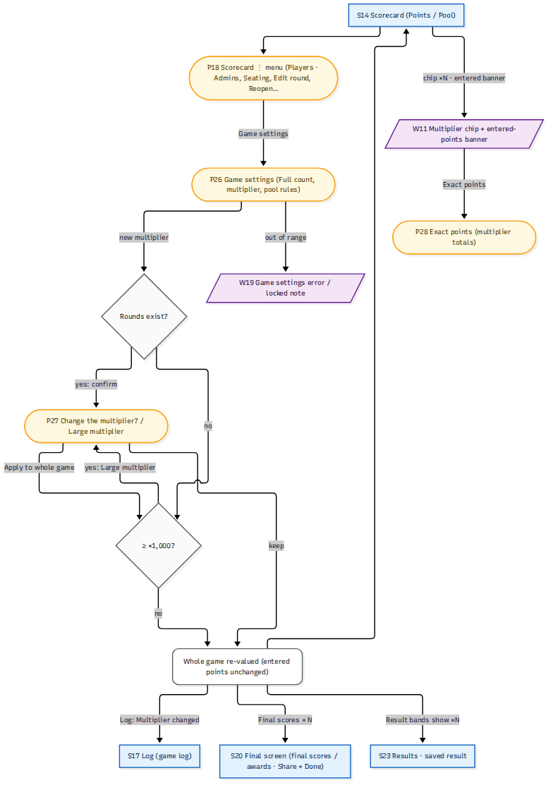
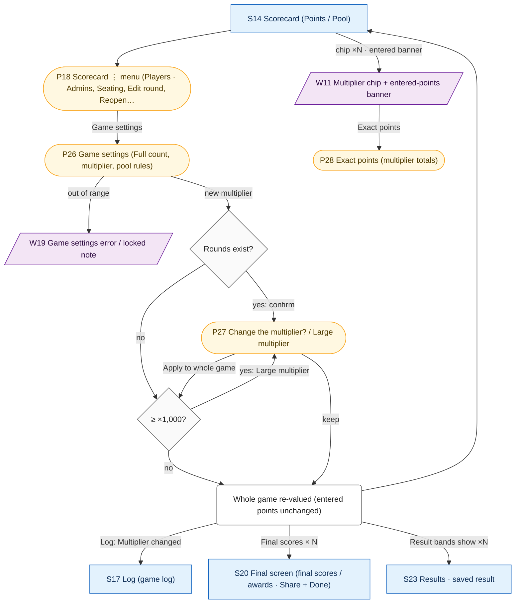

# F08 — Change the multiplier

Requirements: R20, R21 · Screens / pop-ups / warnings in this flow: 10 · untested (red): 0

## Scenarios

| # | Kind | Scenario | Tests |
| --- | --- | --- | --- |
| F08-1 | happy | Change ×1 → ×10 with rounds → confirm → whole game re-valued | [`smoke/18-multiplier-change.yaml`](../../../e2e/smoke/18-multiplier-change.yaml) · [`multiplier-pr14.test.ts`](../../../tests/multiplier-pr14.test.ts) · [`pgTAP/34_multiplier_043.sql`](../../../supabase/tests/34_multiplier_043.sql) |
| F08-2 | happy | Chip, entered-points banner and Exact points sheet | [`smoke/18-multiplier-change.yaml`](../../../e2e/smoke/18-multiplier-change.yaml) · [`multiplier-pr14.test.ts`](../../../tests/multiplier-pr14.test.ts) |
| F08-3 | edge | ×1,000 / ×10,000 display (K / M, ≤ 5 characters) on 20 players | [`full/50-multiplier-20p.yaml`](../../../e2e/full/50-multiplier-20p.yaml) · [`multiplier-pr14.test.ts`](../../../tests/multiplier-pr14.test.ts) |
| F08-4 | misuse | Non-admin cannot change; value outside 1–10,000 refused | [`pgTAP/34_multiplier_043.sql`](../../../supabase/tests/34_multiplier_043.sql) · [`multiplier-pr14.test.ts`](../../../tests/multiplier-pr14.test.ts) |
| F08-5 | happy | Final scores, share image, PDF and /r/ show the multiplied values | [`multiplier-pr14.test.ts`](../../../tests/multiplier-pr14.test.ts) · [`final-scores.test.ts`](../../../tests/final-scores.test.ts) |
| F08-6 | happy | Log row "Multiplier changed ×1 → ×10" | [`pgTAP/34_multiplier_043.sql`](../../../supabase/tests/34_multiplier_043.sql) · [`multiplier-pr14.test.ts`](../../../tests/multiplier-pr14.test.ts) |

## Nodes

| ID | Name | File | Tests touching it |
| --- | --- | --- | --- |
| S14 | Scorecard (Points / Pool) | `app/(screens)/games/[id].tsx` | 91 |
| P18 | Scorecard ⋮ menu (Players · Admins, Seating, Edit round, Reopen, Log, Hide, Delete, Settings) | `app/(screens)/games/[id].tsx` | 15 |
| P26 | Game settings (Full count, multiplier, pool rules) | `components/game/GameSettingsDialog.tsx` | 9 |
| P27 | Change the multiplier? / Large multiplier | `components/game/GameSettingsDialog.tsx` | 3 |
| W11 | Multiplier chip + entered-points banner | `components/game/MultiplierStrip.tsx` | 2 |
| P28 | Exact points (multiplier totals) | `components/game/MultiplierStrip.tsx` | 4 |
| S17 | Log (game log) | `app/(screens)/games/log.tsx` | 24 |
| W19 | Game settings error / locked note | `components/game/GameSettingsDialog.tsx` | 3 |
| S20 | Final screen (final scores / awards · Share + Done) | `app/(screens)/games/final-scores.tsx` | 11 |
| S23 | Results · saved result | `app/(screens)/results/[id].tsx` | 35 |
