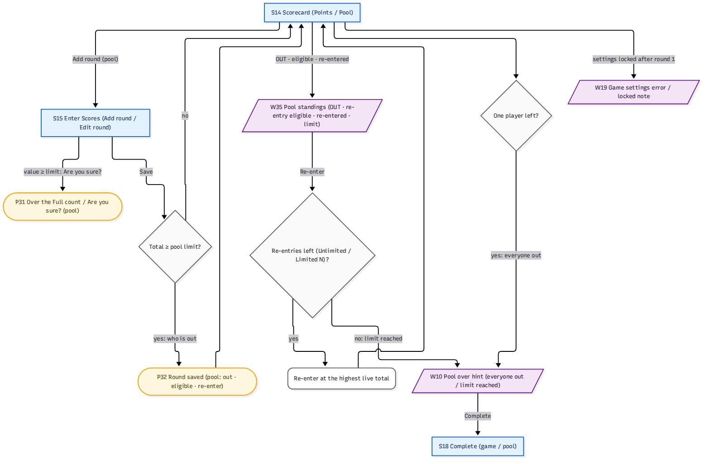
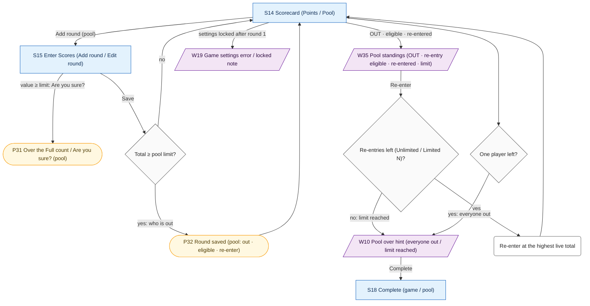

# F09 — Pool: out, re-entry, limit

Requirements: R22, R23, R24 · Screens / pop-ups / warnings in this flow: 8 · untested (red): 0

## Scenarios

| # | Kind | Scenario | Tests |
| --- | --- | --- | --- |
| F09-1 | happy | Pool round: player crosses the limit → Round saved sheet says who is out → OUT chip | [`smoke/16-pool-game.yaml`](../../../e2e/smoke/16-pool-game.yaml) · [`pool-pr13.test.ts`](../../../tests/pool-pr13.test.ts) · [`pgTAP/32_pool_041.sql`](../../../supabase/tests/32_pool_041.sql) |
| F09-2 | happy | Re-enter (Unlimited) at the highest live total | [`smoke/16-pool-game.yaml`](../../../e2e/smoke/16-pool-game.yaml) · [`pgTAP/33_pool_reentries_042.sql`](../../../supabase/tests/33_pool_reentries_042.sql) · [`pool-pr13.test.ts`](../../../tests/pool-pr13.test.ts) |
| F09-3 | edge | Limited re-entries: N used → Re-enter gone, message (F3 fix) | [`pgTAP/33_pool_reentries_042.sql`](../../../supabase/tests/33_pool_reentries_042.sql) · [`test-findings-pr19.test.ts`](../../../tests/test-findings-pr19.test.ts) |
| F09-4 | edge | Everyone out / one left → Complete offered; Give awards | [`chaos/c10-pool-everyone-out.yaml`](../../../e2e/chaos/c10-pool-everyone-out.yaml) · [`pgTAP/32_pool_041.sql`](../../../supabase/tests/32_pool_041.sql) |
| F09-5 | misuse | Pool settings locked after round 1 (PT423); spectator cannot re-enter anyone | [`pgTAP/33_pool_reentries_042.sql`](../../../supabase/tests/33_pool_reentries_042.sql) · [`roles/r02-spectator-pool.yaml`](../../../e2e/roles/r02-spectator-pool.yaml) |
| F09-6 | edge | 20 players wide initials in the pool strip | [`smoke/17-pool-wide-initials-20p.yaml`](../../../e2e/smoke/17-pool-wide-initials-20p.yaml) · [`initials-fit.test.ts`](../../../tests/initials-fit.test.ts) |
| F09-7 | edge | Re-entry a second time after going out again (Unlimited) on the device | **GAP** |

## Nodes

| ID | Name | File | Tests touching it |
| --- | --- | --- | --- |
| S14 | Scorecard (Points / Pool) | `app/(screens)/games/[id].tsx` | 87 |
| S15 | Enter Scores (Add round / Edit round) | `app/(screens)/score-entry.tsx` | 58 |
| P32 | Round saved (pool: out · eligible · re-enter) | `app/(screens)/score-entry.tsx` | 2 |
| W35 | Pool standings (OUT · re-entry eligible · re-entered · limit) | `components/game/PoolStandings.tsx` | 4 |
| W10 | Pool over hint (everyone out / limit reached) | `app/(screens)/games/[id].tsx` | 1 |
| P31 | Over the Full count / Are you sure? (pool) | `app/(screens)/score-entry.tsx` | 4 |
| W19 | Game settings error / locked note | `components/game/GameSettingsDialog.tsx` | 3 |
| S18 | Complete (game / pool) | `app/(screens)/games/complete.tsx` | 24 |
