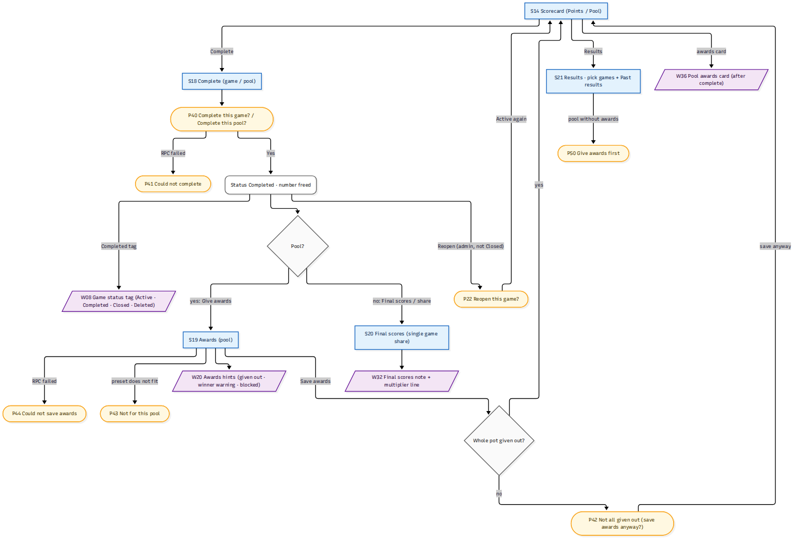
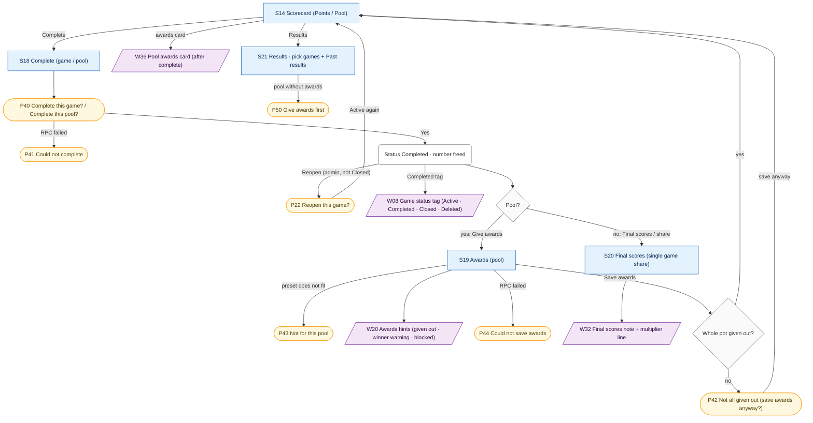

# F10 — Complete → Awards → Result

Requirements: R25, R26, R27 · Screens / pop-ups / warnings in this flow: 16 · untested (red): 0

## Scenarios

| # | Kind | Scenario | Tests |
| --- | --- | --- | --- |
| F10-1 | happy | Complete a Points game → Completed tag → Final scores | [`smoke/05-complete-game.yaml`](../../../e2e/smoke/05-complete-game.yaml) · [`final-scores.test.ts`](../../../tests/final-scores.test.ts) · [`pgTAP/02_games_visibility.sql`](../../../supabase/tests/02_games_visibility.sql) |
| F10-2 | happy | Complete a pool → Give awards → preset / custom → saved → card on scorecard | [`smoke/16-pool-game.yaml`](../../../e2e/smoke/16-pool-game.yaml) · [`pool-pr13.test.ts`](../../../tests/pool-pr13.test.ts) · [`pgTAP/32_pool_041.sql`](../../../supabase/tests/32_pool_041.sql) |
| F10-3 | edge | Not all given out → save anyway; preset not viable → Not for this pool | [`smoke/16-pool-game.yaml`](../../../e2e/smoke/16-pool-game.yaml) · [`pool-pr13.test.ts`](../../../tests/pool-pr13.test.ts) |
| F10-4 | edge | Double Complete taps → one completion | [`chaos/c02-double-complete.yaml`](../../../e2e/chaos/c02-double-complete.yaml) |
| F10-5 | happy | Pool without awards cannot join a result (Give awards first) | [`smoke/16-pool-game.yaml`](../../../e2e/smoke/16-pool-game.yaml) · [`pool-pr13.test.ts`](../../../tests/pool-pr13.test.ts) · [`pgTAP/32_pool_041.sql`](../../../supabase/tests/32_pool_041.sql) |
| F10-6 | happy | Reopen a Completed (not Closed) game as admin | [`archive.test.ts`](../../../tests/archive.test.ts) · [`pgTAP/13_hide_delete_023.sql`](../../../supabase/tests/13_hide_delete_023.sql) |
| F10-7 | misuse | Non-admin cannot complete or reopen | [`roles/r01-player-view-only.yaml`](../../../e2e/roles/r01-player-view-only.yaml) · [`pgTAP/02_games_visibility.sql`](../../../supabase/tests/02_games_visibility.sql) |
| F10-8 | edge | Complete with 20 players: Standings fit (F6) | [`test-findings-pr19.test.ts`](../../../tests/test-findings-pr19.test.ts) · [`smoke/17-pool-wide-initials-20p.yaml`](../../../e2e/smoke/17-pool-wide-initials-20p.yaml) |
| F10-9 | edge | Reopen dialog on the device | **GAP** |

## Nodes

| ID | Name | File | Tests touching it |
| --- | --- | --- | --- |
| S14 | Scorecard (Points / Pool) | `app/(screens)/games/[id].tsx` | 87 |
| S18 | Complete (game / pool) | `app/(screens)/games/complete.tsx` | 24 |
| P40 | Complete this game? / Complete this pool? | `app/(screens)/games/complete.tsx` | 3 |
| P41 | Could not complete | `app/(screens)/games/complete.tsx` | 1 |
| S19 | Awards (pool) | `app/(screens)/games/award.tsx` | 20 |
| P42 | Not all given out (save awards anyway?) | `app/(screens)/games/award.tsx` | 2 |
| P43 | Not for this pool | `app/(screens)/games/award.tsx` | 2 |
| W20 | Awards hints (given out · winner warning · blocked) | `app/(screens)/games/award.tsx` | 1 |
| W36 | Pool awards card (after complete) | `components/game/PoolAwardsCard.tsx` | 4 |
| S20 | Final scores (single game share) | `app/(screens)/games/final-scores.tsx` | 9 |
| S21 | Results · pick games + Past results | `app/(screens)/results/index.tsx` | 38 |
| P50 | Give awards first | `app/(screens)/results/index.tsx` | 3 |
| P22 | Reopen this game? | `app/(screens)/games/[id].tsx` | 1 |
| P44 | Could not save awards | `app/(screens)/games/award.tsx` | 3 |
| W08 | Game status tag (Active · Completed · Closed · Deleted) | `app/(screens)/games/[id].tsx` | 1 |
| W32 | Final scores note + multiplier line | `app/(screens)/games/final-scores.tsx` | 2 |
