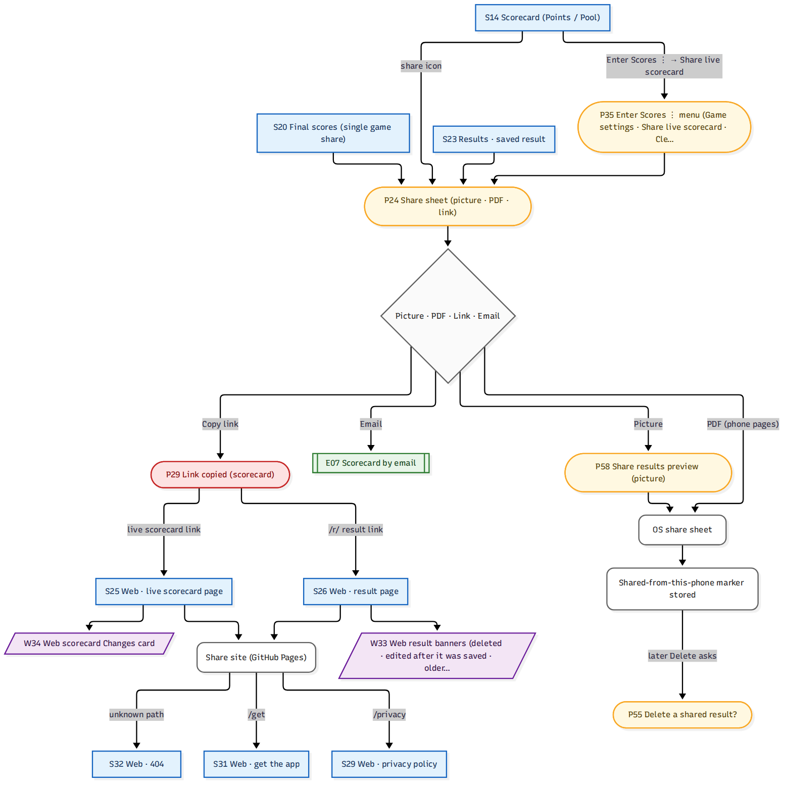
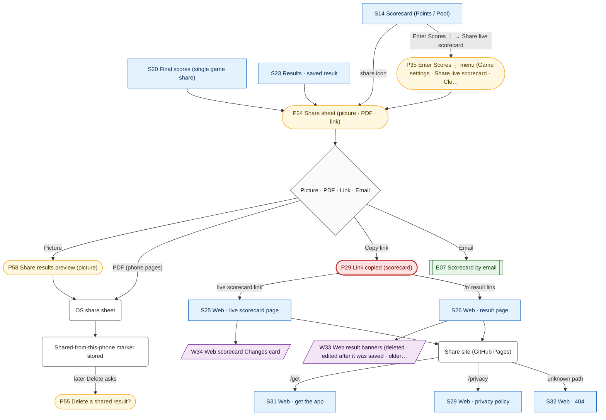

# F11 — Share: picture, PDF, link, live page, email

Requirements: R28, R29, R30 · Screens / pop-ups / warnings in this flow: 16 · untested (red): 1 — P29

## Scenarios

| # | Kind | Scenario | Tests |
| --- | --- | --- | --- |
| F11-1 | happy | Share result picture → preview → OS sheet; generated-by initials | [`full/41-share-images.yaml`](../../../e2e/full/41-share-images.yaml) · [`results-design.test.ts`](../../../tests/results-design.test.ts) · [`results-share-unsaved.test.ts`](../../../tests/results-share-unsaved.test.ts) |
| F11-2 | happy | Share PDF (phone-sized pages) for a result; Rounds PDF for one game | [`results-design.test.ts`](../../../tests/results-design.test.ts) · [`final-scores.test.ts`](../../../tests/final-scores.test.ts) |
| F11-3 | happy | Copy link → toast; /r/ page shows the same result read-only | [`results-design.test.ts`](../../../tests/results-design.test.ts) · [`pgTAP/24_results_design_034.sql`](../../../supabase/tests/24_results_design_034.sql) · [`pgTAP/08_public_scorecard.sql`](../../../supabase/tests/08_public_scorecard.sql) |
| F11-4 | happy | Live scorecard page (signed out) follows rounds; Changes card | [`pgTAP/08_public_scorecard.sql`](../../../supabase/tests/08_public_scorecard.sql) · [`pgTAP/26_event_log_036.sql`](../../../supabase/tests/26_event_log_036.sql) · [`volume-client.test.ts`](../../../tests/volume-client.test.ts) |
| F11-5 | edge | Deleted / edited result → /r/ banner and version links | [`pgTAP/24_results_design_034.sql`](../../../supabase/tests/24_results_design_034.sql) · [`pgTAP/30_results_delete.sql`](../../../supabase/tests/30_results_delete.sql) |
| F11-6 | misuse | Anon can call only the allow-listed RPCs | [`pgTAP/23_security_033.sql`](../../../supabase/tests/23_security_033.sql) · [`security-033.test.ts`](../../../tests/security-033.test.ts) |
| F11-7 | edge | Share before Save carries the "Not saved yet" banner on picture and PDF | [`results-share-unsaved.test.ts`](../../../tests/results-share-unsaved.test.ts) · [`smoke/06-results.yaml`](../../../e2e/smoke/06-results.yaml) |
| F11-8 | happy | Final scores share (yellow sheet, Game N Final Scores) | [`smoke/05-complete-game.yaml`](../../../e2e/smoke/05-complete-game.yaml) · [`final-scores.test.ts`](../../../tests/final-scores.test.ts) |
| F11-9 | edge | Email a scorecard (send-email kind scorecard) end to end | **GAP** |
| F11-10 | edge | Web pages in a real browser (Playwright) — /r/, scorecard.html, link.html, unsubscribe.html | **GAP** |

## Nodes

| ID | Name | File | Tests touching it |
| --- | --- | --- | --- |
| S14 | Scorecard (Points / Pool) | `app/(screens)/games/[id].tsx` | 87 |
| S20 | Final scores (single game share) | `app/(screens)/games/final-scores.tsx` | 9 |
| S23 | Results · saved result | `app/(screens)/results/[id].tsx` | 34 |
| P24 | Share sheet (picture · PDF · link) | `components/share/ShareSheet.tsx` | 3 |
| P58 | Share results preview (picture) | `components/share/ShareImageDialog.tsx` | 2 |
| P29 | Link copied (scorecard) | `app/(screens)/games/[id].tsx` | **GAP** |
| P35 | Enter Scores ⋮ menu (Game settings · Share live scorecard · Clear / Undo my changes · Help) | `app/(screens)/score-entry.tsx` | 2 |
| S25 | Web · live scorecard page | `public/scorecard.html` | 21 |
| S26 | Web · result page | `public/r/index.html` | 14 |
| W33 | Web result banners (deleted · edited after it was saved · older versions) | `public/r/index.html` | 13 |
| W34 | Web scorecard Changes card | `public/scorecard.html` | 13 |
| E07 | Scorecard by email | `supabase/functions/send-email/index.ts (kind scorecard)` | 6 |
| P55 | Delete a shared result? | `app/(screens)/results/[id].tsx` | 2 |
| S29 | Web · privacy policy | `public/privacy/index.html` | 1 |
| S31 | Web · get the app | `public/get/index.html` | 1 |
| S32 | Web · 404 | `public/404.html` | 1 |
