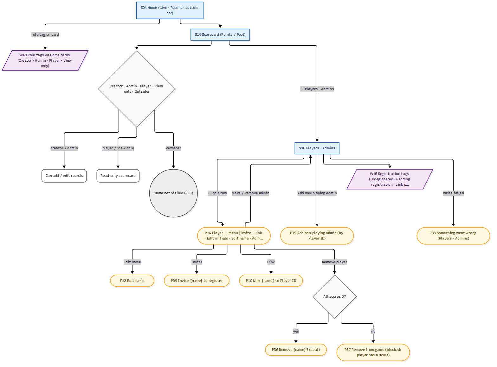
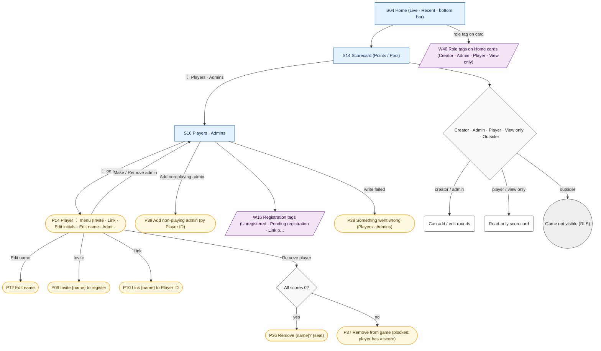

# F12 — Admins and roles

Requirements: R31, R32, R33 · Screens / pop-ups / warnings in this flow: 13 · untested (red): 0

## Scenarios

| # | Kind | Scenario | Tests |
| --- | --- | --- | --- |
| F12-1 | happy | Make a seated player admin → they can score | [`full/30-players-admins-and-settings.yaml`](../../../e2e/full/30-players-admins-and-settings.yaml) · [`game-admins.test.ts`](../../../tests/game-admins.test.ts) · [`pgTAP/02_games_visibility.sql`](../../../supabase/tests/02_games_visibility.sql) |
| F12-2 | happy | Add non-playing admin by Player ID → listed under Admins not playing, no column | [`full/32-add-players-to-game.yaml`](../../../e2e/full/32-add-players-to-game.yaml) · [`game-admins.test.ts`](../../../tests/game-admins.test.ts) |
| F12-3 | happy | Player (non-admin) sees the scorecard read-only: no Add round / Undo / Complete | [`roles/r01-player-view-only.yaml`](../../../e2e/roles/r01-player-view-only.yaml) · [`pgTAP/02_games_visibility.sql`](../../../supabase/tests/02_games_visibility.sql) |
| F12-4 | happy | Spectator on a pool: standings visible, no Re-enter | [`roles/r02-spectator-pool.yaml`](../../../e2e/roles/r02-spectator-pool.yaml) |
| F12-5 | misuse | Outsider sees none of the games (RLS, bundles) | [`roles/r03-outsider-no-break-games.yaml`](../../../e2e/roles/r03-outsider-no-break-games.yaml) · [`pgTAP/10_bundles_020.sql`](../../../supabase/tests/10_bundles_020.sql) · [`pgTAP/02_games_visibility.sql`](../../../supabase/tests/02_games_visibility.sql) |
| F12-6 | happy | Non-playing admin can add rounds and complete | [`roles/r04-nonplaying-admin.yaml`](../../../e2e/roles/r04-nonplaying-admin.yaml) |
| F12-7 | edge | Remove a seat: allowed only when every round score is 0 | [`seat-removal.test.ts`](../../../tests/seat-removal.test.ts) · [`pgTAP/06_seat_removal_016.sql`](../../../supabase/tests/06_seat_removal_016.sql) |
| F12-8 | misuse | Self-promotion to app admin refused; contact columns owner-only | [`pgTAP/04_profiles_privacy.sql`](../../../supabase/tests/04_profiles_privacy.sql) · [`security-concurrency-019.test.ts`](../../../tests/security-concurrency-019.test.ts) |
| F12-9 | edge | Remove player blocked dialog and Edit name on the device | **GAP** |

## Nodes

| ID | Name | File | Tests touching it |
| --- | --- | --- | --- |
| S14 | Scorecard (Points / Pool) | `app/(screens)/games/[id].tsx` | 91 |
| S16 | Players · Admins | `app/(screens)/games/players.tsx` | 51 |
| P14 | Player ⋮ menu (Invite · Link · Edit initials · Edit name · Admin · Remove) | `components/players/PlayerActionMenu.tsx` | 5 |
| P39 | Add non-playing admin (by Player ID) | `app/(screens)/games/players.tsx` | 4 |
| P36 | Remove {name}? (seat) | `app/(screens)/games/players.tsx` | 7 |
| P37 | Remove from game (blocked: player has a score) | `app/(screens)/games/players.tsx` | 4 |
| P12 | Edit name | `components/players/EditNameDialog.tsx` | 4 |
| P09 | Invite {name} to register | `components/players/InviteToRegisterDialog.tsx` | 2 |
| P10 | Link {name} to Player ID | `components/players/LinkPlayerDialog.tsx` | 4 |
| W16 | Registration tags (Unregistered · Pending registration · Link pending) | `utils/myPlayersList.ts` | 15 |
| W40 | Role tags on Home cards (Creator · Admin · Player · View only) | `components/ui/GameListItem.tsx` | 9 |
| S04 | Home (Live · Recent · bottom bar) | `app/(tabs)/index.tsx` | 73 |
| P38 | Something went wrong (Players · Admins) | `app/(screens)/games/players.tsx` | 9 |
