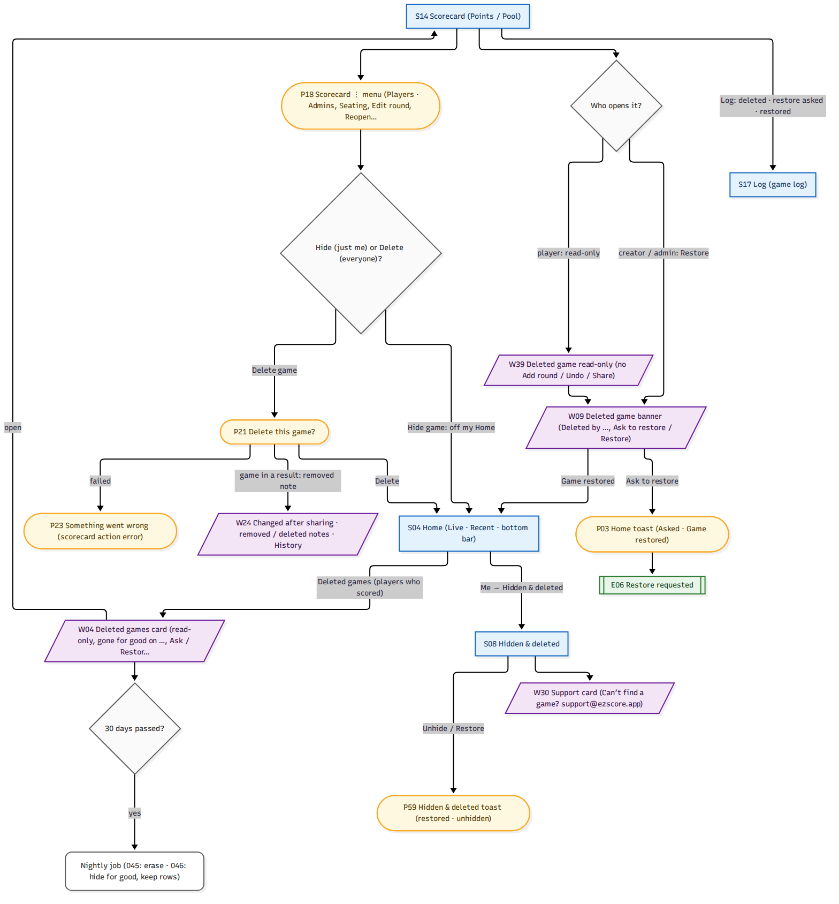
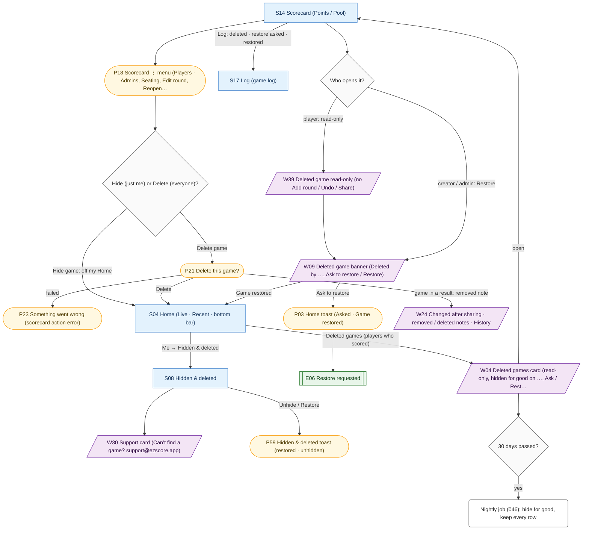

# F13 — Delete, hide, restore, Deleted games

Requirements: R34, R35, R36, R37 · Screens / pop-ups / warnings in this flow: 15 · untested (red): 0

## Scenarios

| # | Kind | Scenario | Tests |
| --- | --- | --- | --- |
| F13-1 | happy | Hide game → off my Home only; others unchanged; Unhide from Hidden & deleted | [`archive.test.ts`](../../../tests/archive.test.ts) · [`pgTAP/13_hide_delete_023.sql`](../../../supabase/tests/13_hide_delete_023.sql) |
| F13-2 | happy | Delete game (admin) → dialog body "Nothing is lost for 30 days" → gone from Home for everyone | [`roles/r05-deleted-game-ask-restore.yaml`](../../../e2e/roles/r05-deleted-game-ask-restore.yaml) · [`going-rogue.test.ts`](../../../tests/going-rogue.test.ts) · [`pgTAP/36_going_rogue_045.sql`](../../../supabase/tests/36_going_rogue_045.sql) |
| F13-3 | happy | Player who scored sees it under Deleted games, opens read-only, Ask to restore → toast + email | [`roles/r05-deleted-game-ask-restore.yaml`](../../../e2e/roles/r05-deleted-game-ask-restore.yaml) · [`going-rogue.test.ts`](../../../tests/going-rogue.test.ts) · [`pgTAP/36_going_rogue_045.sql`](../../../supabase/tests/36_going_rogue_045.sql) |
| F13-4 | happy | Creator sees "Player One asked to restore it" → Restore → Game restored, back on Home | [`roles/r05-deleted-game-ask-restore.yaml`](../../../e2e/roles/r05-deleted-game-ask-restore.yaml) · [`pgTAP/36_going_rogue_045.sql`](../../../supabase/tests/36_going_rogue_045.sql) |
| F13-5 | edge | Deleted game in a saved result → result re-totals, "S5 removed" version | [`pgTAP/24_results_design_034.sql`](../../../supabase/tests/24_results_design_034.sql) · [`pgTAP/13_hide_delete_023.sql`](../../../supabase/tests/13_hide_delete_023.sql) |
| F13-6 | misuse | Outsider / non-scorer cannot read a deleted game | [`pgTAP/36_going_rogue_045.sql`](../../../supabase/tests/36_going_rogue_045.sql) · [`pgTAP/13_hide_delete_023.sql`](../../../supabase/tests/13_hide_delete_023.sql) |
| F13-7 | edge | 30-day step (046): hidden for good, nothing deleted; support can still find it; restore refused with PT410 | [`pgTAP/37_no_permanent_delete_046.sql`](../../../supabase/tests/37_no_permanent_delete_046.sql) · [`pgTAP/36_going_rogue_045.sql`](../../../supabase/tests/36_going_rogue_045.sql) · [`no-permanent-delete-pr22.test.ts`](../../../tests/no-permanent-delete-pr22.test.ts) |
| F13-8 | happy | Log rows: Game deleted · Restore asked · Game restored | [`pgTAP/36_going_rogue_045.sql`](../../../supabase/tests/36_going_rogue_045.sql) · [`going-rogue.test.ts`](../../../tests/going-rogue.test.ts) |
| F13-9 | happy | Support card with support@ezscore.app on Hidden & deleted | [`going-rogue.test.ts`](../../../tests/going-rogue.test.ts) |
| F13-10 | edge | Hidden & deleted screen on the device (Unhide, Restore, toast) | **GAP** |

## Nodes

| ID | Name | File | Tests touching it |
| --- | --- | --- | --- |
| S14 | Scorecard (Points / Pool) | `app/(screens)/games/[id].tsx` | 91 |
| P18 | Scorecard ⋮ menu (Players · Admins, Seating, Edit round, Reopen, Log, Hide, Delete, Settings) | `app/(screens)/games/[id].tsx` | 15 |
| P21 | Delete this game? | `app/(screens)/games/[id].tsx` | 4 |
| P23 | Something went wrong (scorecard action error) | `app/(screens)/games/[id].tsx` | 7 |
| S04 | Home (Live · Recent · bottom bar) | `app/(tabs)/index.tsx` | 73 |
| W04 | Deleted games card (read-only, hidden for good on …, Ask / Restore) | `components/home/DeletedGamesCard.tsx` | 6 |
| W09 | Deleted game banner (Deleted by …, Ask to restore / Restore) | `components/game/DeletedGameBanner.tsx` | 3 |
| W39 | Deleted game read-only (no Add round / Undo / Share) | `app/(screens)/games/[id].tsx` | 3 |
| P03 | Home toast (Asked · Game restored) | `app/(tabs)/index.tsx` | 2 |
| E06 | Restore requested | `supabase/functions/send-email/index.ts (restore_requested)` | 3 |
| S08 | Hidden & deleted | `app/(screens)/hidden-deleted.tsx` | 24 |
| W30 | Support card (Can’t find a game? support@ezscore.app) | `app/(screens)/hidden-deleted.tsx` | 3 |
| P59 | Hidden & deleted toast (restored · unhidden) | `app/(screens)/hidden-deleted.tsx` | 6 |
| S17 | Log (game log) | `app/(screens)/games/log.tsx` | 24 |
| W24 | Changed after sharing · removed / deleted notes · History | `components/results/ResultHistory.tsx` | 2 |
