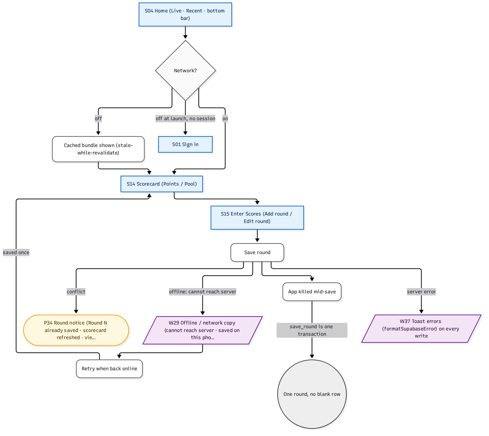
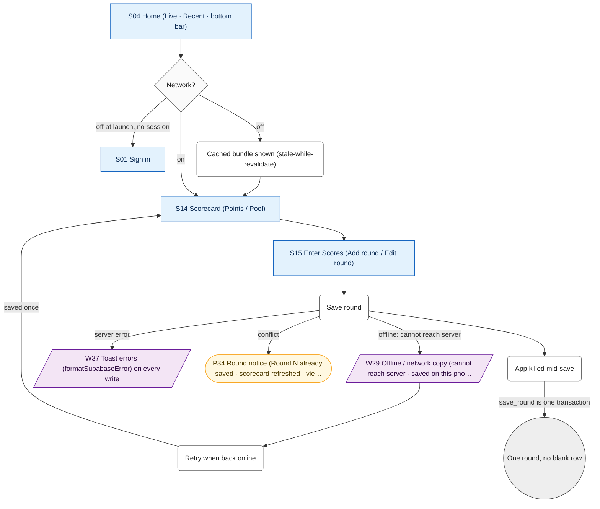

# F14 — Offline and sync

Requirements: R38, R39 · Screens / pop-ups / warnings in this flow: 7 · untested (red): 0

## Scenarios

| # | Kind | Scenario | Tests |
| --- | --- | --- | --- |
| F14-1 | edge | Save with the network off → clear message, nothing half-written | [`chaos/c05-offline-save--net-off.yaml`](../../../e2e/chaos/c05-offline-save--net-off.yaml) · [`degrade.test.ts`](../../../tests/degrade.test.ts) |
| F14-2 | edge | Reconnect → retry saves exactly one round | [`chaos/c06-reconnect-retry.yaml`](../../../e2e/chaos/c06-reconnect-retry.yaml) · [`pgTAP/05_save_round_014.sql`](../../../supabase/tests/05_save_round_014.sql) |
| F14-3 | edge | Kill the app mid-save → after relaunch the scorecard is consistent | [`chaos/c07-kill-mid-save--kill-after.yaml`](../../../e2e/chaos/c07-kill-mid-save--kill-after.yaml) · [`chaos/c08-after-kill-consistent.yaml`](../../../e2e/chaos/c08-after-kill-consistent.yaml) |
| F14-4 | edge | Launch offline with a session → cached Home, no sign-out | [`chaos/c11-launch-offline--net-off.yaml`](../../../e2e/chaos/c11-launch-offline--net-off.yaml) · [`test-findings-pr19.test.ts`](../../../tests/test-findings-pr19.test.ts) |
| F14-5 | happy | Stale-while-revalidate cache seeds scorecard / players / round entry | [`nov10-speed.test.ts`](../../../tests/nov10-speed.test.ts) · [`performance-020.test.ts`](../../../tests/performance-020.test.ts) |
| F14-6 | happy | Older server (RPC missing) → graceful fallback paths | [`degrade.test.ts`](../../../tests/degrade.test.ts) · [`performance-020.test.ts`](../../../tests/performance-020.test.ts) |
| F14-7 | edge | Clock skew / paused project message | [`runtime-fixes.test.ts`](../../../tests/runtime-fixes.test.ts) |
| F14-8 | edge | Two phones offline then both online with the same round number | **GAP** |

## Nodes

| ID | Name | File | Tests touching it |
| --- | --- | --- | --- |
| S04 | Home (Live · Recent · bottom bar) | `app/(tabs)/index.tsx` | 69 |
| S14 | Scorecard (Points / Pool) | `app/(screens)/games/[id].tsx` | 86 |
| S15 | Enter Scores (Add round / Edit round) | `app/(screens)/score-entry.tsx` | 57 |
| W29 | Offline / network copy (cannot reach server · saved on this phone) | `utils/supabaseErrors.ts` | 6 |
| W37 | Toast errors (formatSupabaseError) on every write | `utils/supabaseErrors.ts` | 3 |
| P34 | Round notice (Round N already saved · scorecard refreshed · view only) | `app/(screens)/score-entry.tsx` | 8 |
| S01 | Sign in | `app/(auth)/login.tsx` | 12 |
