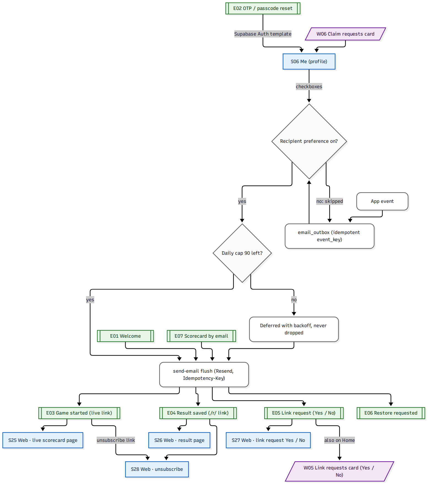
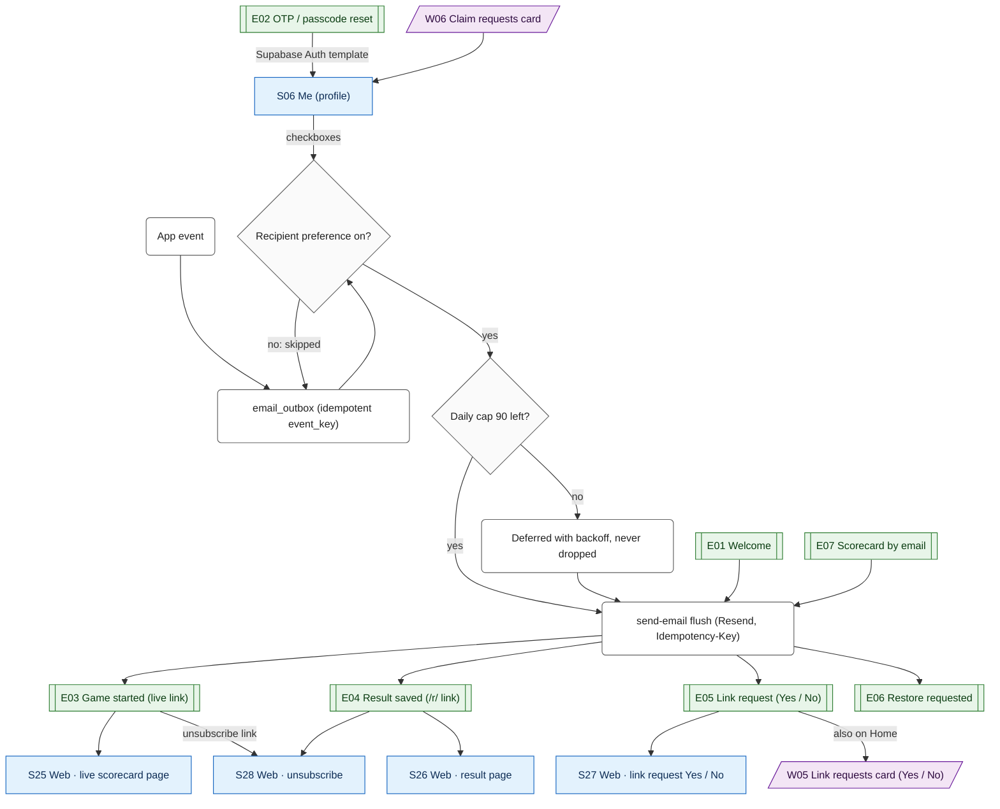

# F15 — Notifications and emails

Requirements: R40, R41 · Screens / pop-ups / warnings in this flow: 14 · untested (red): 0

## Scenarios

| # | Kind | Scenario | Tests |
| --- | --- | --- | --- |
| F15-1 | happy | Game started → one email per registered seated player with the live link | [`pgTAP/14_emails_024.sql`](../../../supabase/tests/14_emails_024.sql) · [`emails-024.test.ts`](../../../tests/emails-024.test.ts) |
| F15-2 | happy | Result saved → email with /r/ link; declarer excluded | [`pgTAP/14_emails_024.sql`](../../../supabase/tests/14_emails_024.sql) |
| F15-3 | happy | Link request email with Yes / No; answer by token once | [`pgTAP/15_link_player_025.sql`](../../../supabase/tests/15_link_player_025.sql) · [`link-player-025.test.ts`](../../../tests/link-player-025.test.ts) |
| F15-4 | happy | Restore requested email to creator and admins | [`pgTAP/36_going_rogue_045.sql`](../../../supabase/tests/36_going_rogue_045.sql) · [`going-rogue.test.ts`](../../../tests/going-rogue.test.ts) |
| F15-5 | edge | Same event twice → one outbox row (event_key) | [`pgTAP/14_emails_024.sql`](../../../supabase/tests/14_emails_024.sql) |
| F15-6 | edge | 150 emails vs cap 90 → 90 sent, 60 deferred, 0 dropped | [`pgTAP/19_guardrails_029.sql`](../../../supabase/tests/19_guardrails_029.sql) · [`volume-client.test.ts`](../../../tests/volume-client.test.ts) |
| F15-7 | happy | Unsubscribe by kind or all; preferences on Me | [`pgTAP/14_emails_024.sql`](../../../supabase/tests/14_emails_024.sql) · [`pgTAP/23_security_033.sql`](../../../supabase/tests/23_security_033.sql) |
| F15-8 | edge | Real delivery through Resend (staging inbox) | **GAP** |

## Nodes

| ID | Name | File | Tests touching it |
| --- | --- | --- | --- |
| E01 | Welcome | `supabase/functions/send-email/index.ts (kind welcome)` | 1 |
| E02 | OTP / passcode reset | `supabase/templates/recovery-passcode.html` | 1 |
| E03 | Game started (live link) | `supabase/functions/send-email/index.ts (game_started)` | 7 |
| E04 | Result saved (/r/ link) | `supabase/functions/send-email/index.ts (result_saved)` | 9 |
| E05 | Link request (Yes / No) | `supabase/functions/send-email/index.ts (link_request)` | 9 |
| E06 | Restore requested | `supabase/functions/send-email/index.ts (restore_requested)` | 3 |
| E07 | Scorecard by email | `supabase/functions/send-email/index.ts (kind scorecard)` | 6 |
| S28 | Web · unsubscribe | `public/unsubscribe.html` | 4 |
| S27 | Web · link request Yes / No | `public/link.html` | 5 |
| S26 | Web · result page | `public/r/index.html` | 14 |
| S25 | Web · live scorecard page | `public/scorecard.html` | 21 |
| S06 | Me (profile) | `app/(tabs)/me.tsx` | 27 |
| W05 | Link requests card (Yes / No) | `components/players/LinkRequestsCard.tsx` | 4 |
| W06 | Claim requests card | `components/players/ClaimRequestsCard.tsx` | 2 |
