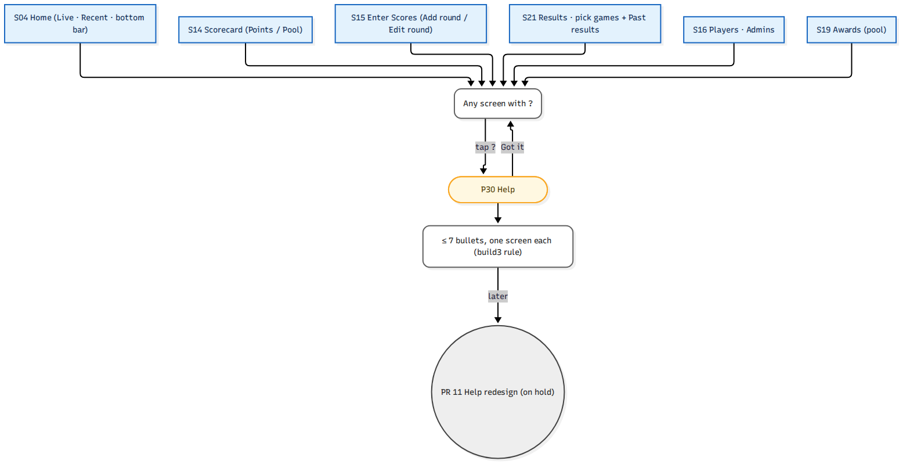
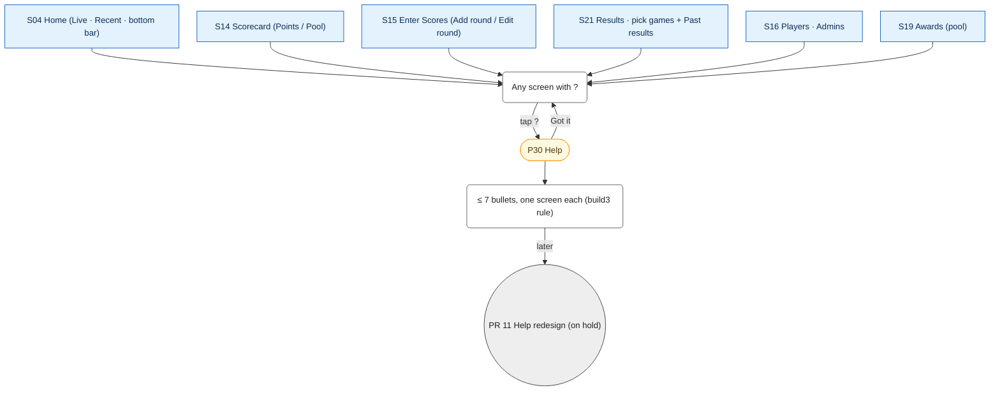

# F16 — Help

Requirements: R42 · Screens / pop-ups / warnings in this flow: 7 · untested (red): 0

## Scenarios

| # | Kind | Scenario | Tests |
| --- | --- | --- | --- |
| F16-1 | happy | Every Help note opens and matches the screen | [`full/50-help-notes.yaml`](../../../e2e/full/50-help-notes.yaml) · [`smoke/02-scorecard.yaml`](../../../e2e/smoke/02-scorecard.yaml) · [`build3.test.ts`](../../../tests/build3.test.ts) · [`build4.test.ts`](../../../tests/build4.test.ts) |
| F16-2 | edge | Help copy stays ≤ 7 bullets and within line length | [`build3.test.ts`](../../../tests/build3.test.ts) |
| F16-3 | happy | Pool, multiplier, seating and deleted-games bullets present | [`pool-pr13.test.ts`](../../../tests/pool-pr13.test.ts) · [`multiplier-pr14.test.ts`](../../../tests/multiplier-pr14.test.ts) · [`seating-pr21.test.ts`](../../../tests/seating-pr21.test.ts) · [`going-rogue.test.ts`](../../../tests/going-rogue.test.ts) |

## Nodes

| ID | Name | File | Tests touching it |
| --- | --- | --- | --- |
| P30 | Help | `components/ui/HelpButton.tsx` | 16 |
| S04 | Home (Live · Recent · bottom bar) | `app/(tabs)/index.tsx` | 69 |
| S14 | Scorecard (Points / Pool) | `app/(screens)/games/[id].tsx` | 86 |
| S15 | Enter Scores (Add round / Edit round) | `app/(screens)/score-entry.tsx` | 57 |
| S21 | Results · pick games + Past results | `app/(screens)/results/index.tsx` | 37 |
| S16 | Players · Admins | `app/(screens)/games/players.tsx` | 50 |
| S19 | Awards (pool) | `app/(screens)/games/award.tsx` | 19 |
