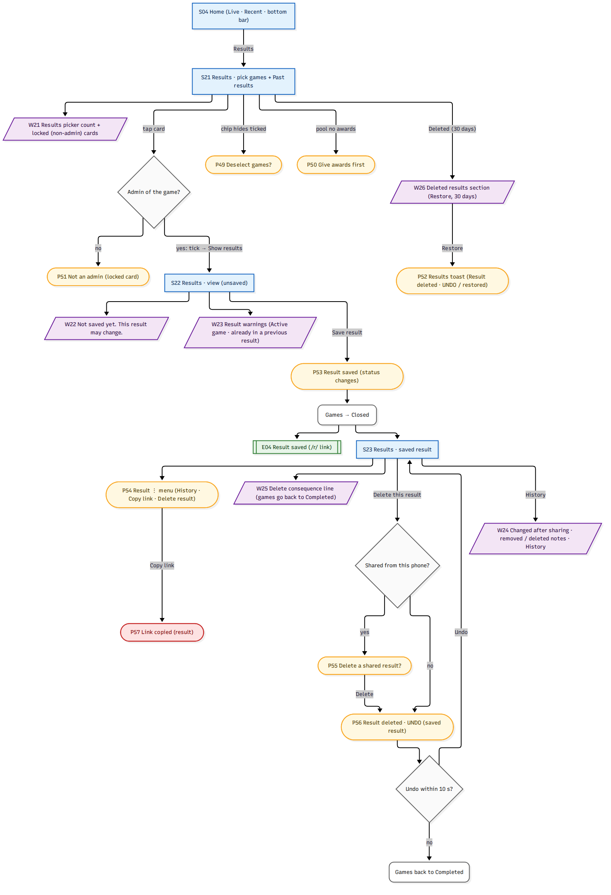
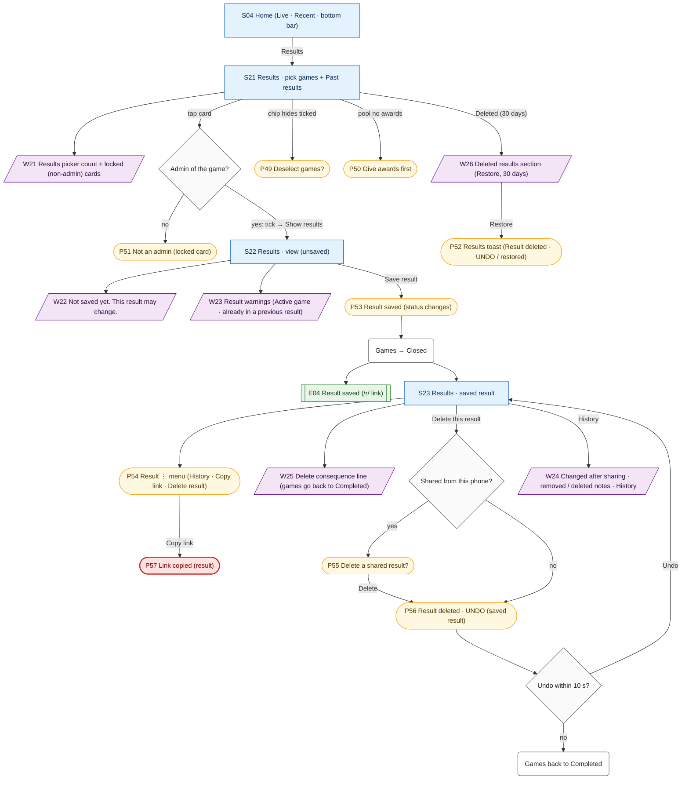

# F17 — Results: pick, save, past, delete, history

Requirements: R26, R27, R43, R44 · Screens / pop-ups / warnings in this flow: 20 · untested (red): 1 — P57

## Scenarios

| # | Kind | Scenario | Tests |
| --- | --- | --- | --- |
| F17-1 | happy | Pick completed games → Show results → Save → games Closed → saved result | [`smoke/06-results.yaml`](../../../e2e/smoke/06-results.yaml) · [`full/40-results-save-and-past.yaml`](../../../e2e/full/40-results-save-and-past.yaml) · [`results-save.test.ts`](../../../tests/results-save.test.ts) · [`pgTAP/03_results_privacy.sql`](../../../supabase/tests/03_results_privacy.sql) |
| F17-2 | edge | Completed game with no rounds → players at 0, not "0 players" | [`smoke/12-results-zero-players.yaml`](../../../e2e/smoke/12-results-zero-players.yaml) · [`pgTAP/24_results_design_034.sql`](../../../supabase/tests/24_results_design_034.sql) |
| F17-3 | misuse | Non-admin card locked → Not an admin dialog | [`smoke/06-results.yaml`](../../../e2e/smoke/06-results.yaml) · [`results-picker.test.ts`](../../../tests/results-picker.test.ts) |
| F17-4 | edge | Deselect games? when a chip would hide a ticked game | [`results-picker.test.ts`](../../../tests/results-picker.test.ts) |
| F17-5 | happy | Delete this result → 10 s Undo → games Completed again | [`smoke/12-results-zero-players.yaml`](../../../e2e/smoke/12-results-zero-players.yaml) · [`full/40-results-save-and-past.yaml`](../../../e2e/full/40-results-save-and-past.yaml) · [`results-delete-pr9.test.ts`](../../../tests/results-delete-pr9.test.ts) · [`pgTAP/30_results_delete.sql`](../../../supabase/tests/30_results_delete.sql) |
| F17-6 | edge | Delete a result shared from this phone → confirm first | [`smoke/15-delete-shared-result-confirm.yaml`](../../../e2e/smoke/15-delete-shared-result-confirm.yaml) · [`results-delete-pr9.test.ts`](../../../tests/results-delete-pr9.test.ts) |
| F17-7 | happy | Deleted results list (30 days) → Restore → games Closed again | [`smoke/12-results-zero-players.yaml`](../../../e2e/smoke/12-results-zero-players.yaml) · [`pgTAP/30_results_delete.sql`](../../../supabase/tests/30_results_delete.sql) |
| F17-8 | happy | History: versions, "Changed after sharing" line, result_* log rows | [`full/70-game-log.yaml`](../../../e2e/full/70-game-log.yaml) · [`event-log-036.test.ts`](../../../tests/event-log-036.test.ts) · [`pgTAP/26_event_log_036.sql`](../../../supabase/tests/26_event_log_036.sql) |
| F17-9 | misuse | Only declarer, seated players, game admins see a result (RLS) | [`pgTAP/03_results_privacy.sql`](../../../supabase/tests/03_results_privacy.sql) · [`results-privacy.test.ts`](../../../tests/results-privacy.test.ts) |
| F17-10 | edge | A game in two live results stays Closed when one is deleted | [`pgTAP/30_results_delete.sql`](../../../supabase/tests/30_results_delete.sql) |
| F17-11 | edge | 30 games × 20 players result page speed | [`pgTAP/22_results_volume_032.sql`](../../../supabase/tests/22_results_volume_032.sql) · [`volume-client.test.ts`](../../../tests/volume-client.test.ts) |

## Nodes

| ID | Name | File | Tests touching it |
| --- | --- | --- | --- |
| S04 | Home (Live · Recent · bottom bar) | `app/(tabs)/index.tsx` | 73 |
| S21 | Results · pick games + Past results | `app/(screens)/results/index.tsx` | 38 |
| W21 | Results picker count + locked (non-admin) cards | `app/(screens)/results/index.tsx` | 2 |
| P51 | Not an admin (locked card) | `app/(screens)/results/index.tsx` | 5 |
| P49 | Deselect games? | `app/(screens)/results/index.tsx` | 1 |
| P50 | Give awards first | `app/(screens)/results/index.tsx` | 3 |
| S22 | Results · view (unsaved) | `app/(screens)/results/view.tsx` | 25 |
| W22 | Not saved yet. This result may change. | `app/(screens)/results/view.tsx` | 2 |
| W23 | Result warnings (Active game · already in a previous result) | `components/results/ResultWarnings.tsx` | 3 |
| P53 | Result saved (status changes) | `app/(screens)/results/view.tsx` | 5 |
| S23 | Results · saved result | `app/(screens)/results/[id].tsx` | 35 |
| P54 | Result ⋮ menu (History · Copy link · Delete result) | `app/(screens)/results/[id].tsx` | 5 |
| W25 | Delete consequence line (games go back to Completed) | `app/(screens)/results/[id].tsx` | 2 |
| P55 | Delete a shared result? | `app/(screens)/results/[id].tsx` | 2 |
| P56 | Result deleted · UNDO (saved result) | `app/(screens)/results/[id].tsx` | 4 |
| W26 | Deleted results section (Restore, 30 days) | `app/(screens)/results/index.tsx` | 4 |
| P52 | Results toast (Result deleted · UNDO / restored) | `app/(screens)/results/index.tsx` | 4 |
| W24 | Changed after sharing · removed / deleted notes · History | `components/results/ResultHistory.tsx` | 2 |
| E04 | Result saved (/r/ link) | `supabase/functions/send-email/index.ts (result_saved)` | 9 |
| P57 | Link copied (result) | `app/(screens)/results/[id].tsx` | **GAP** |
