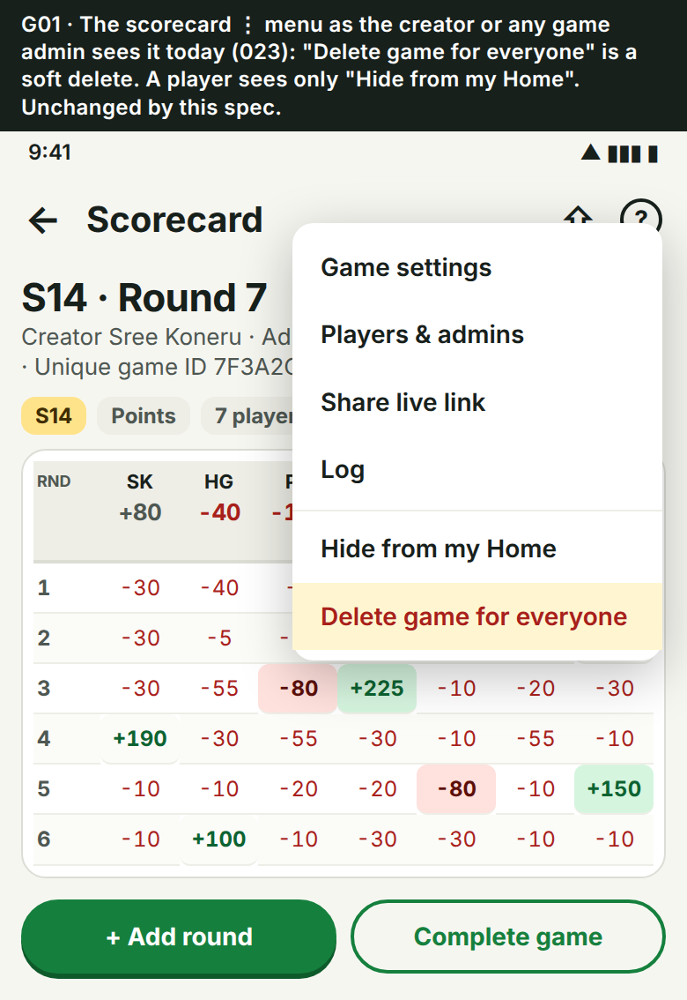
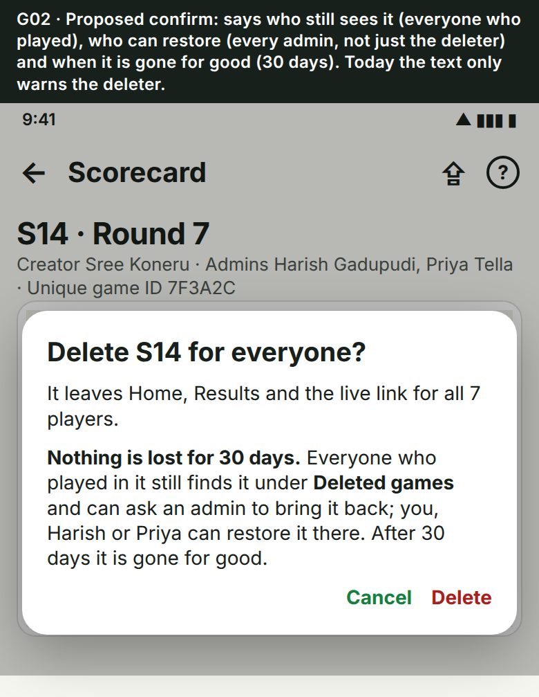
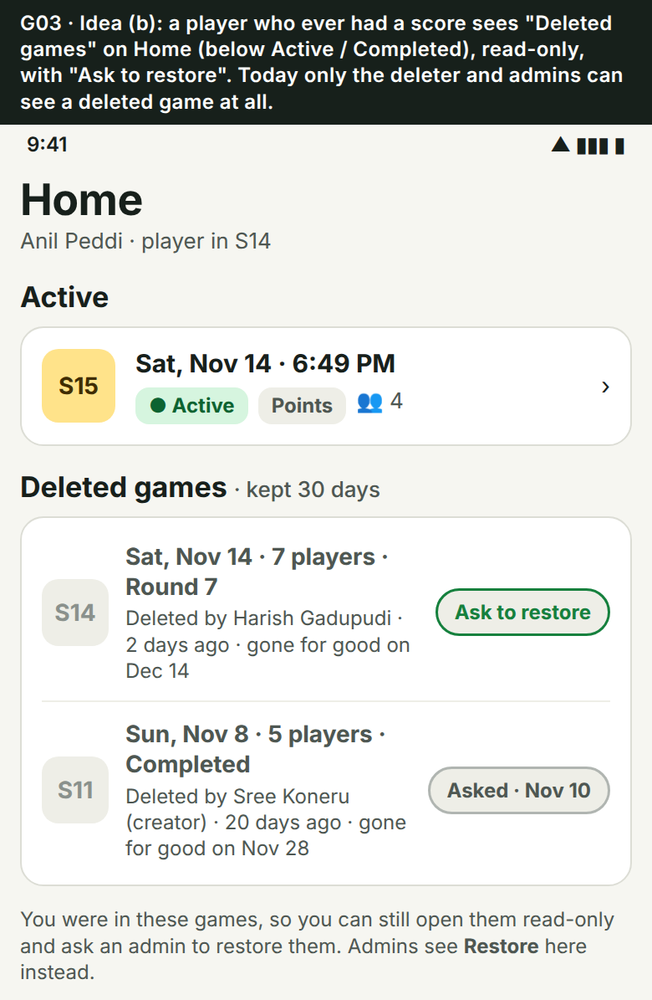
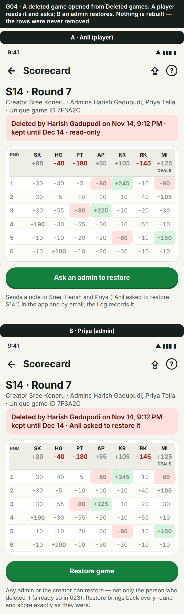
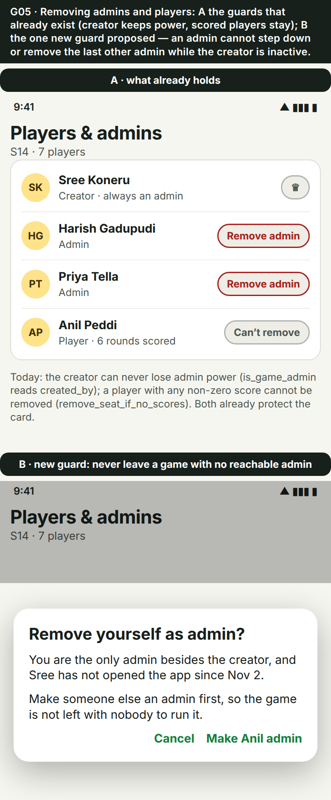
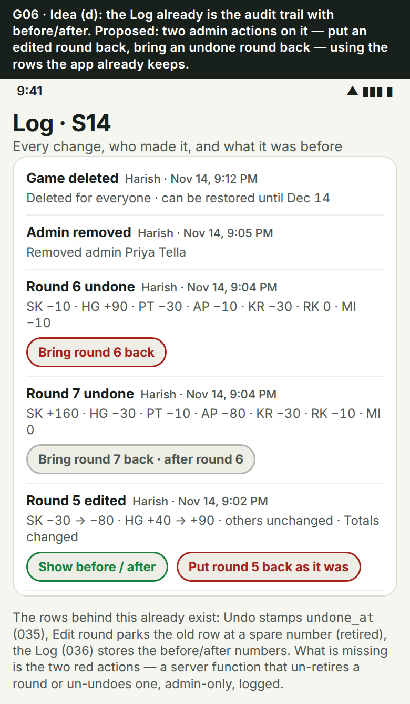
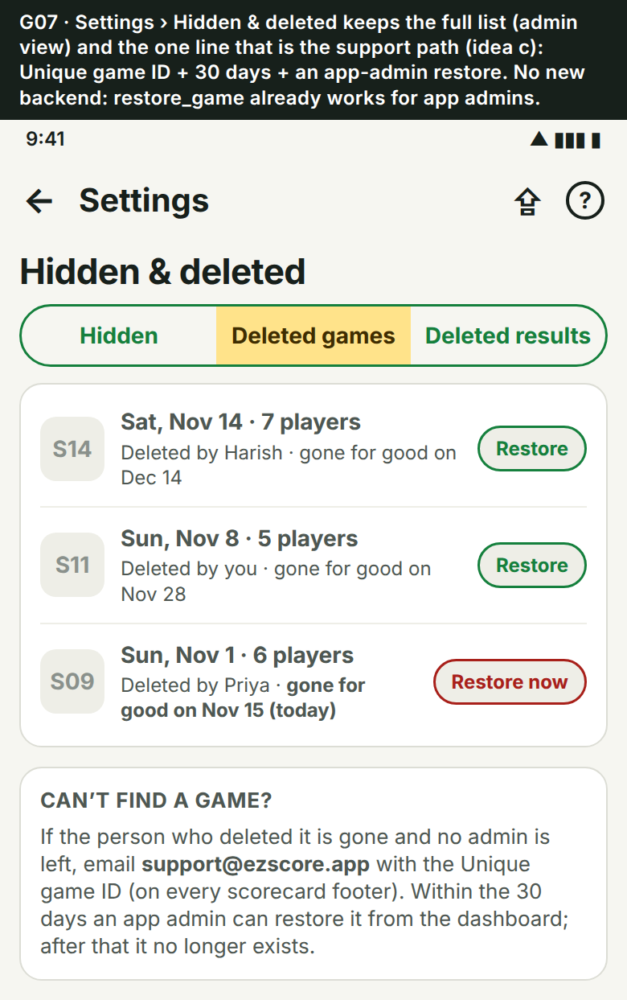
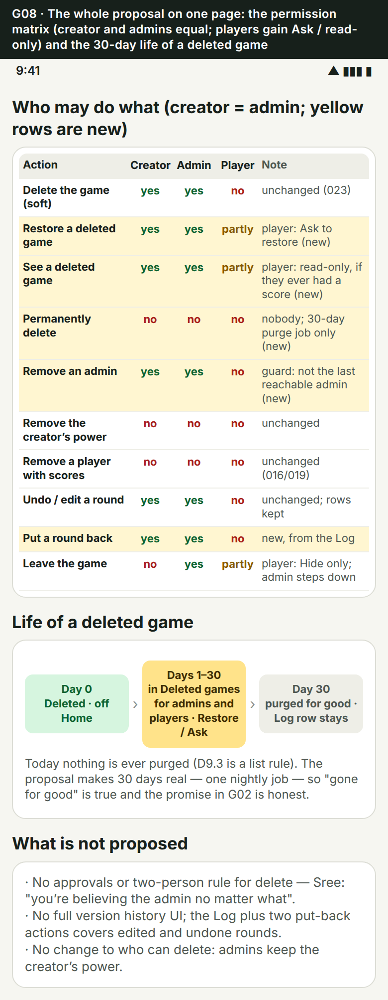

# Going rogue — design mockups G01–G08 (PR 20, review set, Nov 15)

Flat copy of the generated set, embedded in [`../going-rogue-design.md`](../going-rogue-design.md) section 5. 390 dp, light
theme, same style as the Pool and Multiplier sets; each PNG has a caption strip. Sample game: S14 (creator Sree, admins
Harish and Priya, 7 players, 7 rounds). The generator lives outside the repo.

| # | File | Shows |
| --- | --- | --- |
| G01 | `G01-scorecard-menu-delete.png` | The ⋮ menu today (soft delete for creator and admins) — unchanged |
| G02 | `G02-delete-confirm-30-days.png` | Proposed confirm text: who still sees it, who restores, 30 days |
| G03 | `G03-home-deleted-games-player.png` | Idea (b): Home › Deleted games for a player, Ask to restore |
| G04 | `G04-deleted-game-page.png` | Deleted game opened: player (Ask) and admin (Restore) |
| G05 | `G05-admins-players-guards.png` | Existing guards; new last-reachable-admin dialog |
| G06 | `G06-log-history-and-revert.png` | Idea (d): Log with Bring round back / Put round back as it was |
| G07 | `G07-settings-deleted-and-support.png` | Settings list with "gone for good on …" and the support card (idea c) |
| G08 | `G08-matrix-and-timeline.png` | Permission matrix and the 30-day life of a deleted game |

## G01

## G02

## G03

## G04

## G05

## G06

## G07

## G08

