# Help redesign — mockups H00–H14 (PR 11, review set)

Each H01–H14 picture is the real emulator screenshot (CI smoke run of PR 13's branch, Nov 14) with numbered callouts on
the left and the proposed help page on the right. H00 is the page template, H10 the Help & guide index. Spec:
[`../help-design.md`](../help-design.md).

## H00

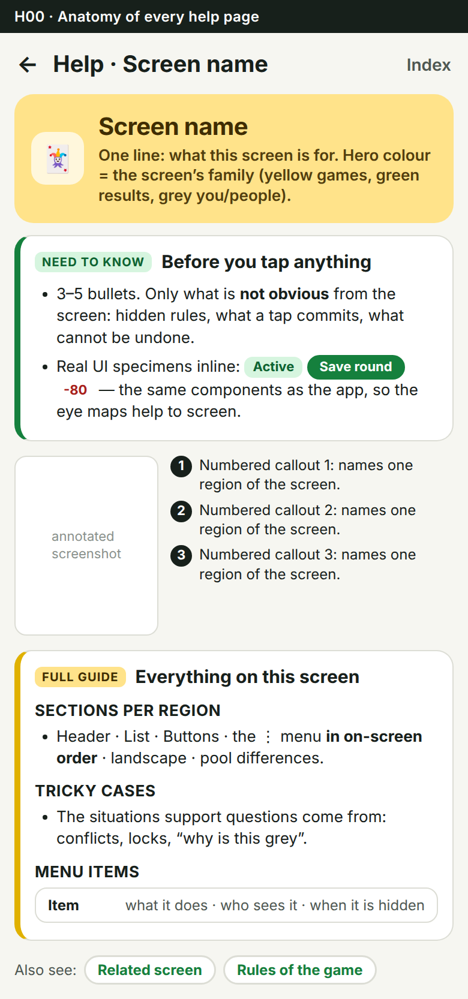

## H01

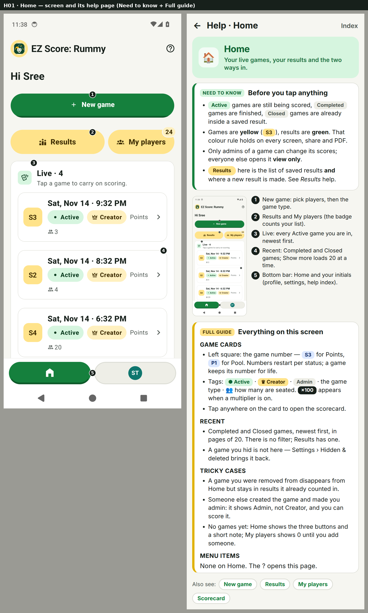

## H02

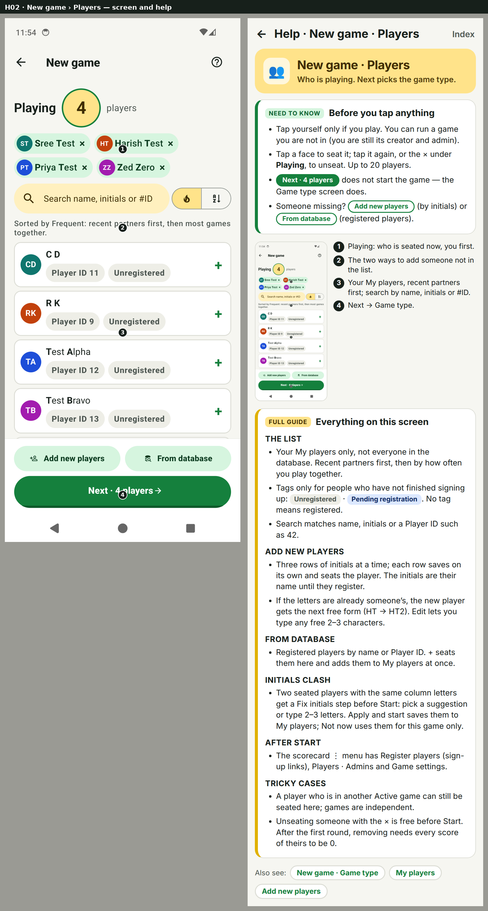

## H03

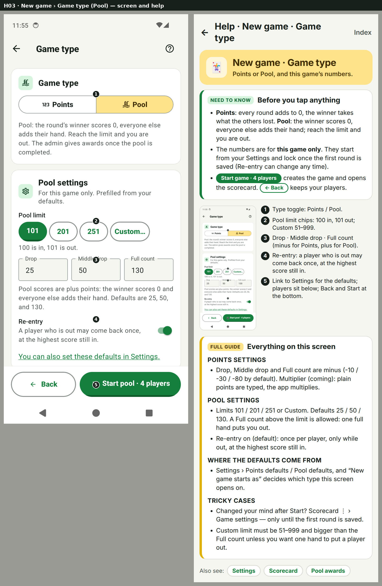

## H04

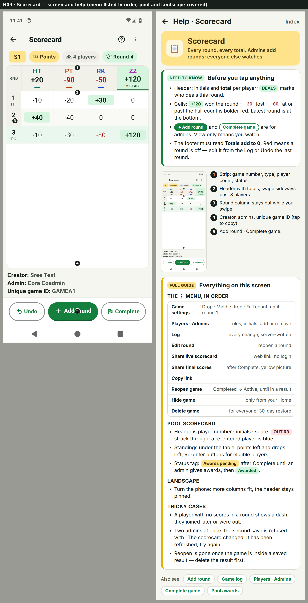

## H05

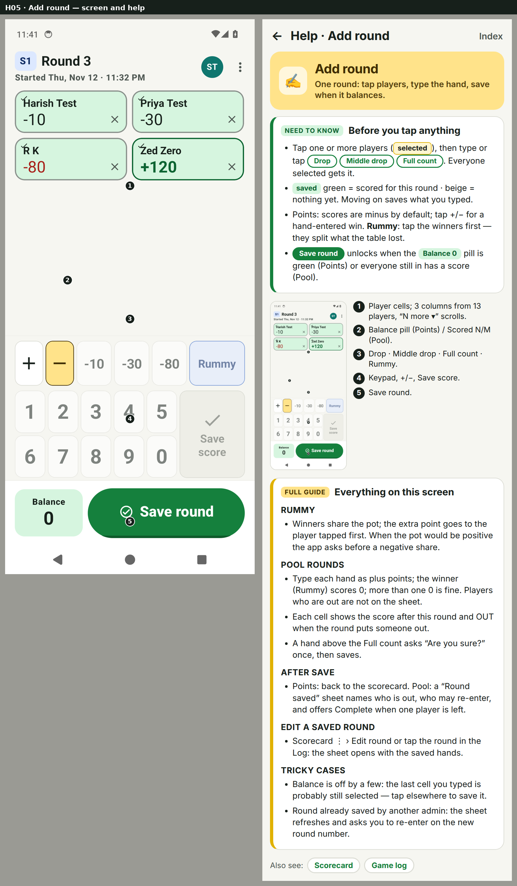

## H06

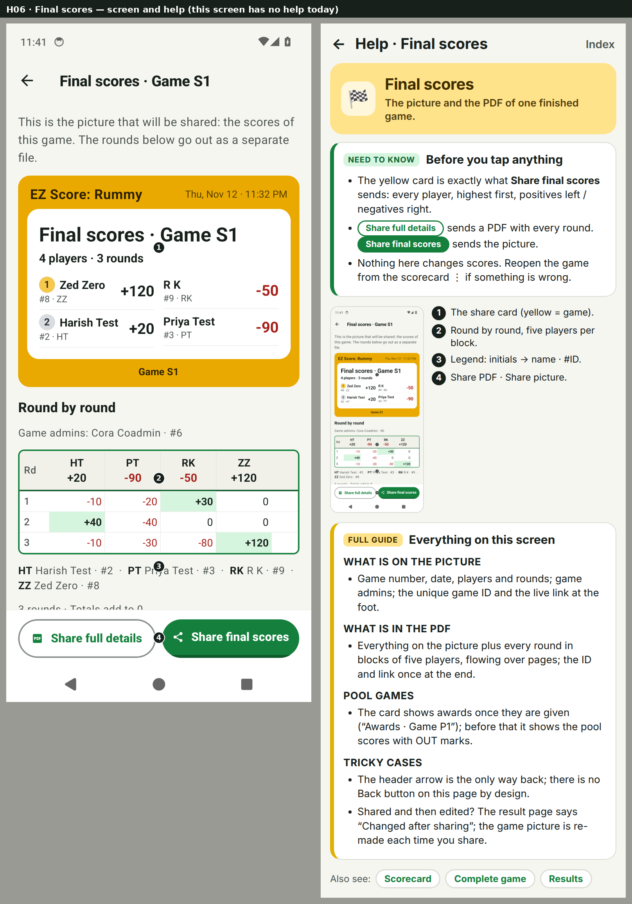

## H07

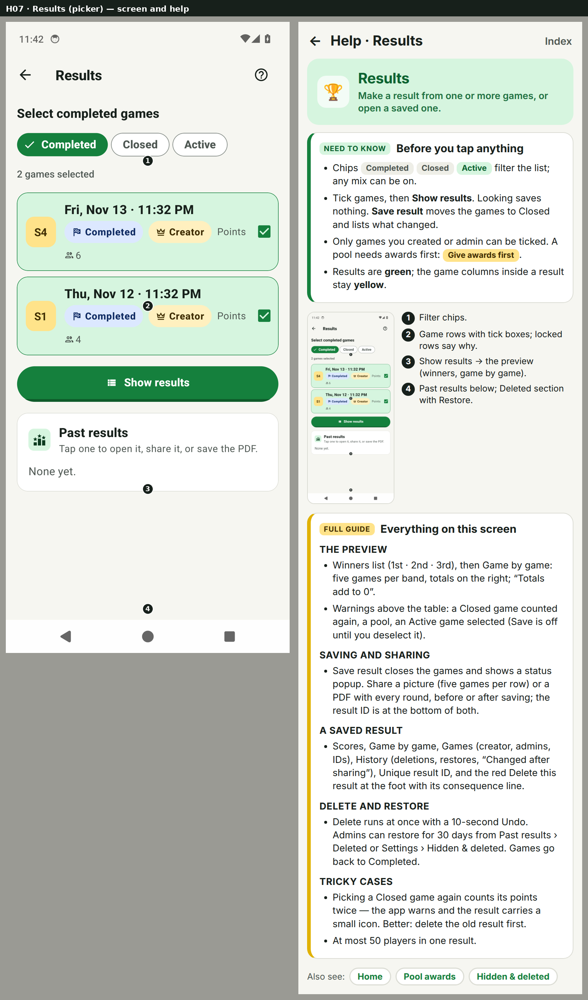

## H08

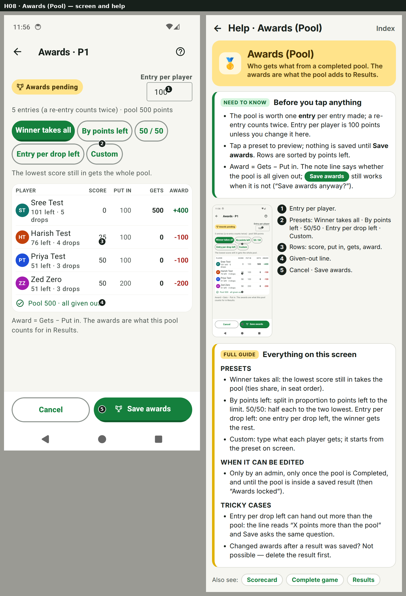

## H09

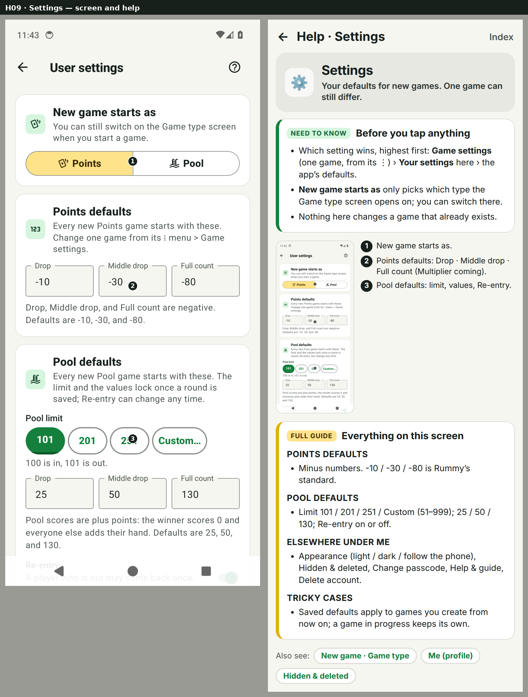

## H10

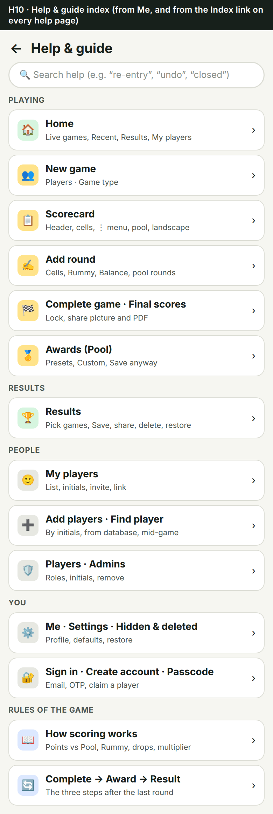

## H11

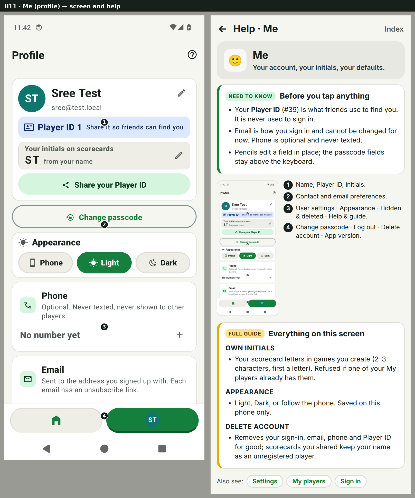

## H12

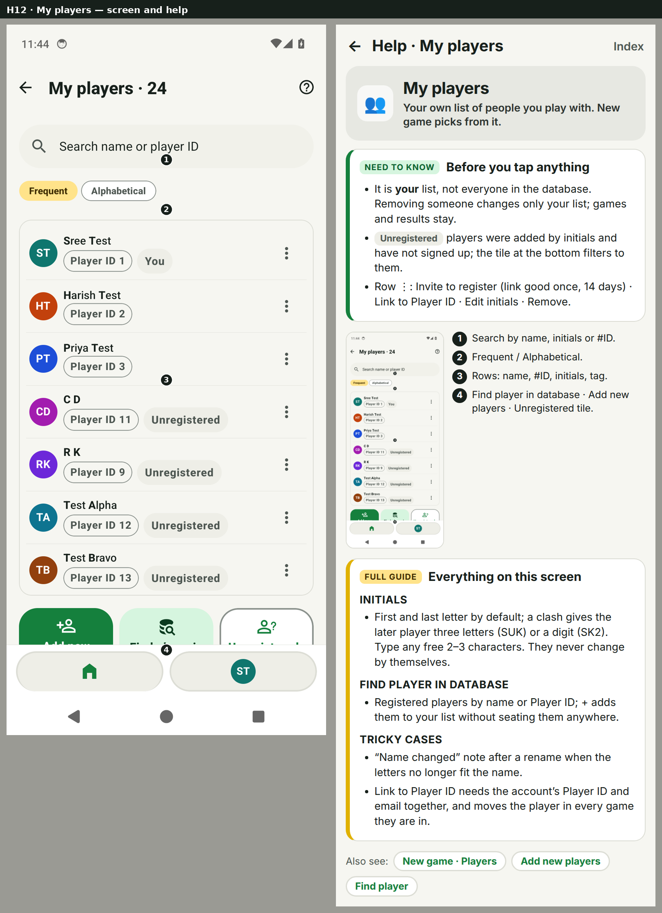

## H13

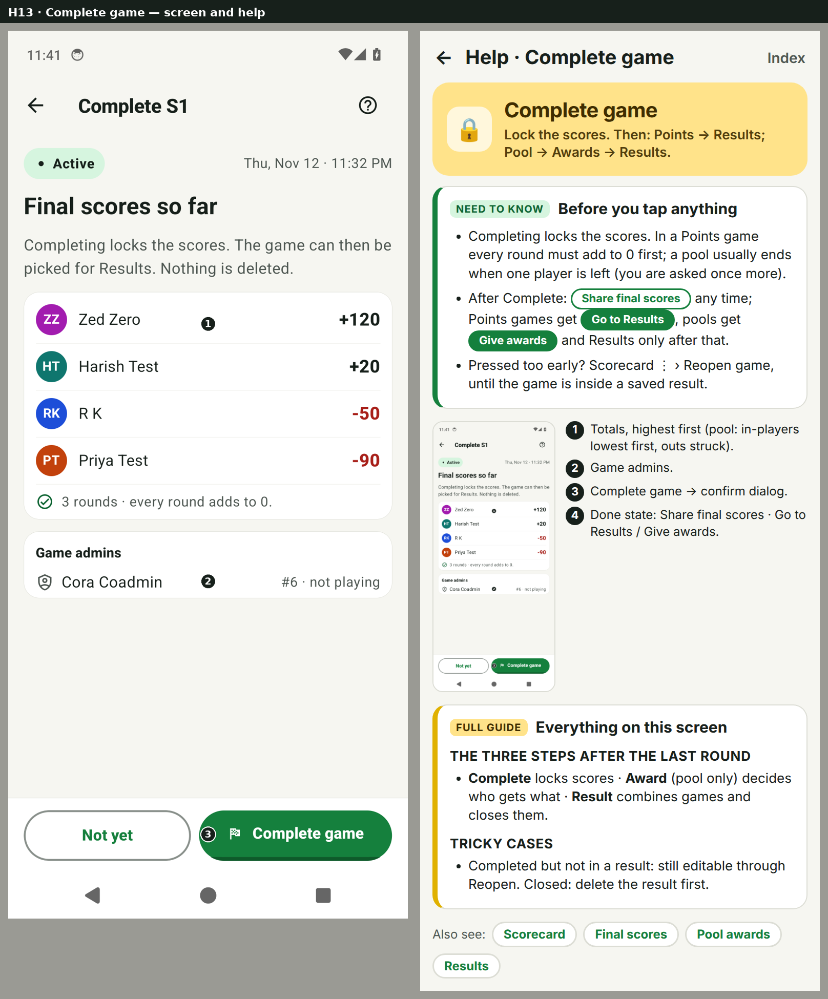

## H14

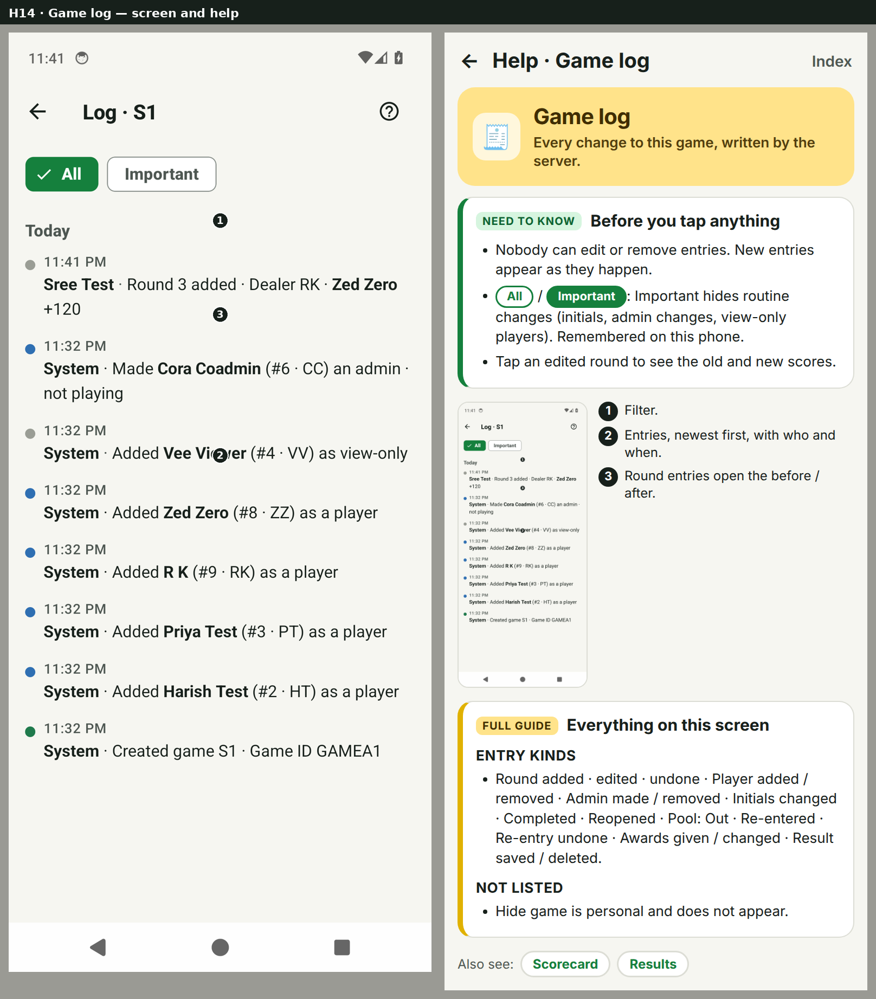
