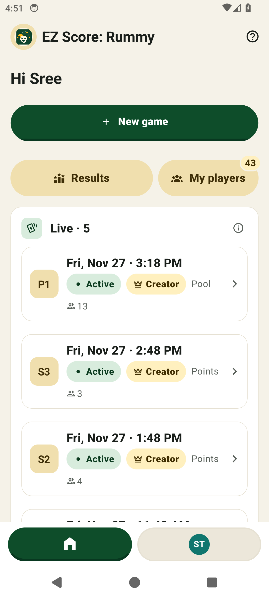
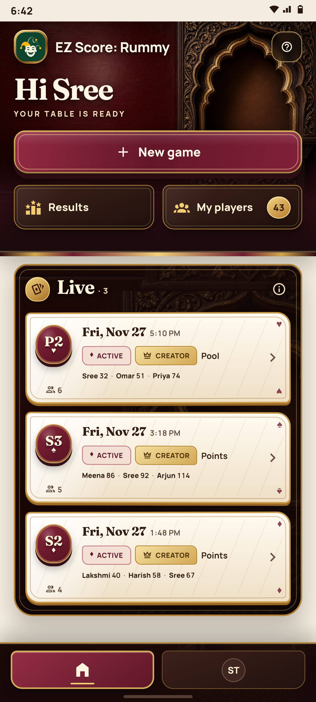
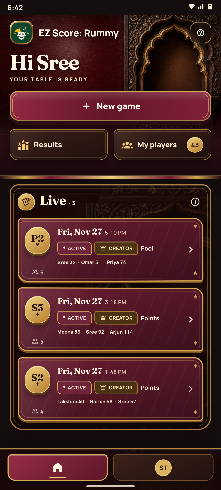
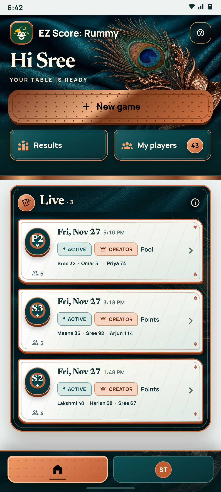
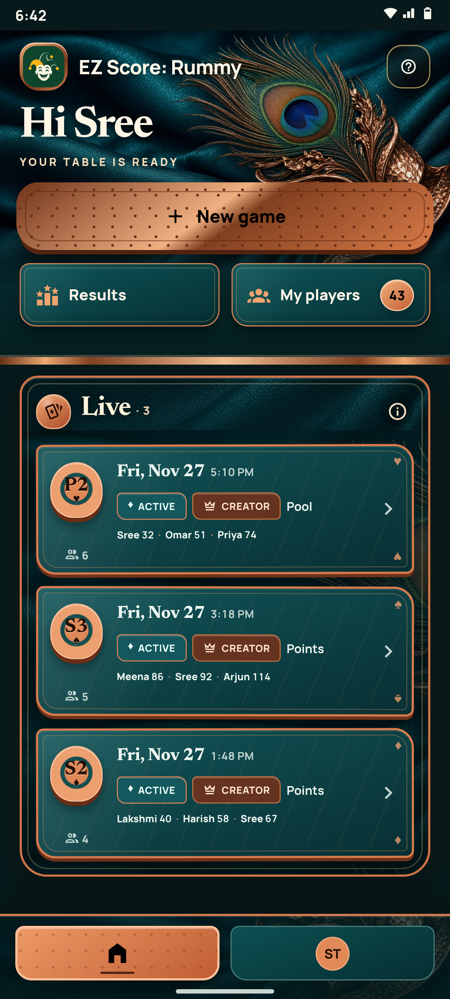
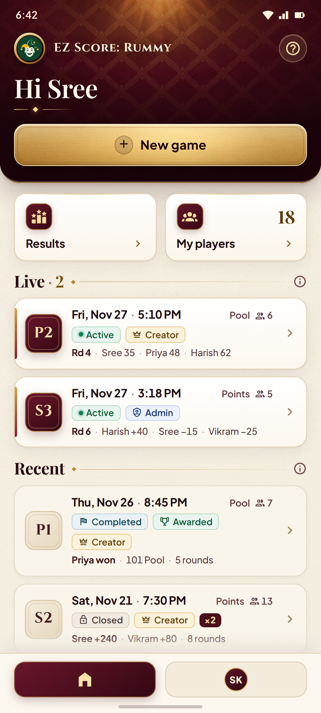
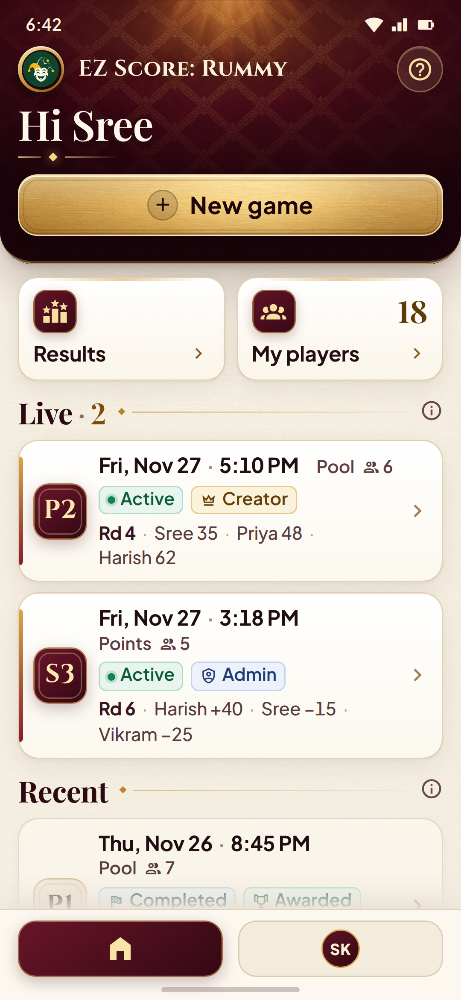
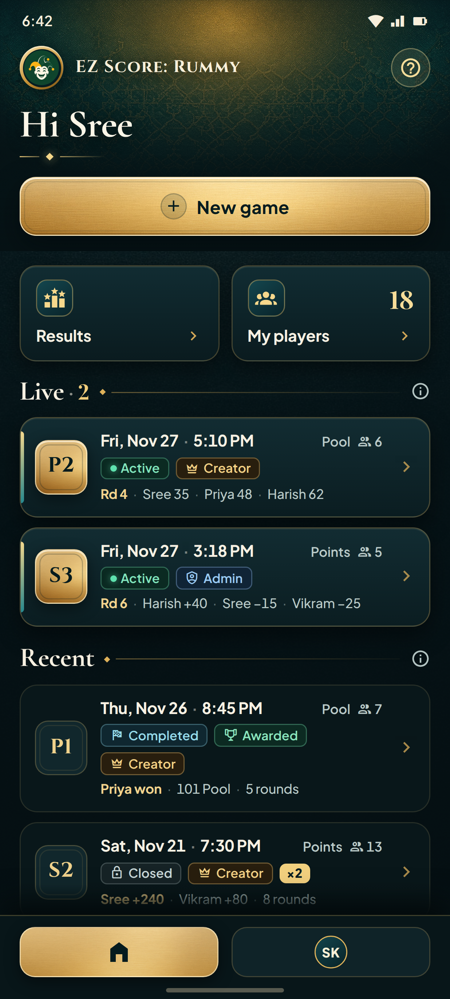

# Premium Home, redrawn (Q60, second round)

Sree, Nov 27, 1:06 PM PT, on the first set (#181): "Hey, these are not good … They are very average or actually
horrible. I want to know which model did it, and maybe we'll try a different model."

The first set (A Emerald & Gold, B Maroon & Marigold, C Ivory & Indigo) was drawn by a Claude Fable 5.2 helper. It
coded each screen in HTML and CSS, and a script turned the pages into pictures, with no real texture or illustration.
Those three are no longer choices.

This round, two other models each drew two directions from scratch. They kept today's Home layout (D136). They used
generated textures (velvet, lacquer, silk, carved wood) behind the header, and real text on top. Every picture is a
single full-size screen: 1236 × 2745 (Pixel 6), and 1080 × 2340 for the small phone (360 dp, text size 1.3).

## Today's Home

## GPT-5.6 Sol

**Mahal Reserve** (the GPT helper's pick): oxblood lacquer and a carved sandalwood arch; each game is a gold-edged
playing card with its suit in the corners.

| Light | Dark | Small phone |
| --- | --- | --- |
|  |  |  |

**Peacock Atelier**: teal silk with a peacock feather, a hammered-copper New game button, copper-edged game tiles.

| Light | Dark |
| --- | --- |
|  |  |

## Gemini 4 Neon

**Royal Darbar** (the Gemini helper's pick): crimson velvet under chandelier light, a brushed-gold New game bar,
ivory game cards with a fine gold edge; Live and Recent both in view.

| Light | Dark | Small phone |
| --- | --- | --- |
|  |  |  |

**Mayur Palace**: sunlit ivory silk by day, midnight peacock silk with a gold lattice at night; closest to the
Joker icon's green.

| Light | Dark |
| --- | --- |
|  |  |

## Recommendation

**Royal Darbar.** It is the calmest to read at the table and keeps the most of today's Home in view on the small
phone, while still looking rich. Mahal Reserve is the most dramatic of the four, if drama is what is wanted.

**Q60:** which of the four should be built as the Home look, or none (draw again)? Default if there is no answer:
nothing is built.

## Where the pictures come from

- `home-premium-v2/gpt/`: GPT-5.6 Sol helper, `render.mjs` (headless Chromium); textures in `assets/` came from
 its image generator. One review round: the game numbers now sit inside their coins and the small phone keeps
 "My players" on one line.
- `home-premium-v2/gemini/`: Gemini 4 Neon helper, `make.mjs` (headless Chromium); textures in `assets/` came
 from its image generator. Its README reports text contrast of at least 6.19 : 1 on every picture.
- Today: a real CI frame, the same one as in `home-premium.md`.
