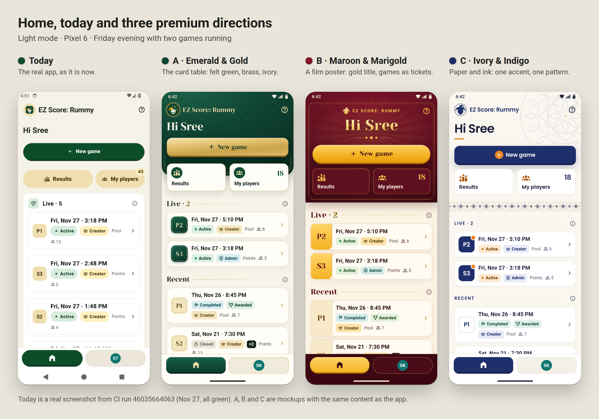
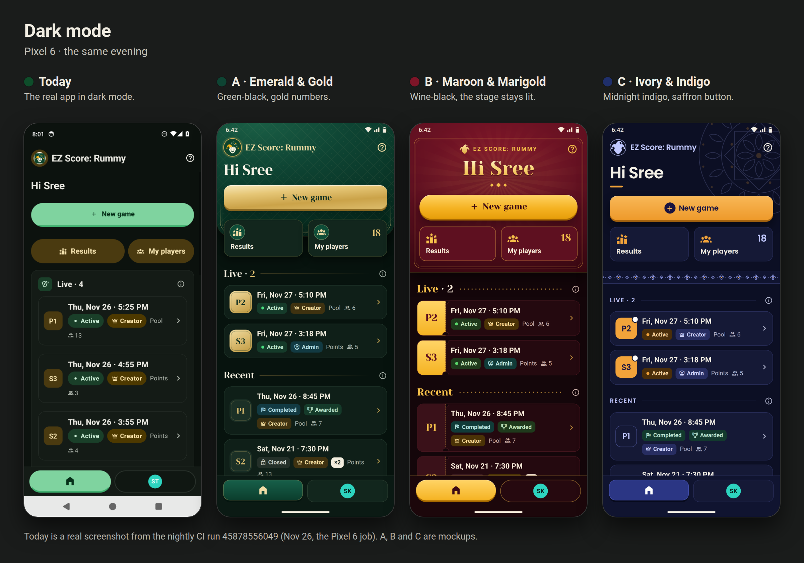
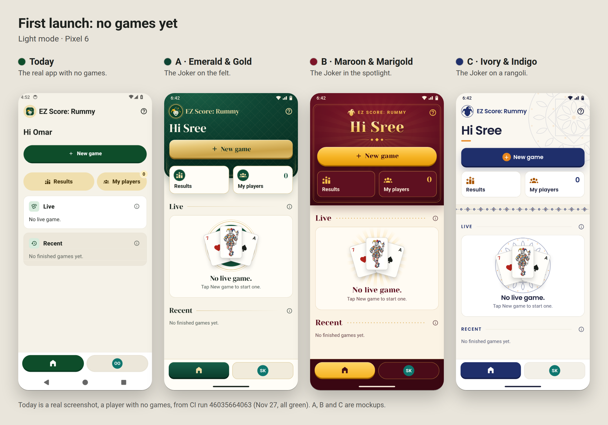
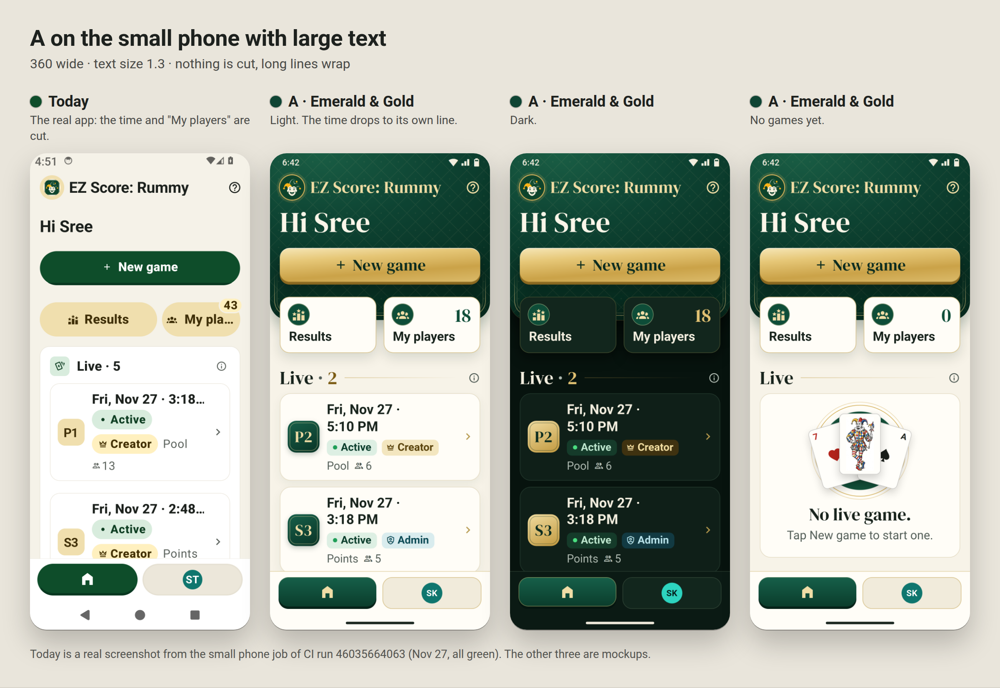

# Home, made premium: three directions

*Nov 27 2026. Pictures only. Nothing is built and nothing is decided.*

Sree, Nov 27:

> "I'm still not happy with the design, though. We might have to change the design for the whole thing. I'm not happy with the design. It doesn't feel premium. I want to just do the home screen. I want Claude to use Fable or something to give me amazing design mockups. Right now, I don't like what we have. We need to do better. I think since it's Rummy, we should go for some premium Indian colors, Indian Bollywood. I don't know. We'll see."

**The one question (Q60): which direction should I take further, A, B or C?** If you do not answer, I take **A**.

Later the same day you said: "I think everything else stays in place. It's just the themes." (D136.) These pictures were already being drawn. They fit that: in all three, Home has the same things in the same order as today, with one exception (a request moves under the two buttons). Read each direction first as a set of colours. The few things I changed besides colour and lettering are in bold in the table at the end, and each can be dropped while the colours stay.

## Today, and the three directions

The first phone is the real app today. The other three are mockups. They show the same games, words and buttons as the app. Only the look changes.

**A · Emerald & Gold**

- Feels like a club card room: deep felt green, a brass button, ivory paper. Rich, but calm.
- The top becomes a green band with a fine lattice pattern. New game is brass. Each game number sits on a green plaque with gold figures.
- It is the same green as the Joker icon, the splash and the share pages, so Home can change alone.

**B · Maroon & Marigold**

- Feels like the front of a Bombay cinema: a lit maroon stage, your name in gold, marigold buttons. The loudest and the most festive.
- "Hi Sree" becomes a gold title under rays of light. Each game is a ticket, with its number on the stub.
- It is a new identity. The green Joker icon, the splash, the scorecard and the store pictures would have to follow, or Home looks like a different app.

**C · Ivory & Indigo**

- Feels like a modern Indian textile brand: ivory paper, indigo ink, one touch of saffron. The quietest and the cleanest.
- No dark band at all. A block-print border sits between the buttons and the games, and a rangoli shows faintly in one corner.
- Also a new identity (blue, not green). It says "card night" the least of the three.

More pictures: [A](home-premium/sheet-a.png) · [B](home-premium/sheet-b.png) · [C](home-premium/sheet-c.png) · [everything Home can show, on one long page](home-premium/sheet-everything.png).

## My recommendation: A

1. **It feels premium and it is still this app.** Same green as the Joker icon and everything a player has already seen.
2. **It reads best at the table.** One dark band on top, light paper under the games, and the game number is the strongest thing on each card.
3. **It costs the least.** The smallest font, no new icon, no new store pictures.

Choose **B** if you want people to say "wow" the first time they open the app, and you accept that the rest of the app follows it. "Bollywood" taken all the way (film strips, sequins, hot pink) would be hard to read at a table, so B keeps the drama of a poster and leaves out the clutter. Pieces can be mixed: B's ticket cards also work in A's colours.

## What building it would touch

- **Colours.** Every screen reads from one shared list of colours. "Home only" means Home gets a few colours of its own first. The other screens do not change until you say so.
- **Font.** One new font file for headings and numbers, 77 to 157 KB. The app grows by less than 1%. All other text stays as it is.
- **Home's parts.** The header, the two tiles, the headings, the game card, the first-launch picture, the request cards, deleted games, the bottom bar.
- **Tests.** The words and the buttons stay the same, so the test flows still find them. The screenshots change.
- **Later, not now.** The same look would spread to the scorecard, Profile, Sign in, the share pages and the Play pictures. With B or C the app icon and the splash change too. A is the same family as the colours you chose on Nov 23 (Felt & Brass, D65, and the green-black dark mode, D71), only deeper. B or C would replace both.

---

## Reference (you do not need to read this)

### Easy to read in bad light

- Every word is at least 4.5 : 1 against what is behind it. The script that makes the pictures measures this and stops if one is lower. The lowest are 5.3 in A, 4.65 in B (the gold "Hi Sree") and 5.25 in C.
- Game numbers and the players count are 19 to 24 points. No text is smaller than 13.
- On the small phone with text size 1.3 nothing is cut. Long lines wrap: the time drops under the date. Today the same phone cuts the time ("3:18…") and "My pla…".

### Nothing is lost

Everything on Home today is in all three directions. What moved or changed shape is in bold.

| On Home today | In A, B and C |
| --- | --- |
| Joker icon and "EZ Score: Rummy" | Top of the screen. A: the full-colour Joker in a gold ring. B and C: the Joker in one colour. |
| Help "?" | Top right. |
| "Hi Sree" | Under the name, bigger. In B it is the title of the poster. |
| New game | Under the greeting, full width. |
| Results, My players | **Two tiles side by side instead of two pills.** Same words, same icons. |
| My players count | **A number inside the tile instead of a bubble on its corner.** |
| A request to link or claim a player (Yes / No, Approve / Decline) | **Moved: under Results and My players, above Live.** Today it sits above New game and pushes it down. |
| "Player update" with OK | Same place as the requests. |
| "Live · 2" with its ⓘ | A heading with the count and the ⓘ. **The small picture beside the word is gone, and so is the box around the list.** |
| A game card: number, date and time, Active / Completed / Closed, Awarded, Creator / Admin, ×2, Points / Pool, players count, arrow | All there, in the same order. **The labels are a little smaller, so they fit on one line more often.** |
| "No live game." | A picture of the Joker card and **one new line: "Tap New game to start one."** |
| "Recent" with its ⓘ, "No finished games yet.", Show more | Same. |
| Deleted games, with "Ask an admin to restore" or "Restore game" | Same, at the bottom. |
| Bottom bar: Home and your initials | Same two buttons, new colours. |
| Pop-ups ("One quick check", "Linked"), the toast, the refresh line, the loading rows, "Couldn't reach the server", the signed-out screen, the tablet layout | Not drawn. They stay as they are and take the new colours. |

### The typeface and its cost

| | Headings and numbers | Files | Size |
| --- | --- | --- | --- |
| A | DM Serif Display | 1 | 77 KB |
| B | Yeseva One | 1 | 108 KB |
| C | Poppins SemiBold | 1 | 157 KB |

All three are free on Google Fonts and work in Expo with the font loader the app already has. The rest of the text stays the phone's own font, which costs nothing. The test build of the app is about 21 MB. The green band and the gold button are gradients: one small standard Expo library, or two picture files.

### Where the pictures come from

- **Today in light mode (with games, with no games, on the small phone):** real screenshots from CI run [46035664063](https://github.com/sreeatcandorps/RummyHome/actions/runs/46035664063), Nov 27, every job that ran was green.
- **Today in dark mode:** the pull-request runs take no dark picture of Home, so it is from the nightly run [45878556049](https://github.com/sreeatcandorps/RummyHome/actions/runs/45878556049), Nov 26. Its Pixel 6 job was green; the run as a whole was red because of the tablet, Pixel 4a and volume jobs.
- **A, B and C:** drawn by `home-premium/make.mjs` from `home-premium/home.html` at three times the size of a Pixel 6 screen (412 × 915). The icons are the app's own icon font. Every phone is also a picture of its own in [`home-premium/`](home-premium/).
- The mockups show Android's gesture line at the bottom. The CI phone shows three buttons. That is a phone setting, not a design change.
