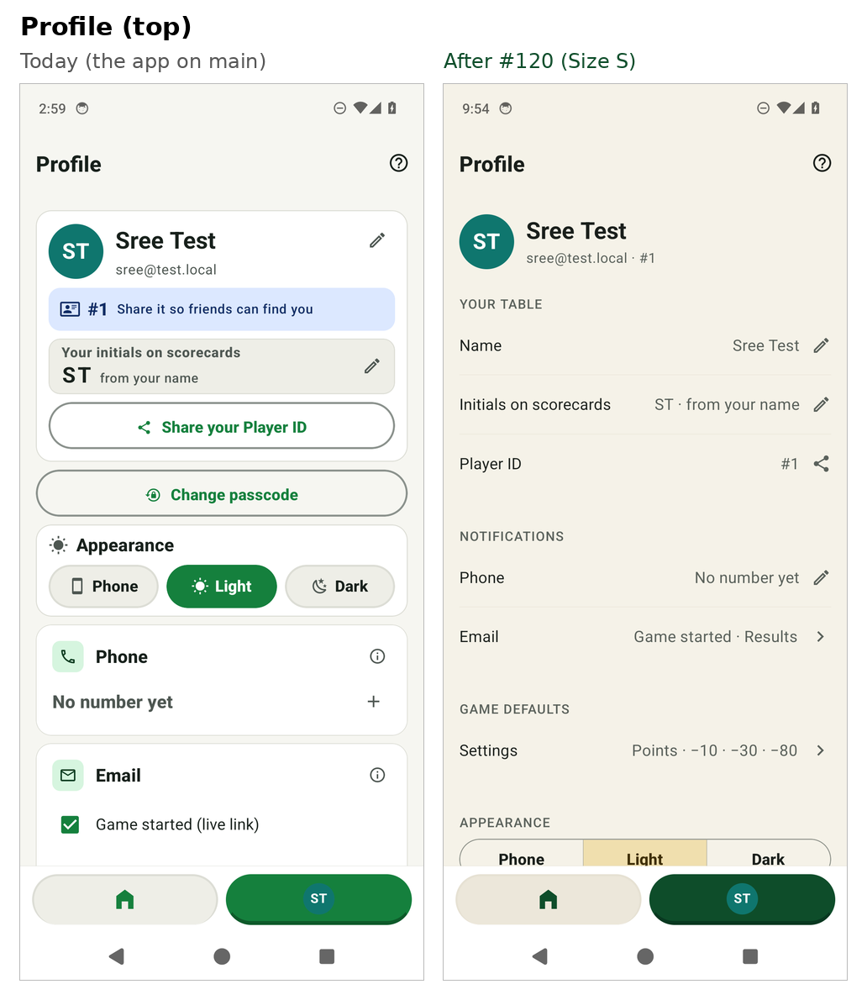
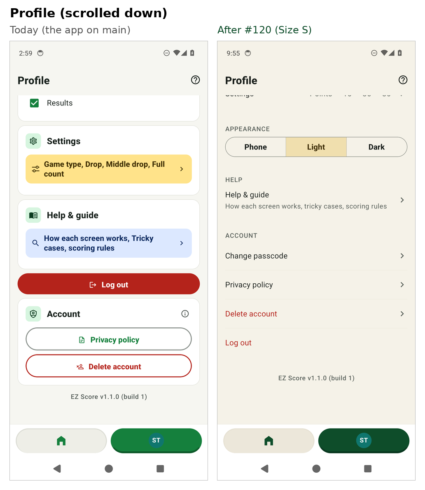
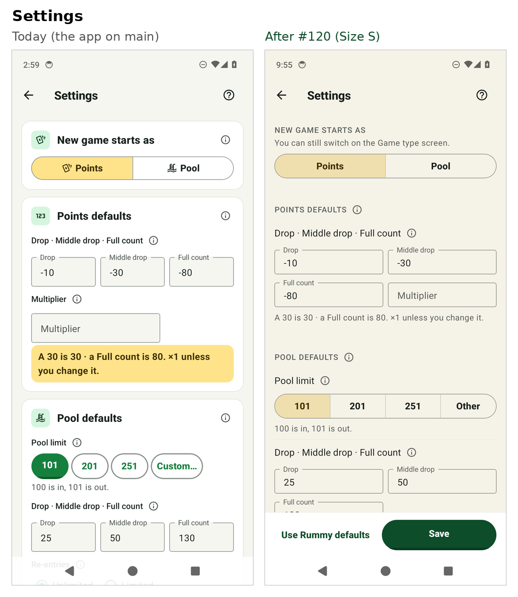
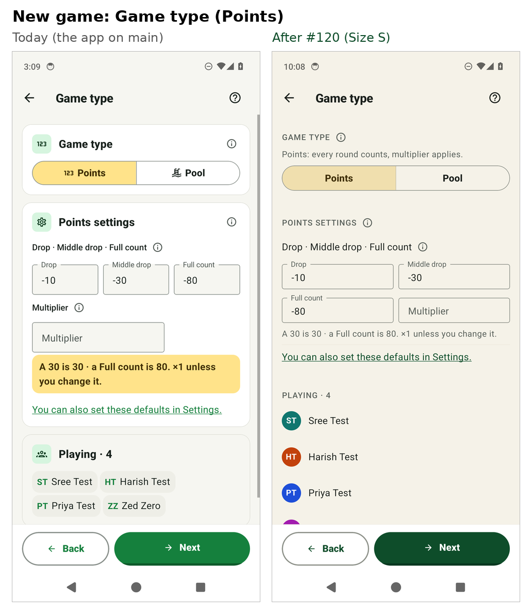
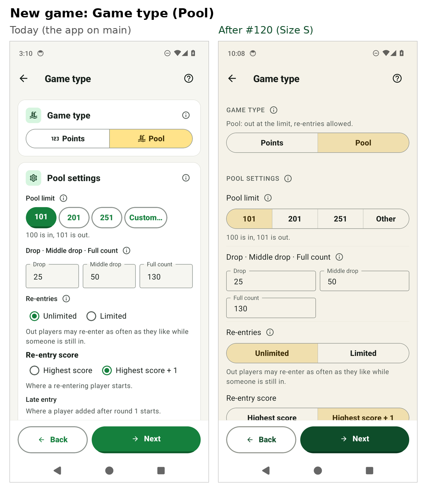
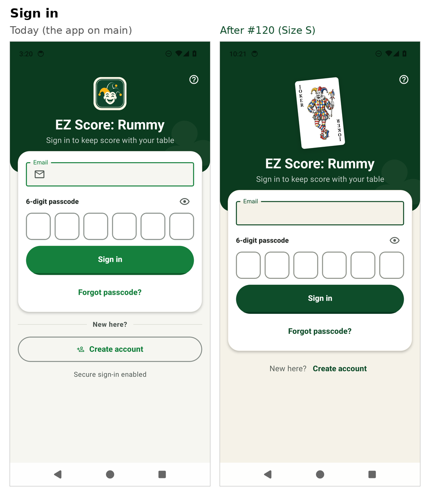
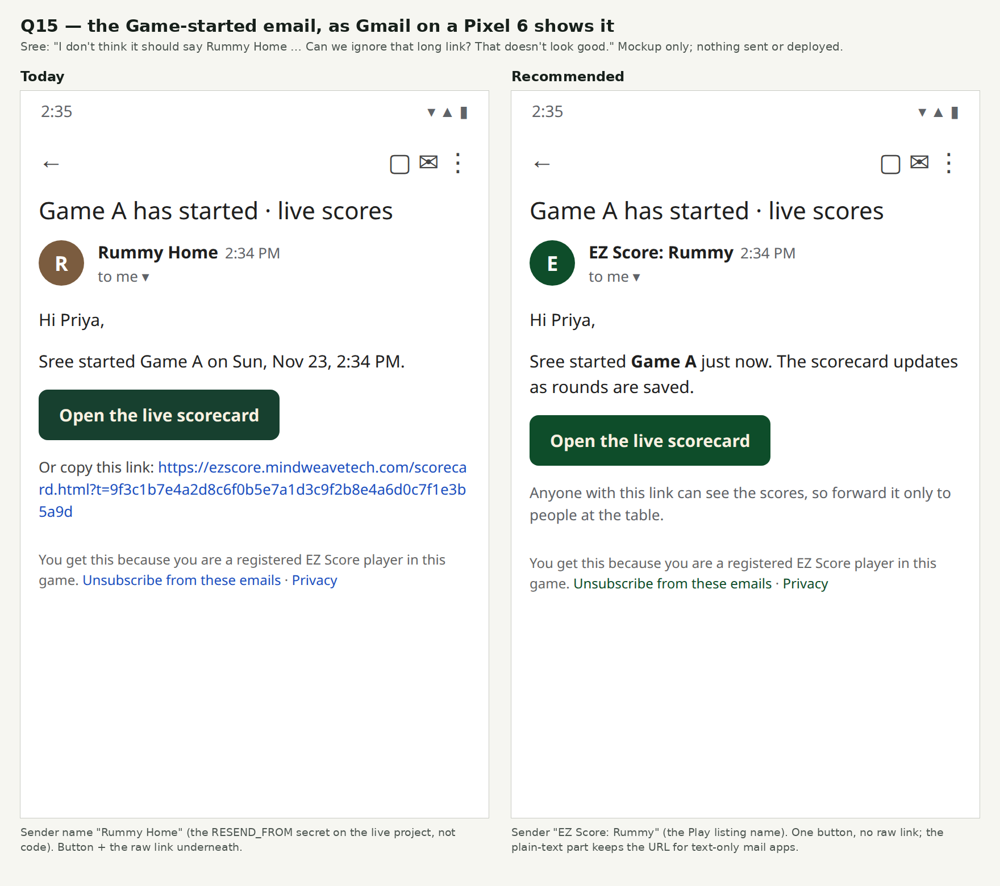

# How we work: one page for Sree and Build Bot

*Last updated Nov 23, 2026, 9:45 PM PT.* This is the plain-words version of the rules in `AGENTS.md` and
`decisions.md`. If this page and `AGENTS.md` ever disagree, `AGENTS.md` wins, and the builder fixes this page.

---

## 1. What Sree needs to do now (in order)

1. **Add the two repo secrets** (about 10 minutes, on a computer). Exact steps in [section 5](#5-the-two-repo-secrets-step-by-step).
   Until then, changes to the share site (the pages people open from a shared link) are not published.
2. **Look at the Size S pictures** in [section 6](#6-see-it-before-you-say-yes) and tell Build Bot
   **"merge #120"**, or what to change.
3. **Look at the new e-mail** in [section 6](#6-see-it-before-you-say-yes) and tell Build Bot **"yes, switch the e-mails"**
   or what to change. Build Bot merges #122 by itself; until you say yes, users keep getting today's e-mails,
   because switching the live sender name and redeploying the e-mail function is something users see.

Already done, nothing to do: **trader status** in Play Console ("not a trader"). Sree set it long ago; our list
was out of date.

---

## 2. Who is who, and where to talk

| Who | What they do |
| --- | --- |
| **Sree** | Decides. Says yes or no. |
| **Build Bot** (Grok, on the phone) | **The one place Sree talks.** Passes Sree's words to the builders exactly as said, adds nothing (D08). Does the merges, builds and live changes Sree said yes to, and the pre-approved merges (D80). Shows Sree the pictures and PRs. |
| **App builder** (Claude in Cursor) | Screens, e-mails, staging database: #120, #122, #129. |
| **Process builder** (Claude in Cursor) | How we work, CI, share-site publishing: #127, this page. |

**Cursor or Grok?** Talk in Build Bot; it works on the phone. Open Cursor only to look at something more
closely on a computer. If Sree does decide something in Cursor, the builder writes it into `decisions.md` and
`next-up.md` in the same turn, so Build Bot sees it there. Either way nothing is lost, but one decision should be
said in one place.

**Where things are written down** (the shared memory both bots read):

| File | What it says |
| --- | --- |
| this page | the rules, and who does what |
| [`next-up.md`](next-up.md) | its first five lines: what needs Sree today, what shipped, what is in progress; below that, the ordered list |
| [`decisions.md`](decisions.md) | everything Sree decided (D-numbers) and the open questions (Q-numbers) |
| a PR | one feature; it opens with five lines "For Sree": decide · a user will notice · try it · risk · after merge |

**How a message travels:** Sree → Build Bot (word for word) → builder → a PR or a commit, plus `next-up.md`
updated → Build Bot reads the top of `next-up.md` on `main` and tells Sree. Before answering "what's the status",
Build Bot reads this page and the first five lines of `next-up.md`.

---

## 3. The rules

### Happens without asking Sree

- Builders open and update PRs, run CI, and write specs, mockups and tests.
- **Staging** (the test copy of the database, `ezscore-staging`): seed it, wipe it, and apply migrations to it
  after the local database tests pass (D79). It stays on Supabase's free plan, at half size (D86).
- Builders close or combine their own outdated PRs (D79).
- **Build Bot merges a PR without asking** (Sree, Nov 23: "Yes, merge qualifying green PRs without asking me") when **all** of these are true (D80):
  CI is green · no migration for the live database · nothing changes under `public/` (the share site) ·
  it is docs / tests / CI only, **or** it builds a design Sree approved (named by its D-number) with its screenshots.
- The share site publishes itself after each merge that changes it, once the two secrets are in (D83).

### Needs Sree's yes, every time

- Merging anything that changes the **share site pages** (`public/`): it goes live at once (D80, D83).
- Merging a PR that changes **these rules** (`AGENTS.md`, `.cursor/rules/`) (D80).
- Applying a migration to the **live** database (D44).
- Building **any APK** (staging or production) or uploading to Play (D44, D79).
- Changing a **live setting users see**, such as the e-mail sender name (D79: "anything users see").
- Closing Sree's issues.

A yes counts only for that exact action. "Go ahead" on a different question, or silence, is not a yes.

### How the work is done

- **At most three open PRs** (D81). A *parked* PR stays open for discussion, gets no code and does not count:
  #112 iPhone (until Apple enrolment), #124 WhatsApp sign-in (until the Android app is approved).
- **Small fixes are collected** into one batch PR, not one PR each.
- **Show, then build:** a mockup before code for anything on a screen.
- **Every UI PR** has screenshots (D45) and, on its CI run, a video of the flows it changed (D82).
- **A bug is fixed** only when a test proves it, and for the share site when the live page is checked (D83).
- **Keep it simple** (D50). **v1 is cut** (D84): Telugu, phone / WhatsApp sign-in and extra tutorials come
  after the app is live in Play.
- `main` is the product; every PR starts from it (D43). The full test suite runs on `main` every night (D07).

---

## 4. Everything open, and what each needs from Sree

| Item | What it is | Needs from Sree |
| --- | --- | --- |
| Two repo secrets | lets the share site publish itself | **add them** ([section 5](#5-the-two-repo-secrets-step-by-step)) |
| [#120](https://github.com/sreeatcandorps/RummyHome/pull/120) Size S redesign | Profile, Settings, Game type and Sign in as tidy grouped lists in the darker green, with the new Joker card on Sign in; the share pages turn the same green. CI green. | **look ([section 6](#6-see-it-before-you-say-yes)), then "merge #120"** or changes. After that, a staging APK on your "build staging". |
| [#122](https://github.com/sreeatcandorps/RummyHome/pull/122) e-mails | sender "EZ Score: Rummy", one green button, no long link (D73). CI green. | nothing to merge: Build Bot merges it under D80 (Nov 23). **"yes, switch the e-mails"** for the live part: the `RESEND_FROM` secret and redeploying `send-email` |
| [#129](https://github.com/sreeatcandorps/RummyHome/pull/129) docs | design review 2 documents and mockups, staging notes | nothing; merges by itself once it is rebased and green |
| [#112](https://github.com/sreeatcandorps/RummyHome/pull/112) iPhone | parked | nothing until Apple enrolment (needs the Candor PS D-U-N-S number) |
| [#124](https://github.com/sreeatcandorps/RummyHome/pull/124) WhatsApp sign-in | parked | nothing until the Android app is approved |
| Google Play review | the Android app | nothing; waiting on Google (trader status already done) |
| Next batch (after #122) | keyboard fix, Delete dialog, Order of players arrows, Q16 sign-up code, Q17–Q19 | one question at a time, each with a recommended answer, after the three steps above |
| Older questions Q3, Q5, Q9, Q10 | small design questions | nothing now; each has a default in `decisions.md` |

---

## 5. The two repo secrets, step by step

Do this on a computer; the GitHub phone app cannot add secrets. Never paste either value into a chat.

**Secret 1: `CLOUDFLARE_API_TOKEN`** (lets GitHub publish the share site)

1. Open <https://dash.cloudflare.com/profile/api-tokens> and sign in as **Sree@candorps.com** (the account with
   `ezscore.mindweavetech.com`).
2. Click **Create Token**.
3. Next to **Edit Cloudflare Workers**, click **Use template**.
4. **Account Resources:** Include → *Sree@candorps.com's Account*.
   **Zone Resources:** Include → Specific zone → *mindweavetech.com*.
5. Leave everything else as it is. Click **Continue to summary**, then **Create Token**.
6. **Copy the token now**; Cloudflare shows it only once.

**Secret 2: `SITE_SUPABASE_ANON_KEY`** (the public key the app and the share pages already use)

1. Open <https://supabase.com/dashboard/project/gngcrplcldfiubvhcdin/settings/api-keys> (the live EZ Score
   project, id `gngcrplcldfiubvhcdin`).
2. Open the **Legacy API Keys** tab. The key the app uses starts with `eyJ`.
3. Copy the **anon** key, marked *public*. **Not** `service_role`: that one is secret and goes nowhere.

**Add both to GitHub**

1. Open <https://github.com/sreeatcandorps/RummyHome/settings/secrets/actions>.
2. **New repository secret** → Name `CLOUDFLARE_API_TOKEN` → paste the Cloudflare token → **Add secret**.
3. **New repository secret** → Name `SITE_SUPABASE_ANON_KEY` → paste the anon key → **Add secret**.

**Check it works**

1. Open <https://github.com/sreeatcandorps/RummyHome/actions/workflows/publish-site.yml> → **Run workflow** →
   branch `main` → **Run workflow**. Or tell Build Bot "run Publish share site".
2. About two minutes later it is green, and its summary ends with "serves build … on all 8 pages". If it is red,
   tell Build Bot; the summary says what failed and has a one-line rollback.

---

## 6. See it before you say yes

Real screenshots from the Pixel 6 test phone in CI: on the left the app as it is today, on the right #120.

**Profile**

**Settings**

**New game → Game type**

**Sign in**

**#122: the new e-mail** (the mockup Sree approved, D73)

---

## 7. What happens after that

1. #122 and #129 (docs) merge by themselves (Build Bot, D80). The live e-mail switch waits for your yes.
2. #120 merges on your yes. The share pages turn green on their own (once the secrets are in), and a staging APK
   follows on your "build staging".
3. The app builder starts the next batch, one question at a time.
4. The process builder turns the `AGENTS.md` rules into short skills the builders load when needed
   (`next-up.md` item 16), so the rules are followed without reminders.
5. Once Google approves the Android app, the WhatsApp discussion (#124) can reopen. Once Apple enrolment is done,
   iPhone (#112) can start.
