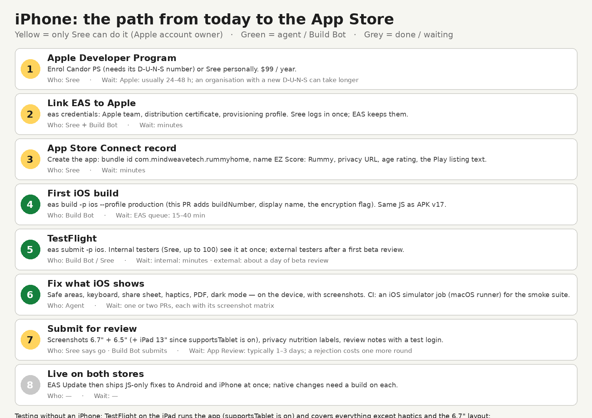

# iPhone — what it takes, step by step (Nov 21, 2026)

Sree: "What is it going to take to build the iPhone app? I want an iPhone app PR opened up … all the steps … give
me a timeline too."

Short version: **the app already runs on iOS.** It is one Expo (React Native) code base; every native module in it
(`expo-haptics`, `expo-print`, `expo-sharing`, `react-native-view-shot`, Paper, Router, Updates) ships for iOS, and
the code has only web/Android branches that already handle iOS correctly (`KeyboardAvoidingView` `padding` on iOS,
the `LayoutAnimation` flag is Android-only, the rest is `web` checks). What is missing is **accounts and
paperwork**, one build, and a device pass. The sequence and who does what:

## The steps

| # | Step | Who | What exactly | What it waits on |
| --- | --- | --- | --- | --- |
| 1 | **Apple Developer Program** | **Sree** | [developer.apple.com/programs/enroll](https://developer.apple.com/programs/enroll/). As **Candor PS LLC** (needs the company's D-U-N-S number and someone with legal authority) or as **Sree personally** (fastest; the app is published under his name). $99 / year. The same decision as Play's "business account" (D55) — organisation is consistent; individual is faster. | Apple's enrolment check: usually 24–48 h; an organisation whose D-U-N-S is new or mismatched can take a week or more of e-mails. |
| 2 | **Link EAS to Apple** | Sree + Build Bot | `eas credentials -p ios` once, signed in with the Apple ID from step 1 (two-factor prompt on his phone). EAS creates and stores the distribution certificate and the App Store provisioning profile. Nothing is committed; the Apple password is typed once and never stored. | minutes |
| 3 | **App Store Connect record** | **Sree** (Build Bot can do it with `eas submit` the first time, but the agreements must be accepted by the account holder) | [appstoreconnect.apple.com](https://appstoreconnect.apple.com): accept the Paid/Free Apps agreement; New app → iOS, name **EZ Score: Rummy**, bundle id `com.mindweavetech.rummyhome` (already in `app.json`), SKU `ezscore-rummy`, primary language English (US). Privacy policy URL: the same `public/privacy/index.html` page Play uses. | minutes |
| 4 | **First iOS build** | Build Bot (on Sree's yes) | `eas build -p ios --profile production` — the same profile and JS as the Android AAB; `app.json` (this PR) carries `buildNumber`, the display name **EZ Score** (what fits under the icon) and `ITSAppUsesNonExemptEncryption: false` so TestFlight does not ask the export-compliance question on every upload. | EAS iOS queue: 15–40 min |
| 5 | **TestFlight** | Build Bot submits; Sree installs | `eas submit -p ios --latest`. **Internal** testers (Sree and up to 99 others on the team) see the build in the TestFlight app within minutes, no review. **External** testers (a public link, up to 10,000) need a first "beta app review". Sree installs TestFlight on the iPad and gets the build there. | internal: minutes · external: about a day |
| 6 | **Fix what iOS shows** | Agent | The iOS-specific pass, from screenshots on the device: safe areas (notch / home indicator — the bottom bars and toasts), keyboard over the passcode and initials fields, the share sheet (final scores picture, PDF — both go through the iOS share sheet, which behaves differently from Android's), haptics on the real last tap, dark mode, Dynamic Type at the largest sizes, iPad layout (two columns of nothing if we are not careful — `supportsTablet` is on, so the iPad version is reviewed too). Each fix a PR with its screenshot matrix (iOS column added). CI gets an iOS simulator job (GitHub `macos-14` runner, Maestro supports the iOS simulator) for the smoke suite — macOS minutes cost 10× Linux minutes, so it runs nightly, not per push. | one or two PRs; the device pass needs a phone or the iPad for an afternoon |
| 7 | **Submit for review** | Sree says go; Build Bot submits | App Store Connect needs: screenshots at 6.7" (1290 × 2796) and 6.5" (1284 × 2778), plus 13" iPad (2064 × 2752) because of `supportsTablet`; the privacy "nutrition labels" (we collect e-mail, name, optional phone/zip, linked to the user, no tracking — the same facts as Play's Data safety); age rating (the questionnaire; a scorekeeper is 4+ — it is not gambling: no money changes hands in the app); review notes with a test login (a seeded tester account, like `sree@test.local` on a hosted test project — see `docs/test-environment-plan.md`). `eas submit` uploads; Sree presses *Submit for review*. | App Review: typically 1–3 days; a rejection (most common: a reviewer cannot sign in, or a "4.2 minimum functionality" note) costs one more round |
| 8 | **Live on both stores** | — | From then on **EAS Update** ships JS-only fixes to Android and iPhone in one command; anything native (a new Expo module, an SDK bump) is a build on each store. | — |

## Timeline, honestly

The agent's part (steps 4, 6, the CI job) is small and is not what sets the date. The date is set by three waits that
are Apple's, in sequence: **enrolment** (1–2 days as an individual; up to a couple of weeks as an organisation with
D-U-N-S trouble) → **external TestFlight review** (about a day; skip it by testing internally) → **App Review** (1–3
days, plus a day per rejection). With an individual enrolment and internal TestFlight only, the first build is on
Sree's iPad within two days of step 1, and the app can be in App Review inside the same week as the iOS device pass.
Enrol as an organisation and add the D-U-N-S wait up front.

**Recommendation:** enrol **now** (step 1 is the long pole and costs nothing but the $99 and a form), as whichever
of individual / organisation Sree wants on the store page — it can be moved to an organisation later, but that is a
support ticket. Everything after it is one build command, one or two PRs and a CI job — none of it is on the critical path.

## Testing without an iPhone

- **iPad + TestFlight** — the app installs on the iPad as an iPad app (`supportsTablet: true`). Covers sign-in,
  games, sharing, PDF, dark mode; does not cover the phone-width layout, the notch, or haptics (iPads have none).
  Good enough for steps 5–6's first pass.
- **A borrowed or second-hand iPhone** for one afternoon at step 6 — an iPhone 11 or newer runs iOS 17/18, which is
  what TestFlight needs. Any model with a notch exercises the safe-area work.
- **Simulator in the browser** — `eas build -p ios --profile preview` with `"simulator": true` produces a `.app`
  that [Appetize.io](https://appetize.io) runs in a browser tab (free tier: minutes per month, enough for layout
  checks). No Mac needed. Useful for the agent to look at iPhone-width layouts before a device exists.
- **The CI simulator job** (step 6) is the durable answer: every nightly, the smoke suite on an iPhone 15 simulator
  with screenshots in the same gallery as the Android devices.

## Cost

| Item | Cost |
| --- | --- |
| Apple Developer Program | $99 / year |
| EAS iOS builds | the same EAS plan as Android; each iOS build uses one build credit / the same queue |
| GitHub macOS runner minutes for the CI simulator job | 10× Linux minutes; a nightly smoke run (~45 min) ≈ 450 Linux-minute equivalents per night — fine on a paid plan, tight on free; the job is nightly for that reason |
| A second-hand iPhone 11 | optional, ~$150–250 |

## What this PR changes in code

`app.json` → `ios`: `buildNumber: "1"`, `infoPlist.ITSAppUsesNonExemptEncryption: false` (no custom crypto —
Supabase over HTTPS is exempt), `infoPlist.CFBundleDisplayName: "EZ Score"` (the full name does not fit under an
iOS icon; Android already truncates to the same). Nothing Android reads changed; the APK and AAB builds are
unaffected. No `eas.json` change: the `submit.production.ios` block (Apple team id, App Store Connect app id) is
filled after steps 1 and 3, when the ids exist.

## Open questions for Sree

| # | Question | Recommended |
| --- | --- | --- |
| 1 | Enrol as **Candor PS LLC** (matches Play, needs D-U-N-S) or **Sree** (fast)? | Sree now if the D-U-N-S is not at hand; it is the long pole |
| 2 | iPad: keep `supportsTablet` (iPad screenshots and review, a real iPad layout pass) or iPhone-only for v1? | keep — Sree owns an iPad and will test on it; the pass is small |
| 3 | TestFlight external link for friends, or internal only until the store? | internal until App Review passes |
