# Multiplier — design mockups M01–M22 (PR 14, review set, revised Nov 15 after Sree's Nov 14 8:58 PM PT answers)

Flat copy of the generated set, embedded in [`../multiplier-design.md`](../multiplier-design.md) section 4. 390 dp, light theme,
same style as the Pool set; each PNG has a caption strip. Sample games: S14 (4 players, ×2), S15 (7 players, ×100; also ×10 → ×5
in M22), S16 (20 players, 14 rounds, ×10,000; Full count 80). The generator lives outside the repo.

Revision notes: no lock anywhere (M01, M03, M04); the ×N chip carries an ⓘ; one K/M rule on every grid (M09–M11, M14, M19, M20);
new M21 (how the exact number is reached) and M22 (changing the multiplier mid-game).

## M01

## M02

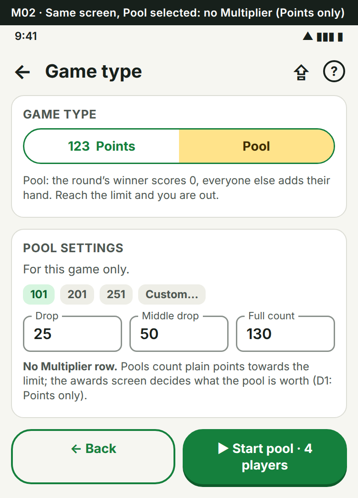

## M03

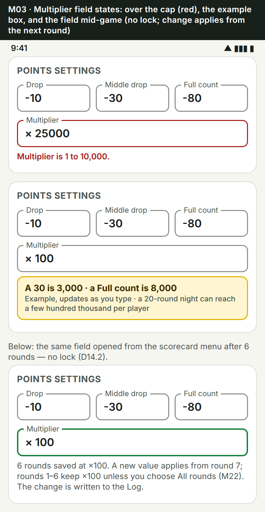

## M04

## M05

## M06

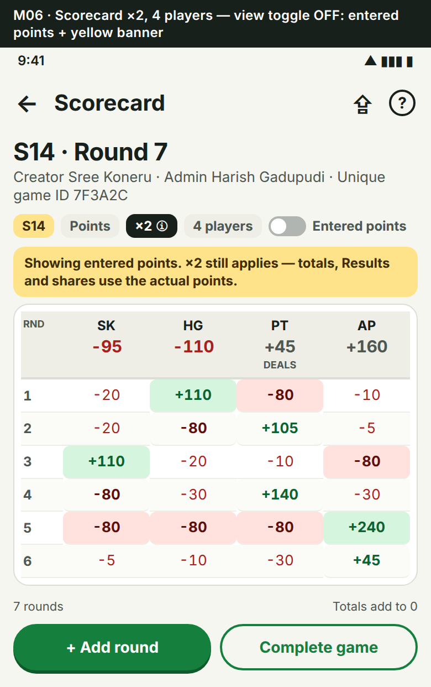

## M07

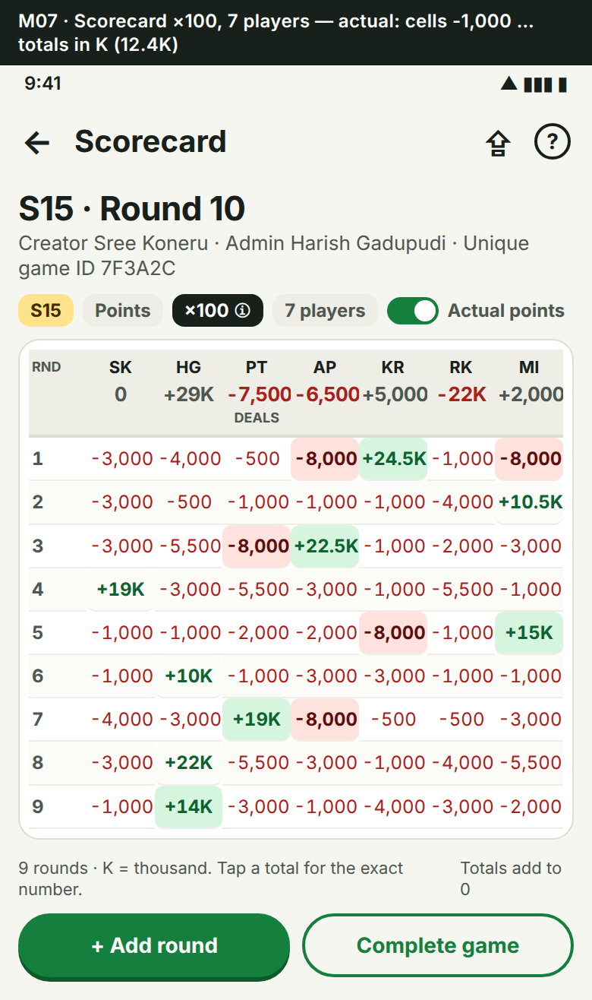

## M08

## M09

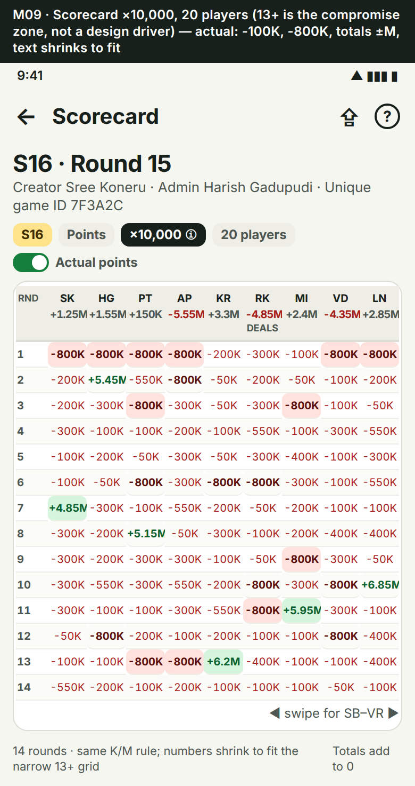

## M10

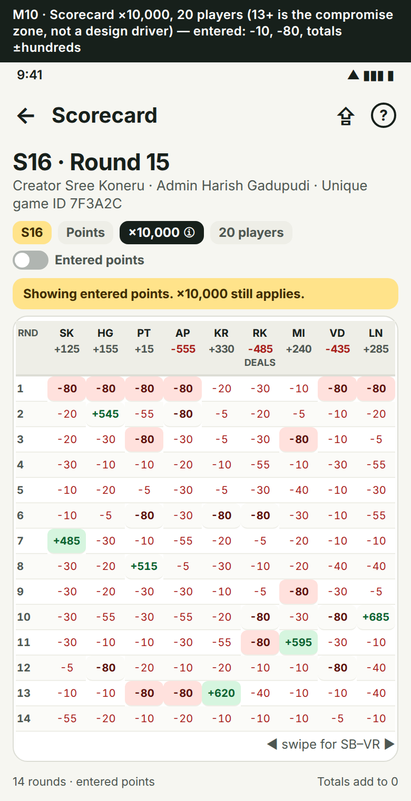

## M11

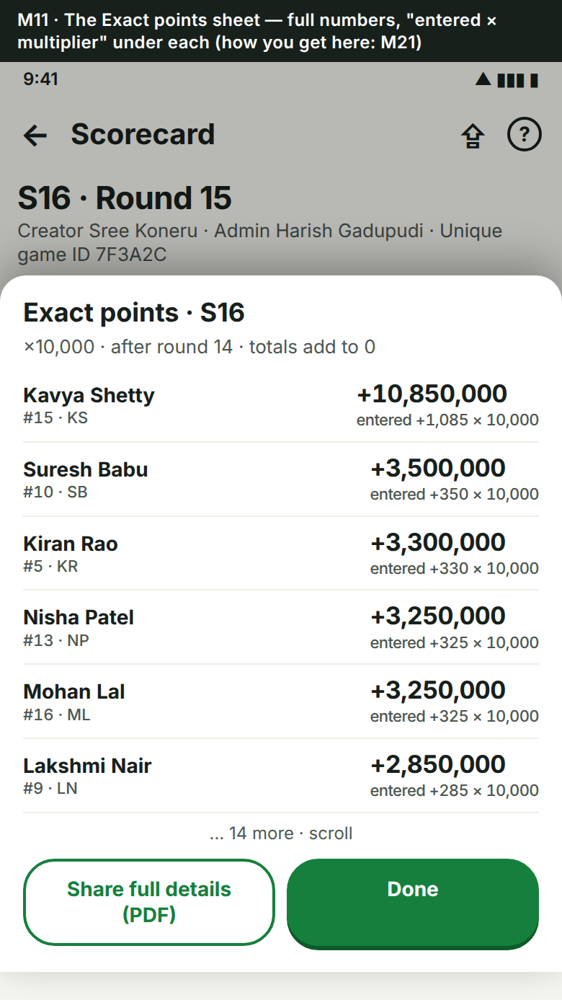

## M12

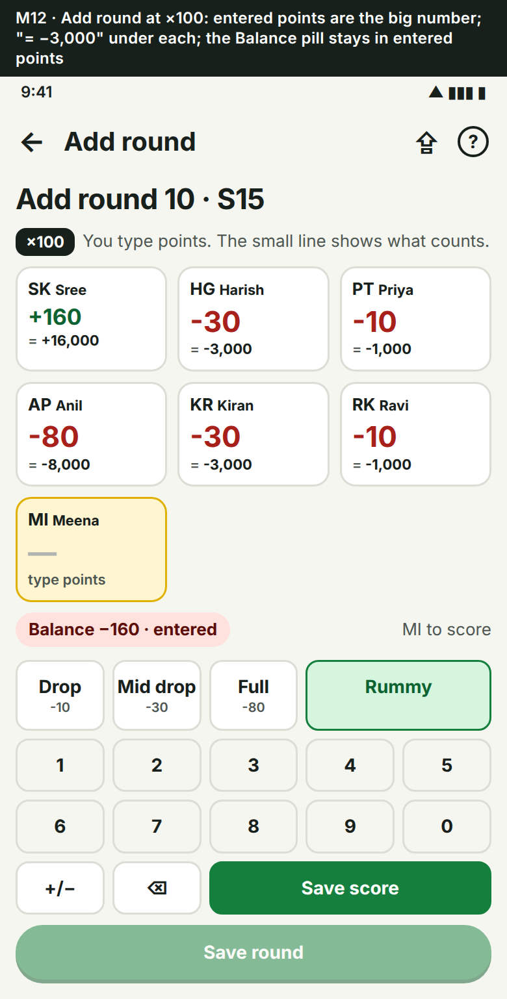

## M13

## M14

## M15

## M16

## M17

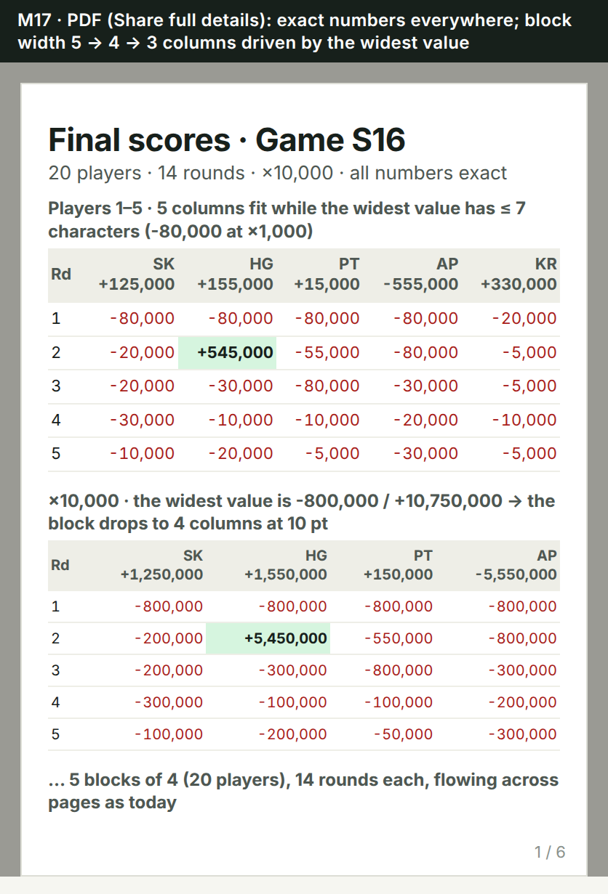

## M18

## M19

## M20

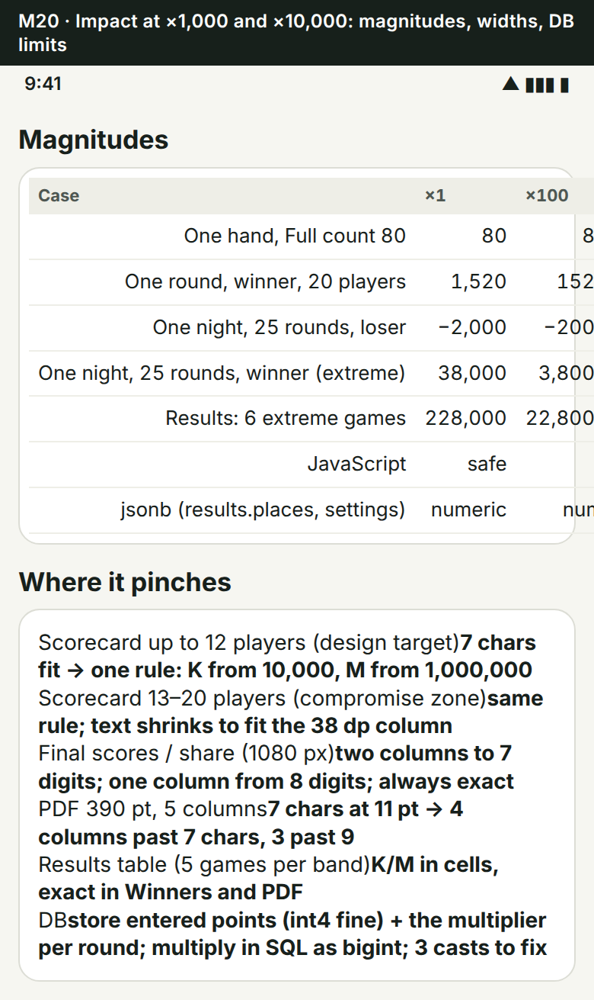

## M21

## M22

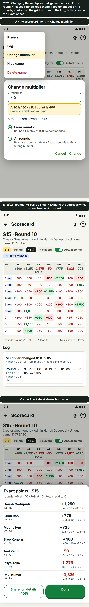
