# Multiplier — design mockups M01–M22 (PR 14, review set, revised Nov 15 to Sree's FINAL 12:35 AM PT answer)

Flat copy of the generated set, embedded in [`../multiplier-design.md`](../multiplier-design.md) section 4. 390 dp, light theme,
same style as the Pool set; each PNG has a caption strip. Sample games: S14 (4 players, ×2), S15 (7 players, ×100), S16 (20 players,
14 rounds, ×10,000; Full count 80). The generator lives outside the repo.

Revision notes (Nov 15 12:35 AM PT, final): the multiplier defaults to ×1 and is prefilled — the creator never has to pick it (M01). It can be
changed at any time from Game settings, and a change always applies to the whole game, every round from round 1 — M03 shows the field editable
mid-game, M22 the confirm when rounds exist ("3 rounds already played …" — Apply to whole game / Start a new game instead / Cancel), the
re-priced card and the one settings_changed Log line. The earlier lock + "end this game and start a new one" hint (M03, M11, M21) is gone; so is
the per-round / "from round N" M22 of Nov 14. One K/M rule on every grid, no 13+ special case: no value is longer than 5 characters
including the sign (M09, M10, M19).

## M01

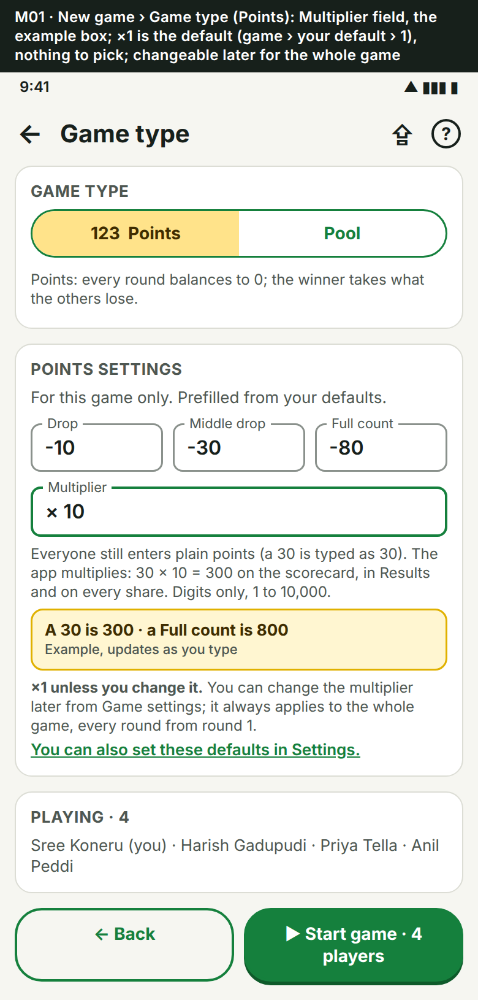

## M02

## M03

## M04

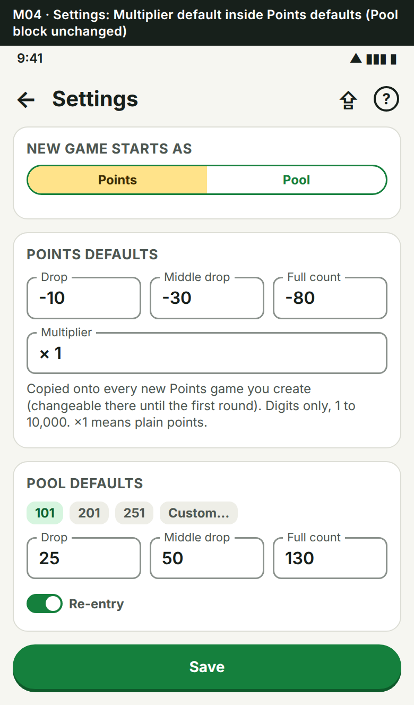

## M05

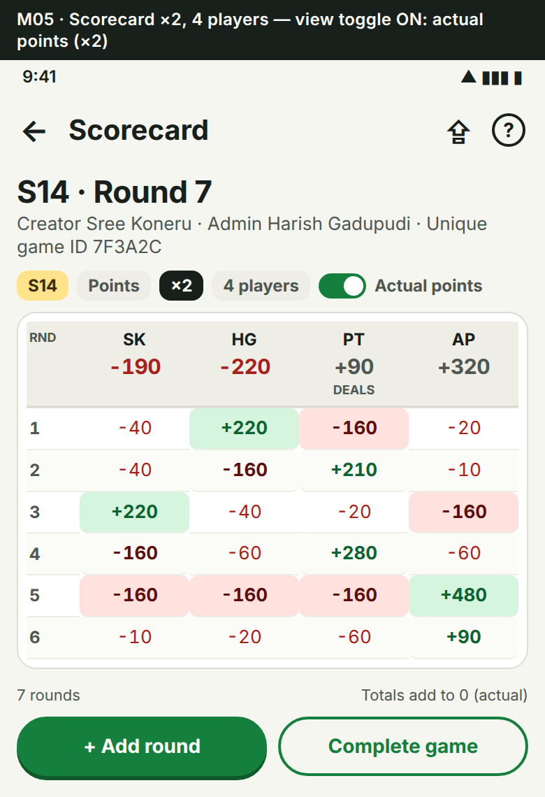

## M06

## M07

## M08

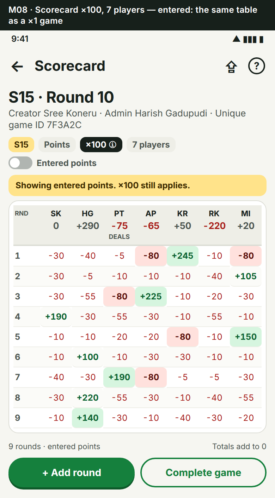

## M09

## M10

## M11

## M12

## M13

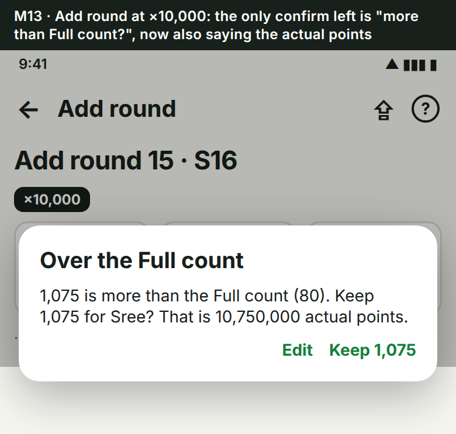

## M14

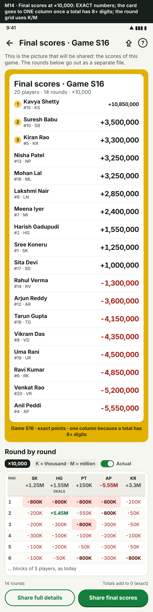

## M15

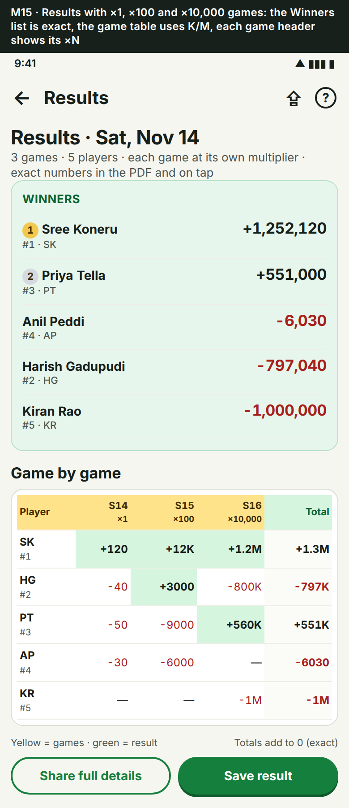

## M16

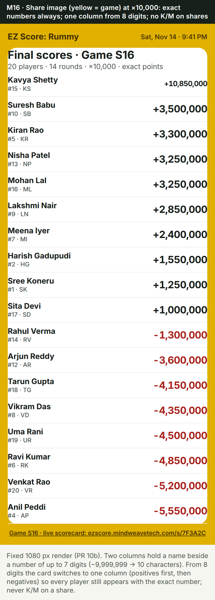

## M17

## M18

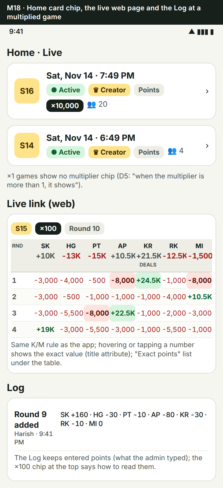

## M19

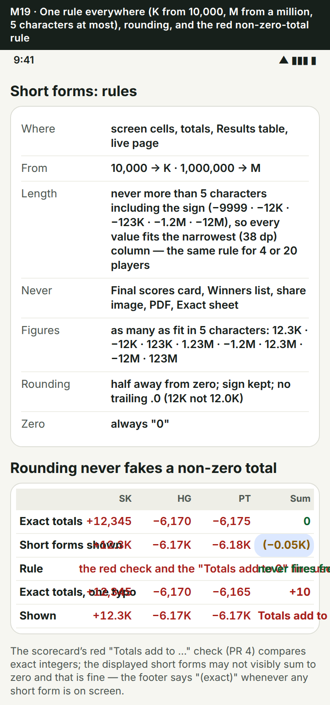

## M20

## M21

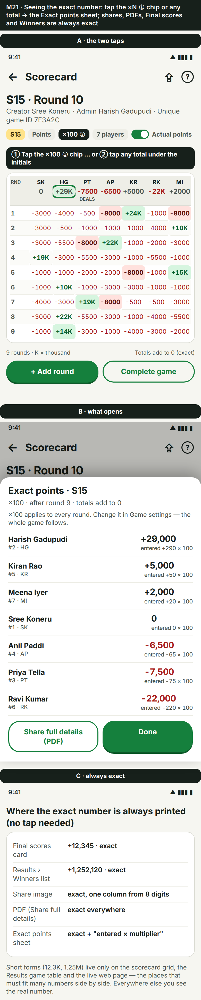

## M22

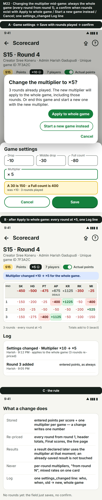
