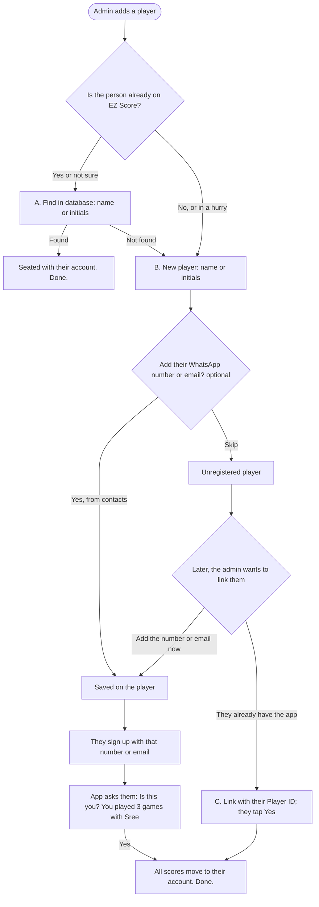

# Adding and linking players — revised workflow (proposal, not built)

**Read "Revised Nov 25" first — approved by Sree Nov 25 (D113).** §0–§6 are the Nov 24 proposal; its phone / email matching (§3 B) is replaced.

Written Nov 24 for Sree to go through. Nothing here is built, and nothing changes in the app until he says which parts
he wants.

> Sree, Nov 24: "I feel like that player number is confusing … I don't want to confuse them by asking for anything too
> much before they sign in, so I don't want to ask for a player number … the admin should be the one just linking up
> these new players. Either they find them in the database, or they'll just create new players … and that's how
> they're linked … his scores are always there. That is super important … a little tutorial right there in the My
> Players section … inviting someone to the app, I think I want to keep them separate … If that user uses that link to
> download and then actually log in, will there be context to remember? … think about those who use WhatsApp and those
> who use email."

## Revised Nov 25: one way, the Player ID (replaces §3's phone / email matching)

> Sree, Nov 25: "we don't want to reveal other people's names when you type in a name … find people in the database
> only by their player number and nothing else … You have to type in the player number and then say 'search' … if
> someone's in a hurry, just do the initials … The more I think about it, the more it feels like we should force them
> to download the app, and then they just give you the new player ID … what if he gives you a wrong player ID … you
> got to also think of players in India, so you can't make it too techy … I don't want to offer three different
> options."

Picture (opens on a phone):
[`linking-player-id.png`](https://raw.githubusercontent.com/sreeatcandorps/RummyHome/cursor/linking-one-way-f877/rummy-home3/docs/design-review-2/mockups/linking-player-id.png).

**Recommendation: one way to find someone, their Player ID, and initials for everyone else.**

1. **They have the app** → ask "what's your Player ID?" (it is on their Profile), type the number, tap **Search**,
   check the name that comes back, **Add to game**. Their scores go to their account from round 1; nothing to link.
2. **No app, or in a hurry** → **Add by initials** (D112) and play. When they get the app, they tell you their Player
   ID; the player's ⋮ › **Link to Player ID**; they get a request and tap **Yes**; the old games move to them.

No name search, no phone numbers, no emails, no contacts, no sign-up links. **Sree's instinct is right**, and the
phone / email matching this page proposed on Nov 24 (§3 B) is dropped: it is the most work (contacts permission, a
migration, two matching paths, WhatsApp sign-in not built yet) for the least common case.

### Where each piece stands today

| Piece | Today | After this |
| --- | --- | --- |
| Find in database by **name or initials** | **Built and live.** Two letters list up to 20 people from the whole database (`search_players`, migration 012). This is the privacy hole Sree spotted. | **Removed** — on the server, not just the screen, so the API cannot list names either. |
| Find by **Player ID** (`#57`) | **Built** in the same box (exact number). | The only search. Number keypad, a **Search** button, nothing shown while typing. |
| Find by full **email** | **Built** (exact address). It tells anyone whether an address has an account. | **Removed** (same reason as names). |
| **Add by initials** | **Built**; the faster version is approved (D112, small batch 3). | Unchanged. |
| **Link to Player ID** + email + Home card + **Yes / Not me** | **Built** (migration 025): the admin sees whose number it is and how many games move; the person must say Yes; requests expire in 7 days. | Unchanged — it becomes the one way to link. |
| Player ID on **Profile** | **Built.** | Unchanged (number only, D103). |
| A phone, WhatsApp number or email **saved on a player**; pick from **contacts** | **Not built** — only proposed on Nov 24 (§3 B). | **Not built.** Dropped. |
| **WhatsApp sign-in** | Planned, parked until the Play review passes (#124, D84). | Unchanged. It changes how people *sign in*, not how they are found. |
| Shared **sign-up link** (old way A) | Built; retiring (D106). | Retires with this. |
| **Player ID box on Create account** (old way C) | Built; coming off (D105). | Gone. |

On "WhatsApp is just a phone number": yes. WhatsApp sign-in is a code sent to the person's phone number over WhatsApp;
the number is the account. It does not need to be in anyone's contacts, and it does not change this flow.

### Tested against apps people use

| App | How you add someone | What it teaches |
| --- | --- | --- |
| **GPay / PhonePe / Paytm (UPI)** | Type a UPI ID or number; the app shows the account holder's name ("RAVI KUMAR") before you pay. | Every Indian phone user knows "type the ID, check the name, then confirm". That is screens 1–2. |
| **Free Fire / BGMI / Ludo King** | Add a friend by their numeric player ID (UID) or a room code. | Asking a friend for their game ID is normal in India, young and old. |
| **Dream11 / MPL** | Join a private contest by a code a friend sends. | Codes over WhatsApp work; nobody browses a directory. |
| **WhatsApp groups** | From contacts, or an invite link. | Needs the contacts permission and a phone number as identity; heavier than a game scorer needs. |
| **Splitwise** | Add by email or phone; matched when that person signs up. | Works, but makes duplicate accounts when they sign up with another email or number, and needs contacts. This was the Nov 24 proposal. |
| **Venmo** | Search people by name. | The counter-example: public name search is how Venmo became a privacy story. |
| **Score-keeping apps** (Scorekeeper, Score Counter) | Type names; no accounts. | = our initials path. Fine for a quick game. |

### The awkward cases

| Case | What happens |
| --- | --- |
| **Wrong Player ID** | Two checks. The admin sees the name ("#57 · Ravi K.") or "No one has #58" before anything happens. When linking old games, the person must also tap **Yes**; "Not me" cancels. If a wrong person is added to a new game, the admin removes the seat (a seat with no scores is free to remove), and the other person can hide the game. |
| **Privacy** | Names are never searched. Only an exact number shows one name, shortened to first name + last initial ("Ravi K."), so typing random numbers gives nothing useful. |
| **They don't know their Player ID** | It is on Profile; the invite message and the Help page say so. |
| **No app and never getting it** | They stay as initials, and the admin's scores for them are kept forever. |
| **They get the app months later** | Link to Player ID from the player's ⋮; every old game moves when they say Yes. |
| **Two admins seated the same person by initials** | Each admin sends a link request; the person says Yes to each. |

### What would change (when Sree says build)

1. **Find on EZ Score** screen: Player ID only, number keypad, **Search** button, one result card with the name shortened
   ("Ravi K."), **Add to game**. Replaces today's name / initials / email list.
2. **Server**: `search_players` answers only an exact Player ID (one migration; names, initials and emails return
   nothing).
3. **Invite to EZ Score** message (D106): "I keep our rummy scores in EZ Score. Get it here: … then send me your Player
   ID (it's on your Profile)."
4. **The "how to add players" card** (D108, low priority) has two lines: "Has the app? Ask for their Player ID." / "No
   app? Add their initials; link them later with their Player ID."
5. The sign-up link retires (D106) and the Player ID box comes off Create account (D105, already planned).

Not built: phone / email on a player, contacts, install-referrer (D107).

## 0. The short version

- **Today the app has three different ways to link a player, and two of them need a player number.** That is the
  confusing part, and Sree is right to want it gone from sign-up (§1).
- **Recommendation: the admin does all the linking, and the new person types nothing extra.** When the admin creates a
  player, they can add that person's **WhatsApp number or email** (one optional line, picked from the phone's
  contacts). When that person later signs up with the same number or email, the app asks them one question —
  *"Is this you? You played 3 games with Sree"* — and Yes brings every score across. No player number, no link to
  keep, nothing to remember through the download (§3).
- **The player number stays, but only as the admin's fallback**: if the admin has no number or email for someone who
  already has the app, they ask for the person's Player ID and link them with it, and the person says Yes (§3, way C).
- **Inviting stays separate from linking**, as Sree wants: *Invite* just sends the download link on WhatsApp or by
  email. It carries no secret and does not link anyone (§4).
- **Will a link "remember" through the download?** Today, no: the person has to tap the link a second time after
  installing. On Android it can be made to remember; on iPhone it cannot be done reliably without a paid service. That
  is one more reason to match on the number or email instead (§5).
- **Separate small PR, proposed**: take the optional *Player ID* box off Create account (§7). It can ship before the
  rest.

## 1. What the app does today

| Way | Who does what | Needs a player number? | What goes wrong |
| --- | --- | --- | --- |
| **Find in database** | The admin searches by name, initials or #ID while adding players, and seats the registered person directly. | Only if the name search doesn't find them. | Works. Nothing to link later. |
| **New player** | The admin types initials or a name; an unregistered player is made on the spot. | No. | Fast, but the scores sit on a player with no account until someone links them. |
| **Link later, A — share a sign-up link** | The admin opens the player's ⋮ › Share link and sends it. The person opens it, signs up, and is asked "Is this you?". | No. | If the app isn't installed yet, the link is lost during the download; the web page says *"Install the app first, then come back and tap it."* Most people won't. |
| **Link later, B — Link to Player ID** | The admin asks the person for their #number (Profile), types it in ⋮ › Link to Player ID; the person gets an e-mail and a Home card and taps Yes. | Yes, the person's. | Works, but the admin has to ask, and the person has to find their number. |
| **Link later, C — Player ID at sign-up** | The admin tells the new person "you are #57"; the person types 57 in the optional *Player ID* box on Create account; the admin then approves a card on their Home. | Yes, the seat's. | The confusing one: a box on the very first screen asking for a number most people never got, plus an approval card on the admin's Home. |

The scores are never lost in any of these: an unregistered player keeps its seats and scores until it is linked.

## 2. What similar apps do

| App | Adding someone who isn't signed up | How they get their history |
| --- | --- | --- |
| **Splitwise** | Add a friend by name with an email or phone number. | When that person signs up with the same email or phone, the shared expenses are already there. No codes. |
| **Tricount / Settle Up** | Add names to the group. | Share the group link; the newcomer opens it and picks *"Which one are you?"* from the names. |
| **WhatsApp groups** | Add from contacts, or share an invite link. | The phone number *is* the identity, so there is nothing to link. |
| **Venmo / Cash App** | Pick from contacts. | Matched on the phone number or email at sign-up. |

The common pattern: **the person who is already in the app does the work, using a contact detail they already have**,
and the newcomer confirms once. Nobody types a number they were given. This is what §3 does.

## 3. The proposed workflow

**A. Find in database** (unchanged). Search by name or initials first; #ID still works in the same box for people who
know it. Found → seated with their account, nothing to link later.

**B. New player** (one optional line added). Name or initials as today, plus *"WhatsApp number or email (optional) —
so their scores follow them when they join"*, with a contacts button. Skip is the default. The admin can add it later
from the player's ⋮ menu.

- **WhatsApp users**: the number is what an Indian admin has for everyone; picking from contacts means no typing. When
  WhatsApp sign-in exists (#124), the person signs up with that number and the question appears at once.
- **Email users**: the same with the email, and it works with today's email sign-up. The server did this once already:
  migration 011 matched an admin's saved email to a confirmed sign-up, and 012 replaced it with the sign-up link (way A)
  — so this is mostly bringing that back, with phone numbers added.
- **Before WhatsApp sign-in exists**, a saved phone number can't match anyone yet (nobody signs in with a phone). It is
  kept, and starts matching the day WhatsApp sign-in ships. The admin can still use way C meanwhile.

**C. Link with their Player ID** (the fallback, unchanged). From the player's ⋮: *Link to someone on EZ Score*. The
admin types the person's Player ID from their Profile; the person gets a card and taps Yes. Only for people already on
the app whose number or email the admin doesn't have.

**What the new person sees**: Create account asks only for name, email (or WhatsApp number) and passcode. Straight
after, if any admin saved their number or email: one card, *"Is this you? You played 3 games with Sree"*, **Yes** /
**Not me**. Yes moves the scores (the same server step as today). Not me leaves them where they are and tells the admin.

**Why the person must still say Yes**: a typo in a number, or a recycled Indian number (they are re-issued after about
90 days of disuse), must never put someone else's scores on an account silently. One tap protects that. The admin is
never asked to approve anything in this path.

**The little tutorial in My players** (Sree: "two ways to create a player"): one card at the top of My players and in
the Add players screen, shown until dismissed, and the same text in Help:

> **Adding a player**
> 1. **Already on EZ Score?** Search their name and add them. Their scores go straight to their account.
> 2. **Not yet?** Add their name now — add their WhatsApp number or email too, and their scores will follow them when
>    they join.
>
> Already have their name but forgot the number? Tap ⋮ on the player › Add WhatsApp or email.

Two items, not three: way C lives in the ⋮ menu and in Help, not in the card, so the first thing people read stays
simple.

## 4. Inviting, kept separate

**Invite to EZ Score** is its own action (⋮ on a player, and on My players): it opens WhatsApp (or the share sheet for
email / SMS) with a short message and the Play Store link:

> "I keep our rummy scores in EZ Score. Get it here: ezscore.mindweavetech.com/get — sign up with this number and you'll
> see our games."

It carries no token and links nobody. If the admin saved the person's number or email (§3 B), signing up with it is
what links them; if not, the admin uses way C after they join. Sharing the invite twice, or forwarding it to the wrong
person, does no harm.

The old **sign-up link** (way A in §1) goes away: it mixed inviting with linking, it breaks across the download, and
anyone holding the link could claim the player. The server keeps the function so old links still open until they
expire (14 days).

## 5. "Will there be context to remember?" through the download

| Phone | Can the app know which link was tapped before it was installed? |
| --- | --- |
| **Android** | **Yes, reliably**: the Play Store passes a *referrer* from the install link to the app on first launch (Google's Install Referrer; Expo reads it with `expo-application`). |
| **iPhone** | **Not reliably.** Apple passes nothing through the App Store. Services like Branch guess by matching the phone's IP and model (paid, sometimes wrong), or the app reads the clipboard (iOS shows a "pasted from Safari" warning). |

So "tap a link, install, and it just knows" is possible on Android only. Matching on the number or email works the same
on both phones and needs no link at all, which is why §3 uses it. If Sree still wants Android's referrer as an extra,
it is a small add-on later (Q32).

## 6. What it means for the screens

| Screen | Change |
| --- | --- |
| Create account | The optional *Player ID* box goes (§7). |
| Add players · New player | One optional line: WhatsApp number or email, with a contacts button. |
| My players | The "Adding a player" card (§3) until dismissed; row tag *"Joins with +91 98…12"* when a contact is saved. |
| Player ⋮ | *Add WhatsApp or email* · *Invite to EZ Score* · *Link to someone on EZ Score* (way C). *Share sign-up link* goes. |
| Home (the new person) | One "Is this you?" card after sign-up when there is a match (today's card, shown more often). |
| Home (the admin) | The "wants to claim your player" approval card goes away once no one can type a number at sign-up. |
| Profile | Player ID stays (copy button, Q18) for way C and for support. |

Server: a `contact` column on the unregistered player's pending link (normalised `+91…` number or lower-case email),
visible only to the admin who saved it; the match runs when a confirmed email or phone arrives. One migration, written
when Sree says build. Privacy policy and Play Data safety add "phone numbers or emails of other people, entered by a
player to link scores" — the same kind of data the app already holds for emails.

## 7. Separate PR: take the Player ID box off Create account

Sree: "I want to get rid of that functionality … Can you have that as a separate PR?"

| | |
| --- | --- |
| **Goal** | Create account asks for name, email and passcode only. |
| **In scope** | Remove the optional *Player ID* field, its label and helper line, and its check from `app/(auth)/register.tsx`; stop saving `PENDING_PLAYER_NO_KEY` at sign-up (so `flushPendingPlayerNo` has nothing to send); update the Create account Help text and the `register.tsx` "Is this you?" note; flow `e2e/smoke/26-create-account-keyboard.yaml` loses step 26e; unit tests that cover the pending player number. |
| **Out of scope** | No migration (the server function stays, unused, so nothing breaks for anyone mid-sign-up). The admin's approval card stays until its last open request is answered. Linking by Player ID from My players (way C) stays. |
| **Pictures (D87)** | Create account before / after, Pixel 6 and the 360-dp phone, raw GitHub links in the PR. |
| **Done when** | Typecheck and unit tests pass, flow 26 passes on the Pixel 6 and the small phone, and the screen has no Player ID box. |
| **Who** | The app builder, after batch 2 (#131) merges, since #131 also edits Create account. |

## 8. Decisions for Sree

| Q | Question | Default if no answer |
| --- | --- | --- |
| **Q29** | Ship §7 (Player ID box off Create account) as its own PR after batch 2? | **Yes.** |
| **Q30** | Admin can save a WhatsApp number or email on a new player, and the person is matched when they sign up with it (§3 B)? | **Yes**, email matching first (works with today's sign-up); phone matching ships with WhatsApp sign-in. |
| **Q31** | Retire the shared sign-up link (way A) and keep *Invite* as a plain download message (§4)? | **Yes.** |
| **Q32** | Add Android's install referrer so an invite tapped before installing still works? | **No** for now (Android-only; §3 makes it unnecessary). |
| **Q33** | The "Adding a player" card: two items, way C only in ⋮ and Help (§3)? | **Yes.** |
