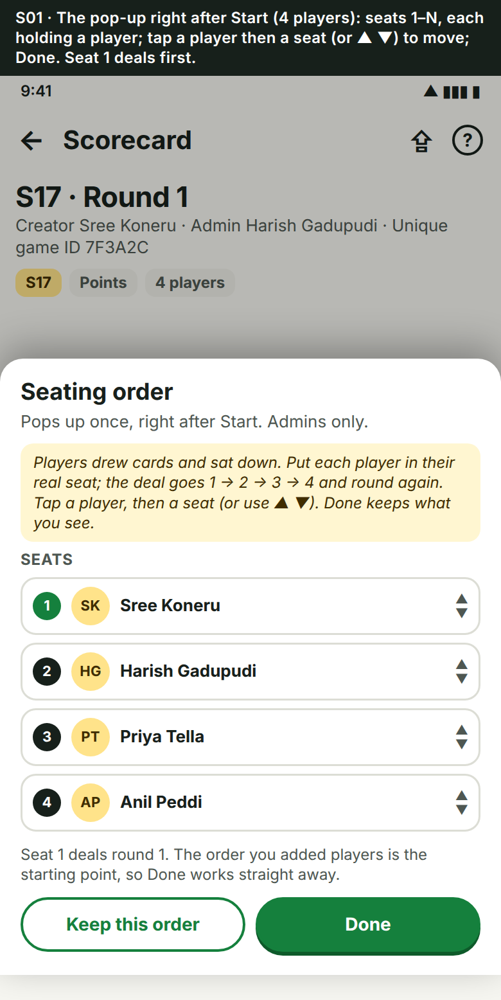
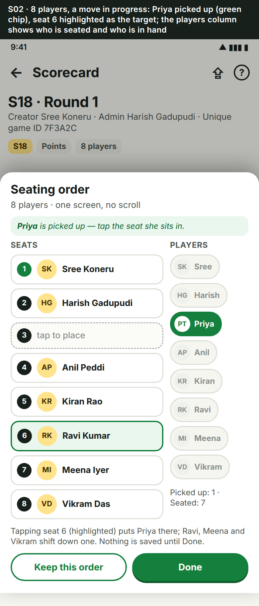
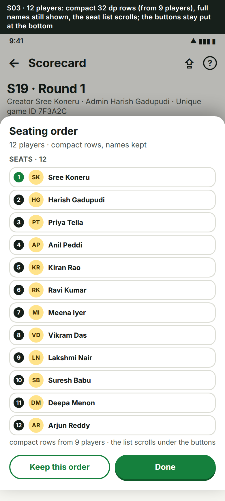
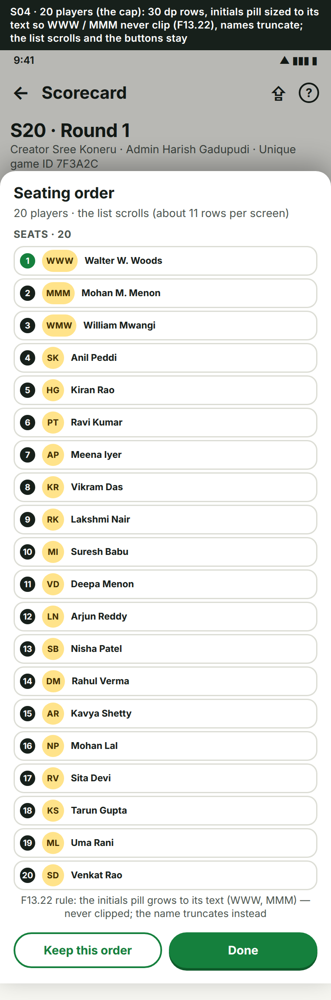
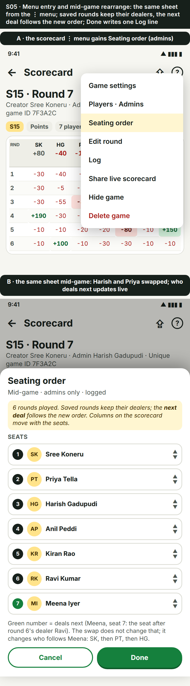
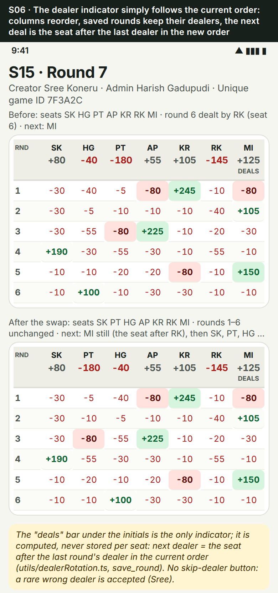
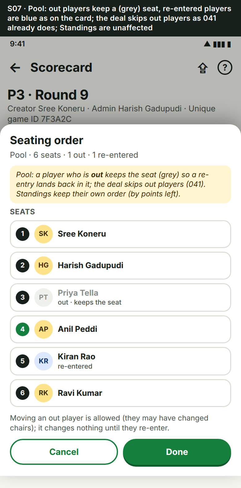
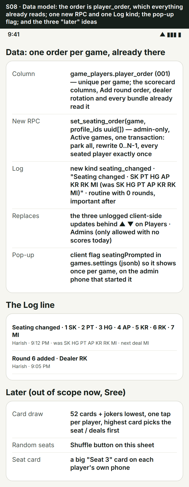

# Seating order — design mockups S01–S08 (PR 21, review set, Nov 15)

Flat copy of the generated set, embedded in [`../seating-order-design.md`](../seating-order-design.md) section 3. 390 dp, light theme, same style as the Pool / Multiplier / Going rogue sets; each PNG has a caption strip. The generator lives outside the repo.

## S01

## S02

## S03

## S04

## S05

## S06

## S07

## S08

