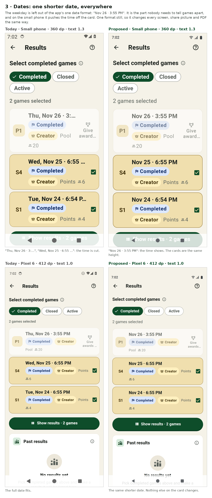
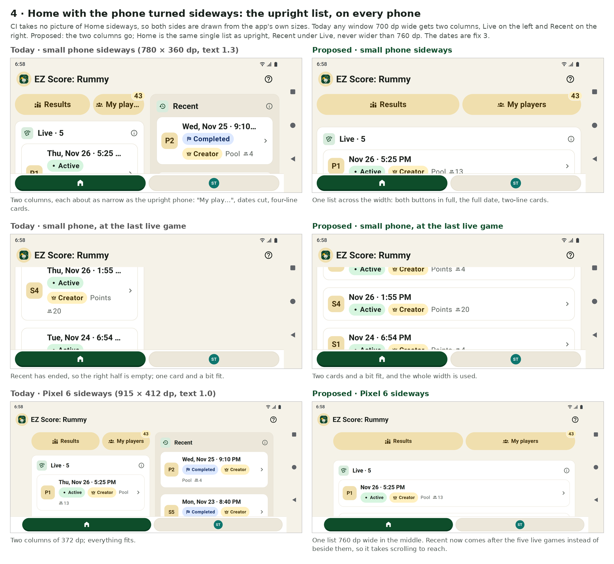

# Small phone: four fixes, one layout for every phone (redrawn Nov 28)

**For Sree.** You asked (Nov 27, 7:30 PM): *"I'm kind of worried about the small phone thing, so now we have
multiple types of code depending on the size of the phone. Are you sure it's worth it, doing all this
small-phone stuff?"*

The earlier pictures gave small phones their own layout. That idea is gone. Each fix below is **one layout
that every phone gets**, so there is no "small-phone code" at all. Two of the four actually delete code.
Each picture shows today beside the proposal, on the small test phone (large text) and on the Pixel 6,
because a change made for every phone changes both.

1. **Awards.** Each player takes two lines on every phone: the name and what they have left, then the four
   numbers underneath. Today on a small phone the name is cut to "Sre…" and "101 left · 5 drops" breaks
   into four lines. On the Pixel 6 the rows stay the same height; the numbers move under the name.
   [Picture](https://raw.githubusercontent.com/sreeatcandorps/RummyHome/main/rummy-home3/docs/small-phone-360/awards-360.png)
2. **Order of players.** The green button says **Start** instead of "Start game", on every phone (its other
   form already says "Next"). Today a small phone shows "Start g…". Nothing else on the circle changes. The
   old switch that hid the Player ID on narrow rows is no longer used by any screen since the circle, so it
   gets deleted.
   [Picture](https://raw.githubusercontent.com/sreeatcandorps/RummyHome/main/rummy-home3/docs/small-phone-360/order-360.png)
3. **Dates.** The weekday is left out of the app's one date format: "Nov 26 · 3:55 PM" instead of
   "Thu, Nov 26 · 3:55 PM", everywhere (cards, results, share pictures, PDF). Today a small phone cuts
   off the time, which is what tells two games of one evening apart.
   [Results](https://raw.githubusercontent.com/sreeatcandorps/RummyHome/main/rummy-home3/docs/small-phone-360/results-360.png) ·
   [Home](https://raw.githubusercontent.com/sreeatcandorps/RummyHome/main/rummy-home3/docs/small-phone-360/home-cards-360.png)
4. **Home with the phone sideways.** The two columns go. Home is the same single list as upright, on every
   phone and tablet. Today a small phone on its side gets two cramped half-width columns. On the Pixel 6 and
   tablets, Recent now comes after Live instead of beside it.
   [Picture](https://raw.githubusercontent.com/sreeatcandorps/RummyHome/main/rummy-home3/docs/small-phone-360/home-sideways-360.png)

**What you would notice on a Pixel 6:** Awards numbers under the name, the button saying "Start", no weekday
in dates, and sideways Home as one list. Nothing else.

**Nothing is built.** The one question: **OK to build these four as one small PR?** If there is no answer,
nothing is built.

The links open without a login once this page is on `main`. Before that, the same pictures are in the pull
request, on its branch.

## Is the small-phone work worth it?

**What exists on `main` today.** There is no small-phone mode: nothing in the app asks "is this a small
phone?" What does exist:

- **The scorecard fit maths** (`utils/scorecardLayout.ts`), which every phone runs. It measures the screen
  width and the text size and works out column widths, row heights and the size of the initials. It is the
  same code at every size, which is why the scorecard works on the small phone. The circle in Order of
  players (`utils/seatRing.ts`) works the same way.
- **One Player ID switch** (`showsPlayerCode` in `utils/seating.ts`): "hide the Player ID when the row is
  narrow". It belonged to the old list. Since the circle (#184), no screen calls it; only one test does.
  Fix 2 deletes it.
- **Two window-shape switches** (`hooks/useLayout.ts`): `isWide` (a window 700 dp or wider) and `isShort`
  (a phone on its side). `isWide` is used in one place, Home's two columns, and fix 4 deletes that.
  `isShort` only trims margins and bars when a phone is on its side, and is not touched.

**What these four would add.** Nothing that depends on size. They swap one layout for another (Awards),
shorten two texts (the button and the date), and delete two switches (the Player ID one and Home's two
columns). After them, the app has fewer size-dependent paths than today, not more.

**What the testing costs.** One test phone in CI: a Pixel 4a set to 360 dp and text size 1.3. It runs the
quick (smoke) tests on every pull request that changes the app, in two parts alongside the Pixel 6, so it adds
emulator minutes but no waiting. It also runs them every night, and runs the full set before an APK. It needs
no code in the app. It is the phone that found all four of these, and it stays as the check, so the next cut
word is found by CI rather than by a player with large text.

**So:** the earlier pictures were not worth it. They would have added a "narrow" switch to four screens,
which is the "multiple types of code" you were worried about. This version is worth it: four small changes,
the same on every phone, two of them deleting code, and one CI phone to keep it honest.

## 0. What was asked

Sree, Nov 27, 7:30 PM, word for word: "I'm kind of worried about the small phone thing, so now we have
multiple types of code depending on the size of the phone. Are you sure it's worth it, doing all this
small-phone stuff?"

The Main agent's proposed rule (Q64, default yes): no new size switches. Every fix is one layout for all phones
(text wraps, shorter words, two lines at every width), and the small-phone test stays as the check.

My reading: redo the four findings of row 12g under that rule. Draw each one as today beside proposed on both CI
phones. Say whether the existing Player ID switch stays or goes. Say "drop it" for any fix that is not worth doing
under the rule. None is dropped (see each section). This page replaces the question asked on Nov 27 (Q51, "build
the four as drawn"); that version had a width switch on every screen.

The four findings, as CI's small phone first reported them (#131): "Awards table at 360 dp × 1.3 — the player
column shows "Sre…" with "101 left · 5 drops" on three lines; Order of players — names truncate to "Meena …"
beside the initials and the **Start game** button reads "Start g…"; Results cards — dates cut to "Tue, Nov 24 ·
…"; Home sideways uses the left half only (two cards tall at 360 dp)." Since then the circle (#184) replaced the
Order of players list, so the cut names are gone and only the button is left. #175 brought the four Awards chips;
the table under them is unchanged.

## 1. How the pictures were made, and how far to trust them

- **Today** is a CI frame wherever CI takes one, on the CI small phone (Pixel 4a profile, 360 × 780 dp, text
  1.3, Android 14) and the Pixel 6 (412 × 915 dp, text 1.0). The frames are in `small-phone-360/ci/`:
  - Awards: #175's run, frame 16m (Split evenly), the code that merged as `2759b879`.
  - Order of players: #184's run, frame 24e (the last tap; this game has no co-admin step, so the button is
    Start game), the code that merged as `dfaeebcc`.
  - Results and Home: run 45878556049 (`main` at `3c0ea575`, Nov 26). Neither screen nor the date format has
    changed on `main` since.
- **Proposed** is drawn by `small-phone-360/make-small-phone-360.py` to the app's own sizes (HTML in headless
  Chrome, sheets with PIL). `--check` draws *today's* screen first and puts it beside the CI frame. Awards,
  Results and Home land within a few dp of the frames, and the text is cut at the same letter. Order of players
  is the CI frame itself with only the bottom bar redrawn: the drawn bar reproduces "Start g…" on the small phone
  and "Start game" on the Pixel 6.
- **One thing measured, not read from the code.** On both Pixel 6 frames (Nov 26 and #175), an Awards row is
  64 dp tall whether its text takes two lines or three. The code's text sizes alone give 48. The drawing uses the
  64-dp floor the frames show. With it, the proposed small-phone row is 64 dp; if the floor grows with text size
  on the phone, it may come out a little taller. Either way it is about half of today's 116.
- **Home sideways has no CI frame** (the flows turn the phone on Home but photograph only the scorecard). Both
  sides are drawn. One fact comes from the Nov 26 run: its log puts the last live game under the left column
  only, and the drawing puts it in the same place.
- On Android 14 and later, "text size 1.3" does not multiply every size by 1.3: small text grows by the full
  30 %, large text by less (an 18-point title becomes 21.6). The script uses Android's own table. That is why
  the tight places are the rows of small text.
- It is still a drawing. The build re-takes these frames on both CI phones before it is called done.

## 2. Fix 1: Awards, two lines per player on every phone

**Today.** The four number columns take 208 dp and the gaps 16. On the small phone that leaves the player 88 dp,
of which the coloured disc takes 36, so the name has 52 dp: "Sre…", "Hari…". "101 left · 5 drops" breaks into four
lines, so each player is 116 dp tall and four players fill the screen. With 13 players that is about 1,500 dp of
scrolling. On the Pixel 6 names fit, but Sree's "101 left · 5 drops" takes two lines.

**Proposed (the earlier page's option E).** Every player on two lines, on every phone. Line 1: the disc, the full
name, and what is left. Line 2: the four numbers under the same five headings. On the small phone the name gets
about 125 dp (about 12 letters; a longer name still ends in "…") and each player is 64 dp tall, about half of today. On the Pixel 6 rows stay
64 dp and nothing wraps. A player who is out reads "out R3" in the same place. In Custom, the box to type in sits
on line 2 where the Gets number is.

**What it costs.** On a tablet or a wide screen, line 1 is half empty and the numbers sit under it instead of
beside it. That is the price of one layout, and it reads fine.

**Worth it?** Yes. Of the four, this is the cut that hurts most: who gets what is the point of the screen, and
today a small phone cannot show whose row it is.

## 3. Fix 2: Order of players, the button says "Start"

**Today.** The circle shows initials only (D138), so nothing on it is cut. The bottom bar holds Back (0.8),
Clear (0.8) and the green button (1.4). On the small phone the green button has room for "Start g…".

**Proposed.** The green button reads **Start** on every phone, like its other form, **Next**. A screen reader
still says "Start game". Back, Clear, the circle and the bar's height do not move. On the Pixel 6 the only change
is the shorter word.

**The Player ID switch: delete it.** `showsPlayerCode` hid the Player ID on narrow rows of the old list. The
circle shows the Player ID in the middle card, on every phone, and no screen calls the switch any more; only one
assertion in `tests/pool-pr24.test.ts` does. `highestCardTag` and `HIGHEST_CARD_TAG_SHORT` ("highest" on a
narrow row) are unused for the same reason. Deleting the three leaves Order of players with no width switch at
all, which is the rule. Keeping them would leave dead code that looks like a small-phone mode.

**Worth it?** Yes. It is one word, and it is the button that starts every game.

## 4. Fix 3: one shorter date, everywhere

**Today.** "Wed, Nov 25 · 6:55 PM" needs 215–233 dp at text 1.3. A card in Results has 216, a card on Home 184,
a locked card 176. So the end is cut, and the end is the time.

**Proposed.** `formatWhen`, the app's one date format (design audit A06), leaves out the weekday: "Nov 26 · 3:55
PM", with the year only when it is not this year ("Nov 26, 2025 · 3:55 PM"). Because it is the one format, the
change is the same everywhere it is used: Home and Results cards, the result page ("Saved Nov 26 · …"), the
Awards line, share pictures, the PDF, the live page, the game log, and the days in "hidden for good on Dec 14"
and "Asked · Nov 10". It stays one format, so A06 holds; it is just shorter. On the small phone "Nov 26 · 3:55 PM"
needs 167–180 dp and fits every card. On the Pixel 6 the weekday is gone and nothing else changes.

**Two limits.** A locked card ("Give awards first") has 176 dp: with a two-digit hour ("Nov 26 · 10:25 PM",
180 dp), "PM" can still be cut there on the small phone. A game from a past year adds ", 2025" and can cut again.
Both are rare, and both are better than today.

**Worth it?** Yes. It is a one-line change to the formatter. The weekday is the part nobody uses to tell games
apart, and the time is the part that does.

## 5. Fix 4: Home with the phone sideways, one list on every phone

**Today.** Any window 700 dp wide (`isWide`) gets two columns: Results / My players and Live on the left, Recent
on the right. A small phone on its side is 780 dp wide, so it gets two columns of 346 dp. Each is as cramped as
the upright phone ("My play…", cut dates, four-line cards) in a window only 221 dp tall. Recent is short, so after
one swipe the right half is empty.

**Proposed.** Delete the two-column layout. Home is the single list it already is upright, Recent under Live, at
every width, never wider than 760 dp (the app's page width), centred. On the small phone sideways, both buttons
and the dates fit and the cards take two lines. On the Pixel 6 sideways and on tablets (upright and sideways), the
list is 760 dp wide in the middle, and Recent comes after the live games instead of beside them.

**What it costs.** On the Pixel 6 sideways and on tablets, Recent takes scrolling to reach. The tablet Play
screenshot in #174 is captioned "Live games on the left, recent ones on the right"; it would need a new frame and
caption. Q50 (the tablet scorecard) is not touched.

**Worth it?** Yes, as a deletion. It removes Home's second layout and the only use of `isWide`. Sree on
landscape (D89): "A lot of the others don't require landscape. I want you to remember that." Home sideways is
one of those others; it needs to work, not to have its own design.

## 6. If Sree says yes: what the build is

- One small PR. No database change, nothing new to install.
- Code: the Awards row (`app/(screens)/games/award.tsx`), the button label (`components/game/OrderStep.tsx`),
  `utils/formatWhen.ts`, Home (`app/(tabs)/index.tsx` loses the two-column branch, and `isWide` goes from
  `useLayout` if nothing else uses it), and `utils/seating.ts` loses `showsPlayerCode`, `highestCardTag` and
  `HIGHEST_CARD_TAG_SHORT` (plus the one test line).
- Tests: the unit tests that expect a weekday from the formatter change with it (for example
  `going-rogue.test.ts` and `no-permanent-delete-pr22.test.ts`; `npm test` finds the rest). The Maestro flows find the
  button by its id, not its words, so they do not change. The Help and Play-listing frames that show a date are
  re-taken by their flows.
- Proof: the Awards, Order of players, Results and Home frames re-taken on **both** CI phones, plus one new frame
  of Home sideways in the sideways flow, which today has none.
- Decision lines to add then (not added here): Q64's rule; A06 without the weekday; Awards on two lines; "Start";
  Home one list at every width.

## 7. Seen on the same frames, not part of these four

For the Main agent to place; none is drawn here. Each has a one-layout fix.

- Home: the **My players** button reads "My pla…" on the small phone (it is the narrower of the two buttons).
- Results list: the locked card's note reads "Give award…" on the small phone.
- Order of players, middle card: "#121 · Seat 1" breaks before the "1" on the small phone, and "Dealer · you
  deal round 1" breaks before the "1" on the Pixel 6. Keeping "Seat 1" and "round 1" together would fix both.
- New game, co-admin step: its button reads "Start game · 4 players" beside Back. It is not photographed at 360
  dp × 1.3 here; if it cuts, "Start · 4 players" is the same fix as fix 2.
- Scorecard: the header reads "Scorecar…" behind the mid-game sheet on the small phone.
