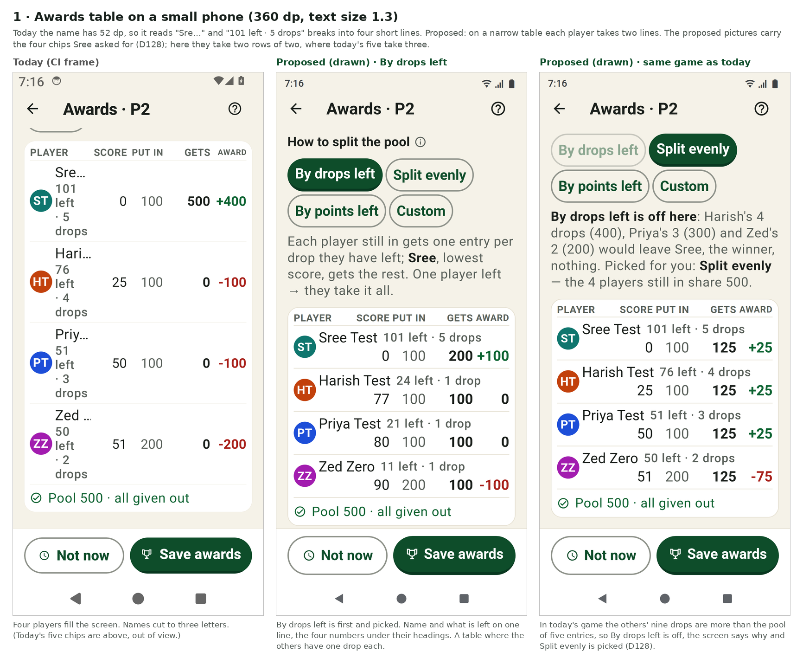
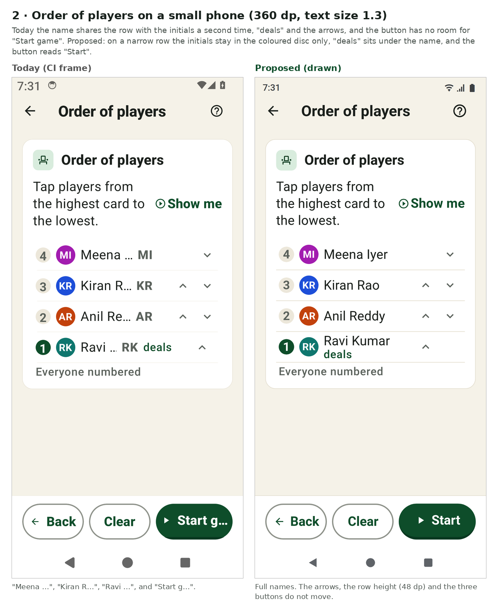
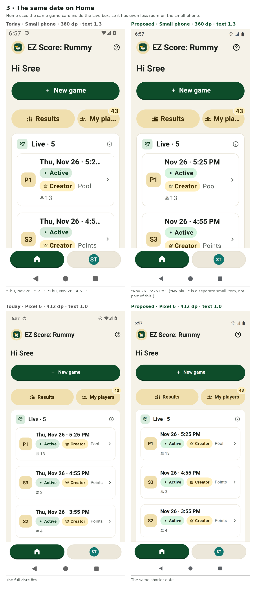
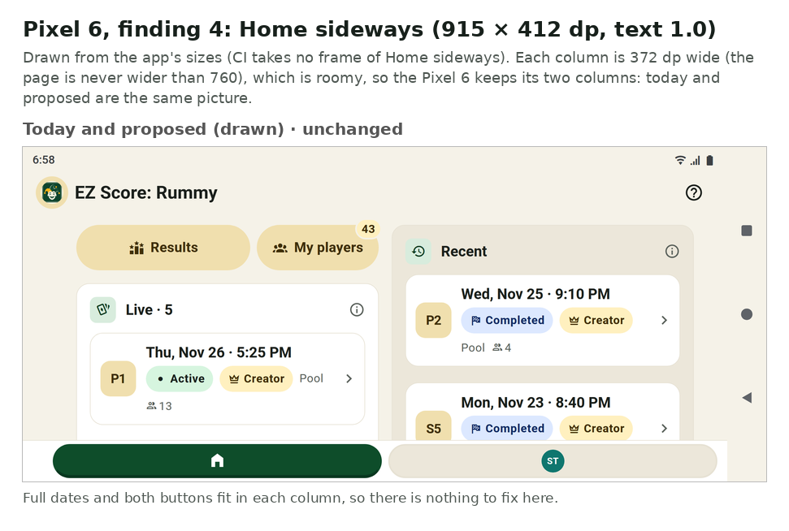
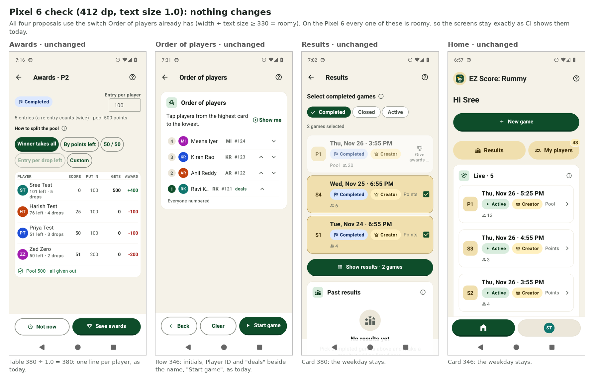

# Small phone (360 dp, text size 1.3): four layout fixes, pictures first (Nov 27)

**For Sree.** On a small phone with large text, four screens cut names, dates or a button. Below is one picture
pair for each (today beside proposed) and one recommendation each. **Nothing is built.** The one question:
**OK to build all four as drawn, as one small PR?** If there is no answer, nothing is built and the pictures wait.
On the Pixel 6 nothing changes (last picture).

| # | Screen | Today | Proposed | Picture |
| --- | --- | --- | --- | --- |
| 1 | Awards table | "Sre…", and "101 left · 5 drops" on four short lines | Two lines per player: name and what is left, then the four numbers | [awards-360.png](https://raw.githubusercontent.com/sreeatcandorps/RummyHome/main/rummy-home3/docs/small-phone-360/awards-360.png) |
| 2 | Order of players | "Meena …", and the button reads "Start g…" | Full names (the initials stay in the coloured disc, "deals" goes under the name); the button reads **Start** | [order-360.png](https://raw.githubusercontent.com/sreeatcandorps/RummyHome/main/rummy-home3/docs/small-phone-360/order-360.png) |
| 3 | Game cards (Results, Home) | "Thu, Nov 26 · 3:…" | The weekday is left out: "Nov 26 · 3:55 PM" | [results-360.png](https://raw.githubusercontent.com/sreeatcandorps/RummyHome/main/rummy-home3/docs/small-phone-360/results-360.png) · [home-cards-360.png](https://raw.githubusercontent.com/sreeatcandorps/RummyHome/main/rummy-home3/docs/small-phone-360/home-cards-360.png) |
| 4 | Home, phone sideways | Two half-width columns; the right half is empty once Recent ends | The same single list as upright, across the full width | [home-sideways-360.png](https://raw.githubusercontent.com/sreeatcandorps/RummyHome/main/rummy-home3/docs/small-phone-360/home-sideways-360.png) |
| — | Pixel 6 check | | Nothing changes | [pixel6-check.png](https://raw.githubusercontent.com/sreeatcandorps/RummyHome/main/rummy-home3/docs/small-phone-360/pixel6-check.png) · [pixel6-sideways.png](https://raw.githubusercontent.com/sreeatcandorps/RummyHome/main/rummy-home3/docs/small-phone-360/pixel6-sideways.png) |

The links open without a login once this page is on `main`. Before that, the same pictures are linked from the
pull request on its branch.

## 0. What was asked

Row 12g of `next-up.md`, found by the CI `small` phone on its first runs (#131):

> "Layout findings, not fixed here: Awards table at 360 dp × 1.3 — the player column shows "Sre…" with "101 left ·
> 5 drops" on three lines; Order of players — names truncate to "Meena …" beside the initials and the **Start
> game** button reads "Start g…"; Results cards — dates cut to "Tue, Nov 24 · …"; Home sideways uses the left half
> only (two cards tall at 360 dp). Same class as bug 5. Mockup first (what to hide at that width), then one PR."

My reading: for each of the four, say what to hide, shorten, wrap or rearrange at that width, show it, and show that
the Pixel 6 does not get worse. One option each, the simplest (D50: "keep this app simple"). Sree has said nothing
on these four yet; the nearest thing he has said is on another 360-dp row (D95): "at least you won't cut off the
initials", which is why the proposals give the room to the name and the number and take it from what is repeated.

## 1. How the pictures were made, and how far to trust them

- **Today** is a CI frame wherever CI takes one: run 45878556049 (nightly tier, `main` at `3c0ea575`, Nov 26). That
  run was red as a whole (the Pixel 4a and tablet jobs failed); the two jobs used here, the small phone and the
  Pixel 6, were green. None of the four screens has changed on `main` since. The frames are in
  `small-phone-360/ci/`.
- **Proposed** is drawn by `small-phone-360/make-small-phone-360.py` to the app's own sizes, the way the other
  mockups in this folder tree are made (HTML in headless Chrome, sheets with PIL). Before drawing a proposal the
  script was made to draw *today's* screen, and that drawing was measured against the CI frame: rows, cards, bars
  and buttons land within 4 dp, and names and dates cut within one letter of the frame (`--check` writes the
  comparison sheets). So a name that fits in a proposed picture should fit on the phone. It is still a drawing:
  the build re-takes these frames on the CI small phone before it is called done.
- **Home sideways has no CI frame** (the flows turn the phone on Home but only photograph the scorecard). Both
  halves of that pair are drawn. One fact comes from the run: its log puts the last live game at x 29–341 of 780 dp,
  under the left column only, and the drawing puts it in the same place.
- **A thing learned on the way.** On Android 14 and later, "text size 1.3" does not multiply every size by 1.3:
  small text grows by the full 30 %, large text by less (an 18-point title becomes 21.6, the 24-point "Hi Sree"
  26.4). The frames agree with that table, and the script uses it. It means the tight places at large text are
  the rows of small text, which is what the four findings are.

## 2. One switch for all four

Order of players already decides whether a row is "roomy": `showsPlayerCode` in `utils/seating.ts`, row width ÷
text size ≥ 330. Below that it hides the Player ID. All four proposals use that same switch and add no other, so
there is one rule to test and one sentence to remember: **when the box is narrow, show the short form.**

| What is measured | Small phone, ÷ 1.3 | Pixel 6, ÷ 1.0 | Narrow form |
| --- | --- | --- | --- |
| Order of players row (exists today) | 294 → 226, narrow | 346, roomy | Player ID hidden (today) + finding 2 |
| Awards table | 328 → 252, narrow | 380, roomy | finding 1 |
| Game card in Results | 328 → 252, narrow | 380, roomy | finding 3 |
| Game card on Home | 294 → 226, narrow | 346, roomy | finding 3 |
| One Home column, phone sideways | 346 → 266, narrow | 372, roomy | finding 4 |

A 360-dp phone at normal text size is also narrow for the first four rows (294 and 328 are under 330). CI has no
such phone, so there is no picture; by the numbers it is nearly as tight today (the Awards name has the same 52 dp,
"Start game" needs 80 dp and has 76), so it gets the same short forms.

## 3. Finding 1: Awards table

**Seen.** The table gives the four number columns 208 dp and the gaps 16, which leaves the player 88 dp, of which
the coloured disc takes 36. The name has 52 dp: "Sre…", "Hari…". "101 left · 5 drops" breaks into four lines, so
each player is 115 dp tall and four players fill the screen. With 13 players that is about 1,500 dp of scrolling.

| Option | What it does | Why not |
| --- | --- | --- |
| **A. Two lines per player when narrow (recommended)** | Line 1: disc, full name, "101 left · 5 drops". Line 2: the four numbers under their headings. 61 dp per player instead of 115 | — |
| B. Initials only, no name | The disc already shows them | "101 left · 5 drops" still wraps; the name is how people check who gets what |
| C. Hide "Put in" | Gains 52 dp | Award = Gets − Put in; hiding one of the three makes the last column look wrong |
| D. Narrower number columns | Gains about 24 dp | Not enough for a name, and four-digit awards would then be cut |
| E. Two lines at every width | One layout | Wide screens and tablets get a half-empty first line; the Pixel 6 would change |

**Recommendation: A.** Nothing is hidden and nothing is new to learn: the same five headings, the same numbers in
the same columns, and the name gets about 125 dp (12 letters). In Custom, the box to type in sits in the second
line where the Gets number is.

**Chips.** The proposed pictures show the four chips Sree asked for (D128: By drops left, the default · Split
evenly · By points left · Custom), not today's five; at 360 dp × 1.3 the four do not fit one row and take two rows
of two (today's five take three), and by the same drawing the Pixel 6 gets three and Custom on a second row. In
the game CI photographs, By drops left is off by D128's own rule (the others' nine drops are more than the pool
of five entries), so the picture has two proposed halves: a table where By drops left applies and is picked, and
today's game with the reason under the chips and Split evenly picked.

**Pixel 6.** 380 is roomy: one line per player, exactly as today.

## 4. Finding 2: Order of players

**Seen.** A row holds the seat number, the coloured disc with the initials, the name, the initials again as text,
"deals" on the dealer's row, and 96 dp for the two arrows. The name is left with 80 dp (56 on the dealer's row):
"Meena …", "Ravi …". In the bar, the three buttons leave **Start game** 76 dp for a label that needs 101.

| Option | What it does | Why not |
| --- | --- | --- |
| **A. Narrow row: initials in the disc only, "deals" under the name; button reads "Start" (recommended)** | Name gets 112 dp: "Meena Iyer", "Ravi Kumar" fit. The row stays 48 dp, the arrows do not move | — |
| B. Move Clear out of the bar | Room for "Start game" | A button people know moves; one more place to learn |
| C. Back as an arrow only | Gains about 30 dp | Still not enough for "Start game" at this text size, and Back loses its word |
| D. Names on two lines | Nothing cut | Rows of different heights; the arrows stop lining up (D52, D74) |
| E. Smaller arrows | Gains a little | Sree set the size and the 48-dp row (D52) |

**Recommendation: A.** The second copy of the initials is the one thing in the row that is on screen twice, so it
is the one to drop; the disc keeps them. A very long name ("Venkateswara Rao") still ends in "…", which is the
trade D95 already accepted. The button's other form already reads one word ("Next"); the screen reader still says
"Start game". The same row is used when the order is changed mid-game, so that sheet gets the full names too, with
"highest card" under the name in the same way.

**Pixel 6.** 346 is roomy: initials, Player ID and "deals" beside the name and "Start game", exactly as today.

**For the build.** The row is a fixed 48 dp today; with "deals" under the name it must be *at least* 48, so it can
grow at text sizes above 1.3 instead of clipping.

## 5. Finding 3: dates on game cards

**Seen.** "Wed, Nov 25 · 6:55 PM" needs 215–233 dp at this text size. The card in Results has 216, the card on
Home 184, a locked card 176. So the end is cut, and the end is the time, the only part that tells two games of
one evening apart.

| Option | What it does | Why not |
| --- | --- | --- |
| **A. Narrow card: leave out the weekday (recommended)** | "Nov 25 · 6:55 PM" needs 167–180 dp and fits | — |
| B. Date on two lines | Nothing left out | The cards are already four lines and 158 dp tall on this phone |
| C. Shrink the text to fit | Nothing left out | Different sizes from card to card; small text for older eyes |
| D. Leave out "PM" or the minutes | Shorter still | 6:55 and 6:55 PM are different games |

**Recommendation: A.** The weekday is the part nobody needs to tell games apart. It applies wherever the shared
game card is used (Home, the Results list) and to the Past results card, which cuts the same way. The long form
stays on roomy screens, on the result page, in the PDF and in everything shared.

**Two honest limits.** A locked card ("Give awards first") has 176 dp: with a two-digit hour ("Nov 26 · 10:25 PM",
180 dp) the "PM" can still be cut there. A game from a past year adds ", 2025" and is cut again. Both are rare, and
both are better than today.

**This bends A06** (one date format everywhere). It stays one formatter with a short form for narrow cards, not a
second format; the decision line should say so when Sree says yes.

**Pixel 6.** 380 and 346 are roomy: the weekday stays, exactly as today.

## 6. Finding 4: Home with the phone turned sideways

**Seen.** Any window 700 dp wide gets the tablet layout: two columns, Results / My players and Live on the left,
Recent on the right. A small phone on its side is 780 dp wide, so it gets two columns of 346 dp, each as cramped as
the upright phone ("My play…", cut dates, four-line cards) in a window only 221 dp tall. Recent is short, so after
one swipe the right half is empty and the left half shows one card and a bit.

| Option | What it does | Why not |
| --- | --- | --- |
| **A. Two columns only when each column is roomy; otherwise the upright list (recommended)** | The small phone gets one full-width list: both buttons in full, full dates, two-line cards, two cards and a bit per screen | — |
| B. Every phone sideways gets the upright list | A simpler sentence | Changes the Pixel 6, where two columns work today |
| C. Lock Home upright | No sideways Home at all | A new native piece and a new build; the screen would flip when coming back from a sideways scorecard |
| D. A sideways design for Home (cards in a grid, the three buttons in one row) | Uses the width best | D89: "A lot of the others don't require landscape. I want you to remember that." |

**Recommendation: A.** It takes a special layout away from the phones it does not fit; it does not design a new
one, which is what D89 asks. Tablets and the Pixel 6 keep their two columns.

**Pixel 6.** Sideways each column is 372 dp, roomy: the same picture today and after. The script draws both and
stops if they differ.

## 7. Pixel 6 check

These are today's CI frames from the same run. Every width in §2 is roomy on the Pixel 6, so no proposal switches
on: the four screens stay as they are, pixel for pixel. Two things on these frames are already tight today and are
*not* changed by this page (listed in §9): the dealer's row reads "Ravi K…", and "101 left · 5 drops" takes two
lines in Awards.

## 8. If Sree says yes: what the build is

- One small PR, or four rows on the small-fixes batch; the Main agent chooses. No database change, nothing new to
  install.
- The switch moves from "show the Player ID" to a shared "is this box roomy" helper with unit tests at 360 × 1.3,
  360 × 1.0 and 412 × 1.0, so the next narrow place uses it instead of inventing a number.
- Proof on the CI small phone: the awards, order and Results frames re-taken (same frame names as in
  `small-phone-360/ci/`), plus one new frame of Home sideways in the sideways flow, which today has none.
- Decision lines to add then (not added here): the narrow form of the Awards row and the Order row; A06's short
  date; Home's two columns only when roomy.

## 9. Seen on the same frames, not part of these four

For the Main agent to place; none is drawn here.

- Home: the **My players** button reads "My pla…" on the small phone (it is the narrower of the two buttons; the
  badge is not the cause).
- Results list: the locked card's note reads "Give award…".
- Scorecard: the header reads "Scorecar…" behind the mid-game sheet.
- Awards: the five ways to split wrap to three rows of buttons at this text size (D128's four take two, §3).
- Pixel 6: the dealer's row "Ravi K…" in Order of players; "101 left · 5 drops" on two lines in Awards.
