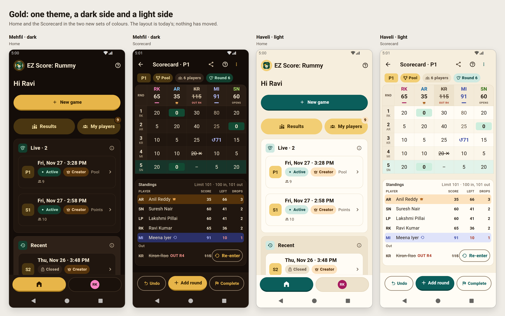
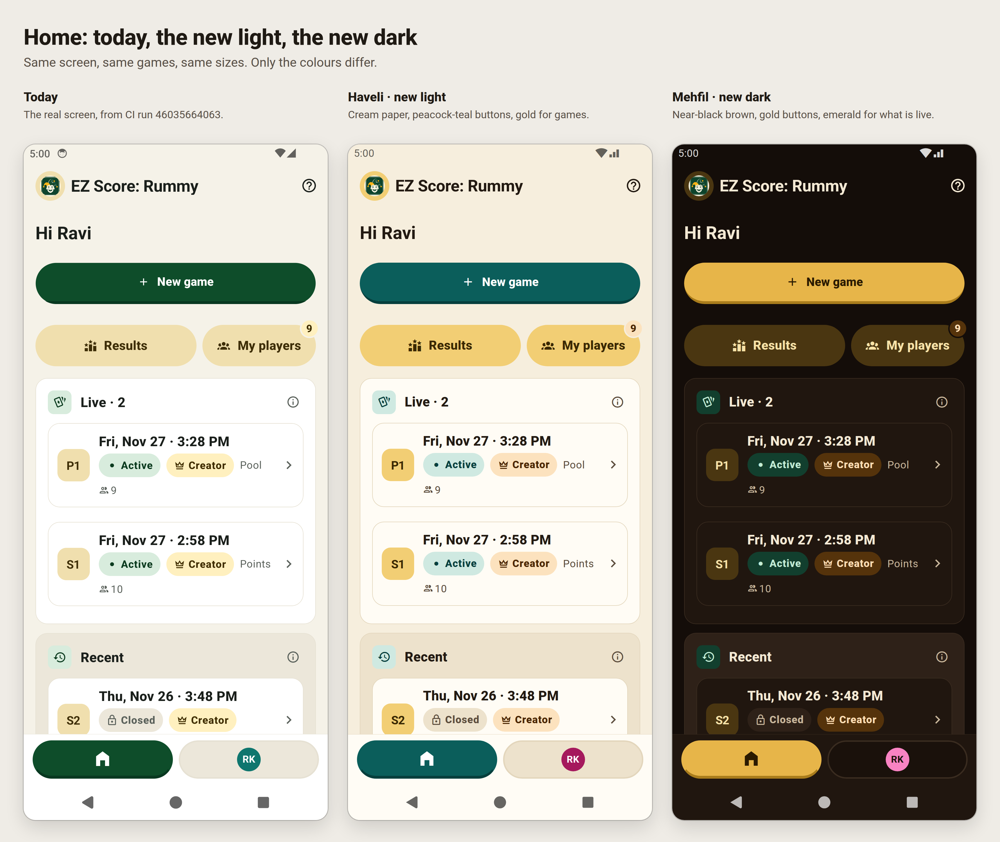
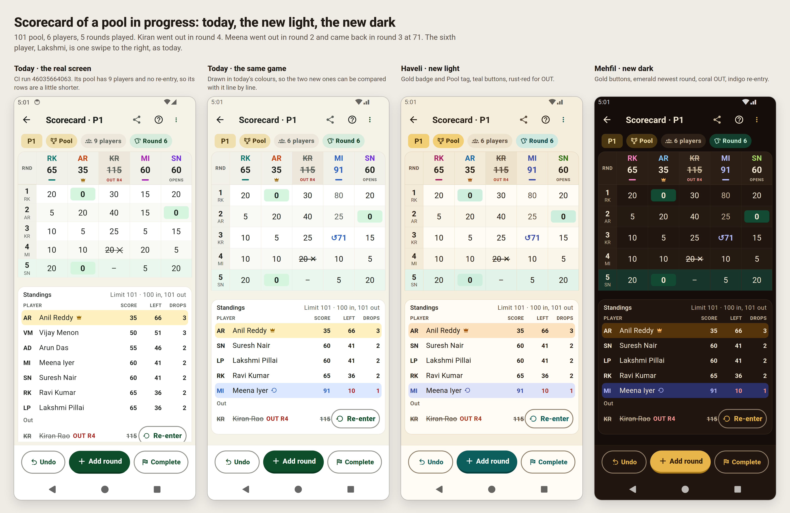
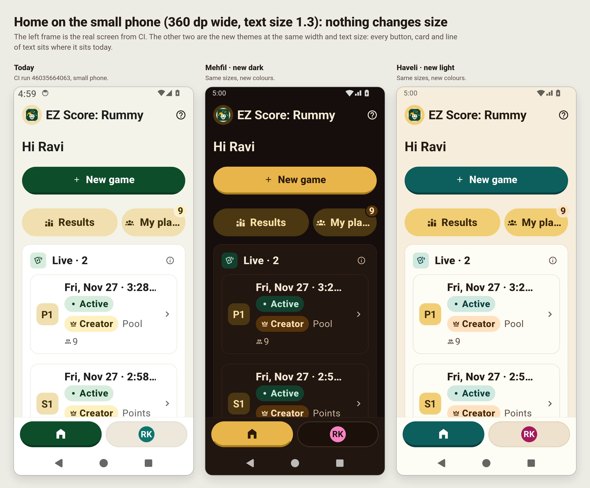
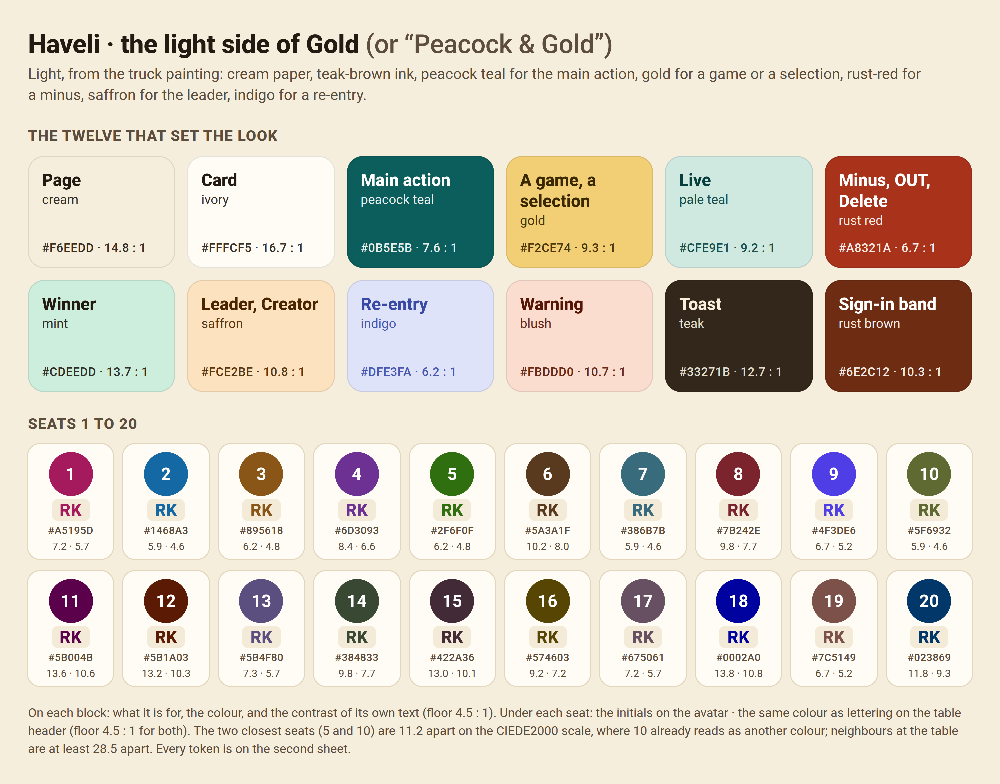
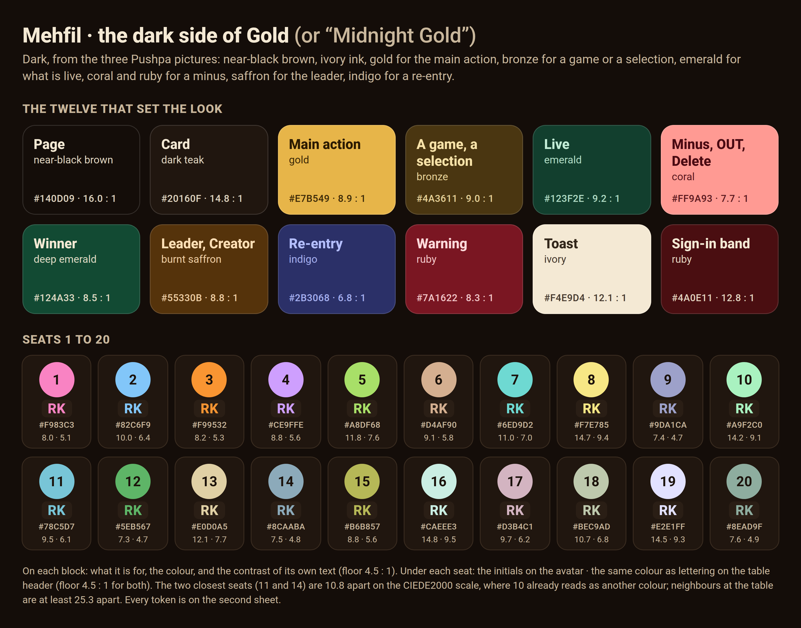
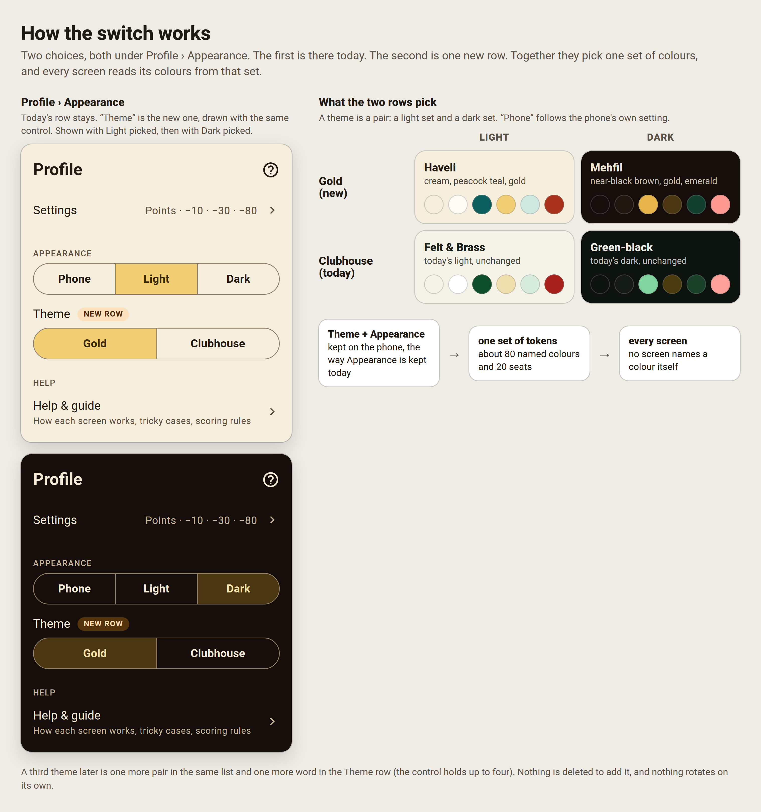
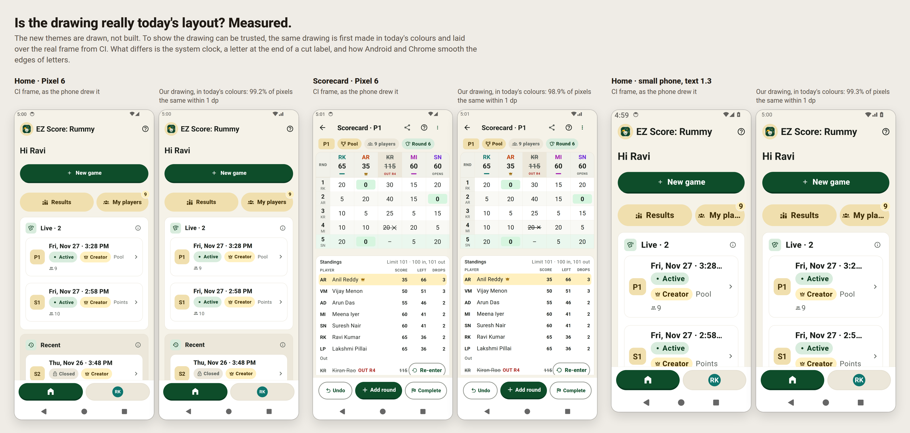

# Themes: Gold, with a light side and a dark side

*Nov 27 2026. Pictures and colours only. Nothing is built and nothing is decided.*

Sree, Nov 27:

> "I'm still not happy with the design … It doesn't feel premium … since it's Rummy, we should go for some premium Indian colors, Indian Bollywood."

> "Do you think these can be used to create a dark theme and a light theme? Indians definitely like gold and some strong colors, but this is what I'm thinking. … I think everything else stays in place. It's just the themes. We will switch the theme, and also maybe we should have multiple themes. We could kind of change the colors of the app once in a while (probably not a great idea), but instead of just deleting everything, it should be easy to just flip into a design."

**The one question (Q61): make these two the app's light and dark themes, with today's look kept as a choice under Profile › Appearance?** I recommend yes. Until you answer, nothing changes.

How I read it: every screen keeps its layout, its words and its sizes. Only the colours change. The colours come from your four pictures; the pictures themselves are not in the app or in this repository.

## The pictures

**Home.** The first phone is the real app today. The other two are drawings of the same screen.

**Scorecard of a pool in progress.** Five rounds, six players, one out, one who came back.

**The small phone with large text.** Nothing changes size.

## The two themes

In Profile they are one theme with two sides: **Gold** (or "Bangaram"). Today's look stays beside it as **Clubhouse**.

| | Light side: **Haveli** (or "Peacock & Gold") | Dark side: **Mehfil** (or "Midnight Gold") |
| --- | --- | --- |
| Colours from | the truck painting | the three Pushpa pictures |
| Page | cream `#F6EEDD` | near-black brown `#140D09` |
| Card | ivory `#FFFCF5` | dark teak `#20160F` |
| Main button | peacock teal `#0B5E5B` | gold `#E7B549` |
| A game, a selection | gold `#F2CE74` | bronze `#4A3611`, gold letters |
| Live, the winner | pale teal `#CFE9E1` | emerald `#123F2E` |
| Minus, OUT, Delete | rust red `#A8321A` | coral `#FF9A93`, ruby `#7A1622` behind a warning |

A haveli is a painted courtyard house. A mehfil is an evening of music and cards among friends.

## What I recommend

1. **Yes to both.** Gold becomes the look the app opens with. Clubhouse stays as a choice, so nobody loses the look they know.
2. **Gold is the one signature colour.** Ruby, emerald, teal and indigo each have one job. Strong colours everywhere stop looking premium.
3. **In light, the main button is peacock teal, not gold.** Gold words on cream cannot be read. Gold stays where it is a fill: the game squares, Results, My players.
4. **In dark, the main button is gold.** That bends today's rule that green is the action and yellow is a game. To keep the rule, the dark buttons would be emerald. I recommend gold: it is the look you asked for.
5. **What leaves the phone stays as it is for now:** the picture you share, the PDF, the web scorecard. So do the Joker icon and the splash.

**Can everyone read it?** Yes. All 57 pairs of text and background were measured in each theme, and all pass. Each theme has 20 seat colours, twice today's 10, and the initials read on every one. The numbers are at the foot of this page.

## How the switch works

Profile › Appearance keeps **Phone · Light · Dark** and gains one row, **Theme: Gold · Clubhouse**. The two rows together pick one set of colours, and every screen reads from it. The app opens in Light (your answer to Q62), so most people will meet Haveli first.

## More themes, or changing colours once in a while?

You said it is probably not a great idea, and I agree. People find things by colour: the gold square is a game, the green tag is live. If that changes on its own, it feels like a different app. So: **two new themes now, today's look kept, and room for one more** (a festival look, say) without touching a screen. People choose; the app never changes colour by itself.

---

*Below this line is for whoever builds it.*

## The contrast numbers

Floors: 4.5 : 1 for text and numbers, 3 : 1 for large numbers, icons and outlines. Seat distances are on the CIEDE2000 scale, where 10 already reads as another colour. **✗** is under its floor.

| Check | Floor | Haveli | Mehfil | Today, light | Today, dark |
| --- | --- | --- | --- | --- | --- |
| Text and numbers on their background, the weakest of 52 pairs | 4.5 | 5.2 | 5.5 | 4.9 | 5.3 |
| Large numbers, icons, outlines, the weakest of 5 pairs | 3 | 3.5 | 4.7 | **2.8 ✗** | 5.1 |
| Seat colours | 20 | 20 | 20 | 10 | 10 |
| Initials on a seat's avatar, the weakest | 4.5 | 5.9 | 7.3 | 5.2 | **1.9 ✗** in the bottom bar |
| A seat's colour as lettering on the scorecard, the weakest | 4.5 | 4.6 | 4.7 | **4.2 ✗** | 5.2 |
| The two most alike seats | 10 | 11.2 | 10.8 | 10.1 | 11.0 |
| Two players sitting side by side, the most alike | 20 | 28.5 | 25.3 | **11.6 ✗** | **11.0 ✗** |

Both new themes pass every check, and they fix four things that fall short today (the **✗** cells). One honest limit: to red-green colour-blind eyes, some of any twenty colours look alike (and some of today's ten). That is why every seat always shows its initials too. Every pair and every seat: [contrast.md](themes/contrast.md).

## What a build needs

No migration, no new dependency, no layout change. It touches the theme file, the saved preferences, Profile, the places that name a colour themselves, and one new test.

1. **A list of themes in `constants/theme.ts`.** `themes = { clubhouse: { light, dark }, gold: { light, dark } }`. Clubhouse is today's two sets, unchanged, so every test that pins today's values keeps passing. Gold's values are copied from [`themes/palettes.mjs`](themes/palettes.mjs), the checked spec: all 79 tokens of today's file, each given a value ([tokens.md](themes/tokens.md), pictures: [light](themes/tokens-haveli.png), [dark](themes/tokens-mehfil.png)).
2. **The choice.** `theme: 'gold' | 'clubhouse'` kept beside `appearance` in the preferences context (same storage key); the root layout picks `themes[theme][dark ? 'dark' : 'light']`. Profile gets one more `SegmentedChoice` under Appearance.
3. **Seats come from the theme.** Twenty per side, each with a fill, an initials colour and a lettering colour. Today there are ten, the initials are always white, and eight places always take the light set. `seatColor(i)` becomes `theme.seats[i]` in twelve places.
4. **Fixed colours move into the theme file.** The scan found **151 colour values on 103 lines in 14 files** outside the theme file, far more than expected. Each has a plan in [fixed-colours.md](themes/fixed-colours.md):
   - ten places on screen become tokens (for example, the lines of a result's table are white today, so on dark they draw white lines);
   - the share picture, the PDF and the web scorecard (six files, most of the values) move into one named `share` set and keep today's colours;
   - the splash and icon background in `app.json` stay: Android reads them before the app starts.
5. **A test that keeps it that way.** `tests/no-fixed-colours.test.ts` runs the same scan as [`themes/lib/inventory.mjs`](themes/lib/inventory.mjs) and fails when a colour value appears outside the theme file (only `app.json` is allowed), or when a screen reads the fixed `brand` set or a seat colour without the theme. A second test runs the contrast and seat checks of [`themes/lib/check.mjs`](themes/lib/check.mjs) on every theme in the list, so a fourth theme cannot ship with text nobody can read.
6. **Before it is called done.** The screenshot matrix in both sides of Gold, a Maestro flow that flips Theme and photographs Home and the Scorecard in all four sets, and the real screens beside these drawings.

## Decisions this touches

| Decision | What happens to it |
| --- | --- |
| D136, Q61 | This page is the pictures they asked for. |
| D65 (Palette B · Felt & Brass; "seat colours, red … do not change") | Stays whole, as the Clubhouse theme. In Gold the seat colours and the red have new values; what each colour means does not change. |
| D71 (dark stays green-black) | True for Clubhouse. Gold's dark is brown-black. |
| D11 (games are yellow, results are green) | Kept on both sides of Gold. |
| The colour contract, design-review-2 B03 | Kept in light, with teal in place of green. Bent in dark: the main action is gold (recommendation 4). |
| D09 ("Clubhouse") | Used as the name of today's look in the Theme row. D65 calls the same colours "Felt & Brass"; either name can go on the row. |
| D137 (new installs start on Light) | Unchanged, so Haveli is the first thing a new player sees. |
| D50 (keep it simple) | One new row, no rotation, the share picture stays fixed. |
| D135, Q60 (premium Home) | A separate question. Its three directions are ideas for Home's shapes; this page changes colours only, on every screen. |

## How the pictures were made, and how far to trust them

- **Today's frames are real.** They come from the last green CI run of #170, [run 46035664063](https://github.com/sreeatcandorps/RummyHome/actions/runs/46035664063): the smoke flow on the Pixel 6 and on the small phone (360 dp, text 1.3). They are in [`themes/today/`](themes/today).
- **The new frames are drawn**, as HTML photographed by Chrome, with the app's own icon font and the sizes read from the app's code. To prove the drawing is today's layout, it is first made in today's colours and compared with the CI frame pixel by pixel: **99.2%** of pixels match within 1 dp on Home, **98.9%** on the Scorecard, **99.3%** on the small phone. What differs is the clock, the edges of letters, and one letter of a cut title on the small phone.

  
- **The CI pool has nine players and no re-entry**, so the Scorecard picture has four phones: the real frame, the asked game drawn in today's colours, then the two new themes.
- **Only two screens are drawn.** Every other screen reads the same named colours, so it follows; the build shows each one before it merges. Thirteen to twenty players in landscape is not drawn here; the twenty seat colours are on the swatch sheets.
- **From the pictures to the palette.** The colours measured in the four pictures are mostly dark browns, with ruby and indigo in the third and tan and grey in the truck painting. The page and card colours are taken almost as measured (`#160B09`, `#21170F` → `#140D09`, `#20160F`; the ruby band is `#4A0E11` exactly, the re-entry indigo comes from `#1F1C35`). Bright gold, emerald and teal are small parts of the pictures: they keep their family and were made stronger until they could carry text.
- **To rebuild everything:** `node docs/themes/build.mjs` in `rummy-home3/` (Node 22, `npm ci`, Chrome). `--check` runs only the checks.
