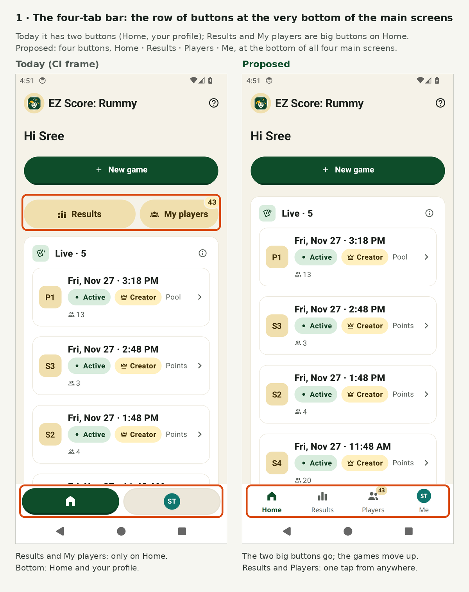
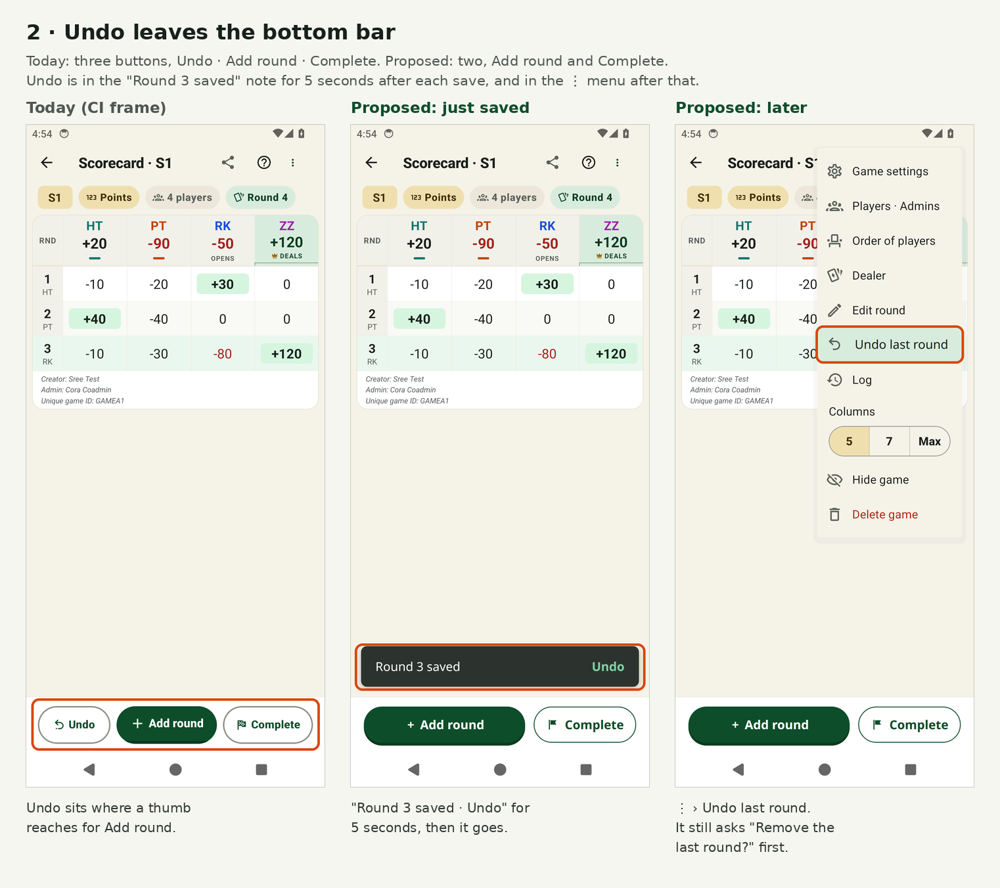
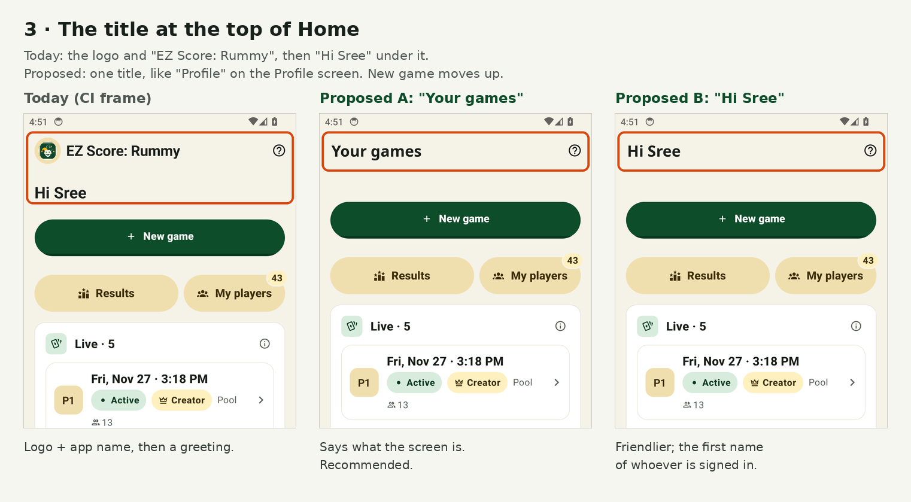
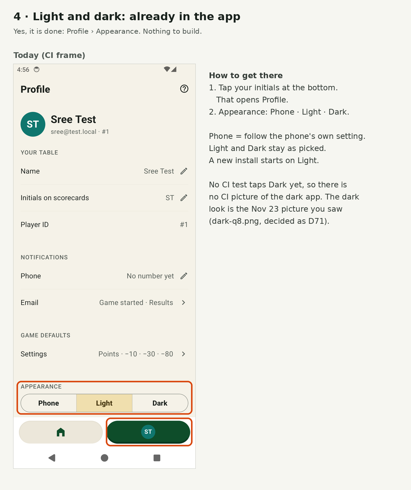
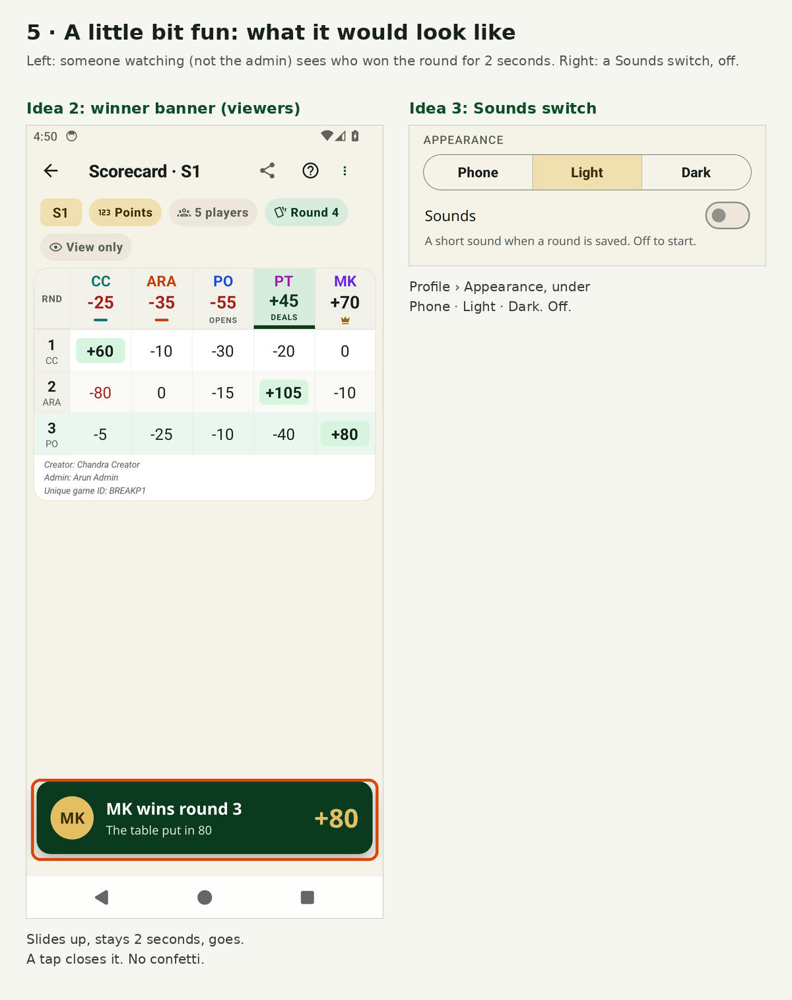

# Three design questions, and "a little bit fun" (Nov 27, 2026)

> Sree, Nov 27: "Leftover design review question: since a 4-tab bar, moving undo out of the bar, and the home title.
> 4-tab bar, what is that? Yeah, I don't know what that is, but you have to ask me those questions." And: "The light,
> light, light and dark switch is done, right? Maybe some sounds, yeah, that would be fun. I just want recommendations,
> though. I don't want too much going on, but we could definitely make it a little bit fun."

The "today" pictures are the real app on a Pixel 6, from CI run 46035664063 (Nov 27, small batch 4, now on main). In
each proposed picture, only the part with the orange ring changes. Nothing is built. The questions are at the end.

## 1. The four-tab bar

The "tab bar" is the row of buttons at the very bottom of the main screens. Today it has two buttons: Home and your profile.
Results and My players are two big yellow buttons on Home, so you can only reach them from Home.
Proposed: four buttons, **Home · Results · Players · Me**, at the bottom of those four screens. The yellow buttons go and the games move up.
Results and My players are then one tap from any main screen. Today, from Profile, it takes two taps. The 43 badge moves onto Players.
Inside a game (scorecard, Add round) there is no bar, same as today.

## 2. Undo out of the bottom bar

Today the scorecard has three buttons at the bottom: Undo · Add round · Complete. Undo sits right next to Add round, the button you tap most.
Proposed: two buttons, **Add round** and **Complete**. After each save, a note says "Round 3 saved · Undo" for 5 seconds. The app already shows the same kind of note when you delete a result ("Result deleted · Undo").
After the note is gone: open the ⋮ menu and tap **Undo last round**. It first asks "Remove the last round?", as Undo does today.
To fix an older round, tap its round number, as today. Viewers never see Undo, as today.

## 3. The title at the top of Home

Today Home starts with the logo and "EZ Score: Rummy", then "Hi Sree" on a line of its own. The other main screens have a plain title, like "Profile".
Proposed: one title, either **"Your games"** (it says what the screen is) or **"Hi Sree"** (friendlier). Either way, New game moves up by one line.
The logo stays on the sign-in screen and on the app icon.

## 4. Light and dark

**Yes, it is done: Profile › Appearance.** You pick Phone (follow the phone's own setting), Light or Dark, and the whole app changes. A new install starts on Light.
Nothing needs building. The picture is the real switch. No CI test taps Dark yet, so the dark look is the Nov 23 picture (`dark-q8.png`, D71).

## 5. "A little bit fun": three small ideas

| Idea | What the user feels | Cost | What we would not do |
| --- | --- | --- | --- |
| **1. A light buzz when a round is saved** | The admin's phone says "got it" without them having to look. | No new package. The app already buzzes once (Order of players) through `expo-haptics`. | No buzz on every key. |
| **2. A 2-second winner banner for viewers** | People watching on their own phone see "MK wins round 3 · +80" slide up, then go. A tap closes it. | No new package. | Not on the admin's phone (they are typing the next round). No confetti. Not on the web page for now. Off when the phone is set to remove animations. |
| **3. A Sounds switch, off by default** | One short sound when a round is saved, only for people who turn it on (Profile › Appearance). | A new package (`expo-audio`) and one small sound file, so a new app build. | No sound on key taps. Never on by default. |

## The five questions (each has a default)

1. **Four-tab bar:** put Home · Results · Players · Me at the bottom, and take the Results and My players buttons off Home? *Default: yes.*
2. **Undo:** take Undo out of the scorecard's bottom bar, and offer it in a 5-second "Round N saved · Undo" note and in ⋮ › Undo last round? *Default: yes.*
3. **Home title:** "Your games" or "Hi Sree", in place of the logo line and the greeting? *Default: "Your games".*
4. **Light and dark:** keep Profile › Appearance as it is, with new installs starting on Light? *Default: yes, no change.*
5. **A little bit fun:** which of these three, if any: the buzz on save, the viewers' winner banner, the Sounds switch (off)? *Default: the buzz and the banner; no sounds for now.*

Pictures: `design-review-2/mockups/three-q*.png`, made by `make-three-questions.py` from that run's frames.
