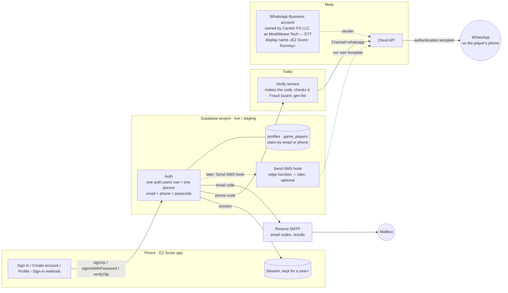
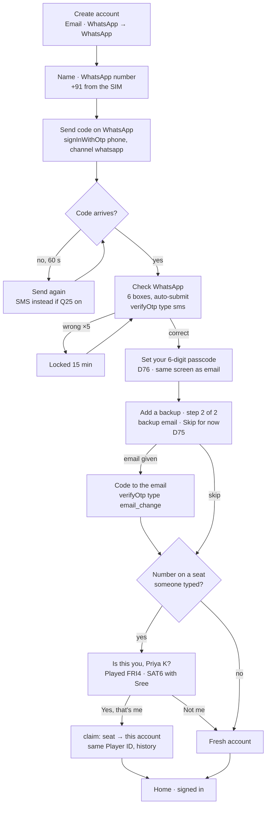
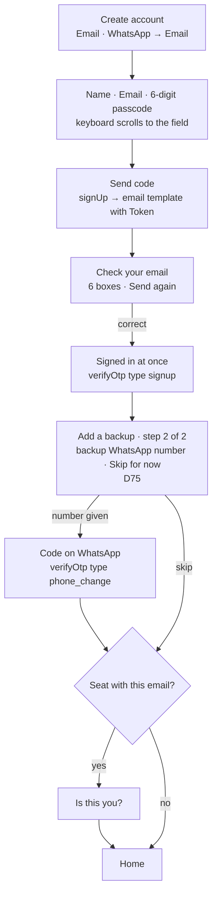
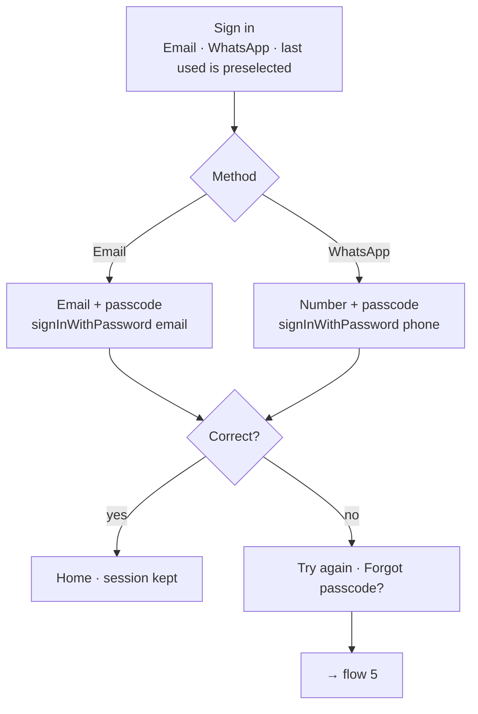
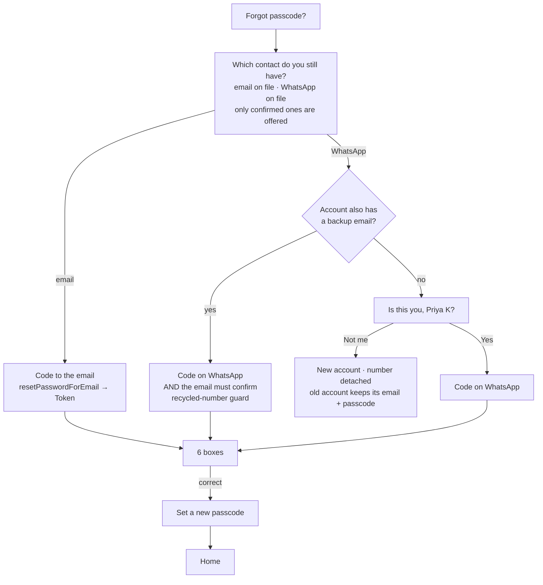
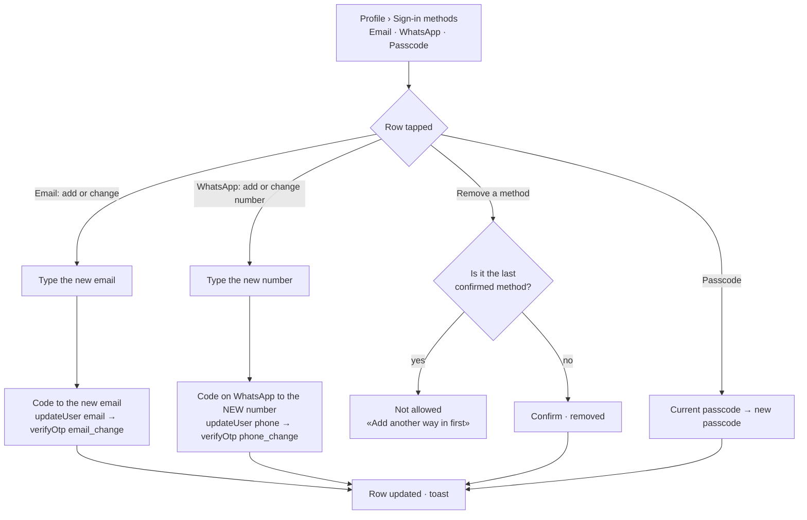
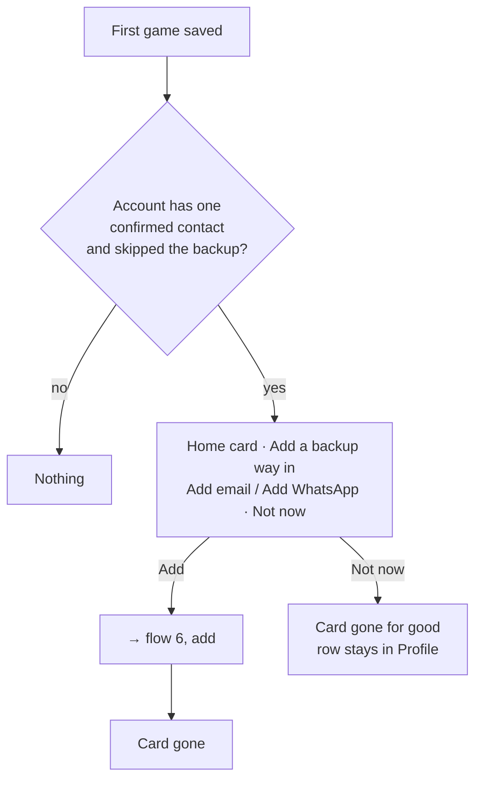
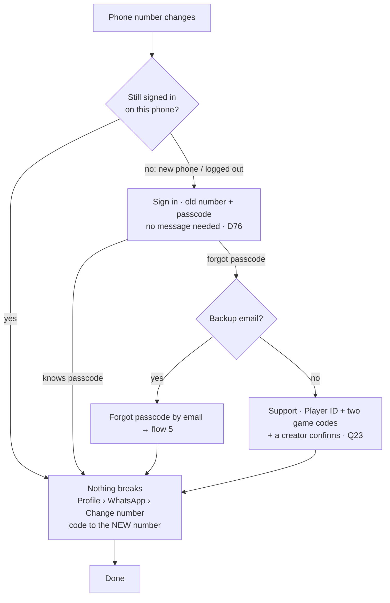
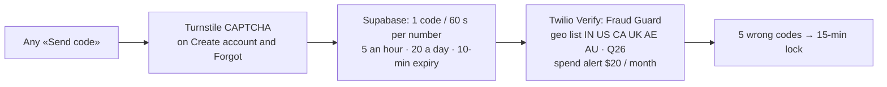

# WhatsApp sign-in — architecture and every flow

Companion to `whatsapp-sign-in-design.md` (the reasoning, costs, paperwork, decisions). This file is the picture:
how the pieces connect and what happens on each screen, step by step. GitHub renders the diagrams inline; the same
source is rendered to `flows-*.png` by `make-flow-images.py` for the PR body.

Decisions these flows implement: D75 (backup contact at sign-up with Skip, reminded once), D76 (same 6-digit passcode
for both methods), Q16 (email sign-up by code, not link). Open: Q20, Q21, Q23, Q25, Q26, Q27.

## 1. Architecture — what talks to what

Who pays whom: Meta ₹0.115 per delivered WhatsApp message (India) through Twilio; Twilio $0.05 per code typed
correctly; Resend free to 3,000 emails a month. A sign-in sends nothing (D76).

## 2. Create account — WhatsApp

## 3. Create account — Email (Q16, code not link)

## 4. Sign in — both methods, no message sent (D76)

The number here is a username: a dead or changed number still signs in (§5a case 2 of the design doc).

## 5. Forgot passcode — any contact that still works

## 6. Profile › Sign-in methods — add, change, remove

"Change number" is the only thing a person must do when their number changes; everything else keeps working (§5a).

## 7. Backup reminder — once (D75)

## 8. Number changed — what the person experiences

## 9. Abuse limits that sit under every flow

## 10. What changes where (build plan, when Sree says go — after Google approves the current review)

| Layer | Change |
| --- | --- |
| Paperwork (Sree) | Meta Business Portfolio → WhatsApp Business account via Twilio embedded sign-up → display name → business verification (EIN / Articles) → Twilio Verify service with the WhatsApp sender |
| Supabase (staging first) | Phone provider = Twilio Verify (SIDs); test numbers with fixed codes; email templates with `{{ .Token }}` (Q16); rate limits; CAPTCHA |
| `services/auth.ts` | `signUpWithWhatsApp`, `verifyPhoneCode`, `signInWithPassword({ phone })`, `addContact`, `changeContact`, `forgotPasscode(contact)` |
| Screens | `login.tsx` + `register.tsx`: Email \| WhatsApp control, number field with country code, Check WhatsApp, Set passcode, Add a backup; `me.tsx`: Sign-in methods group; Home: reminder card |
| Database | migration: claim RPC keyed on phone as well as email; `profiles.phone_confirmed` view of `auth.users.phone` |
| Help | sign-in page: "Sign in with WhatsApp", "I lost my number", "Add a backup" |
| Tests | Maestro flows for 2–8 above on the staging APK with fixed-code test numbers; 360 dp × 1.3 font pass |
| Store | Play Data safety: phone number → account management; Apple privacy label: phone number · linked |
