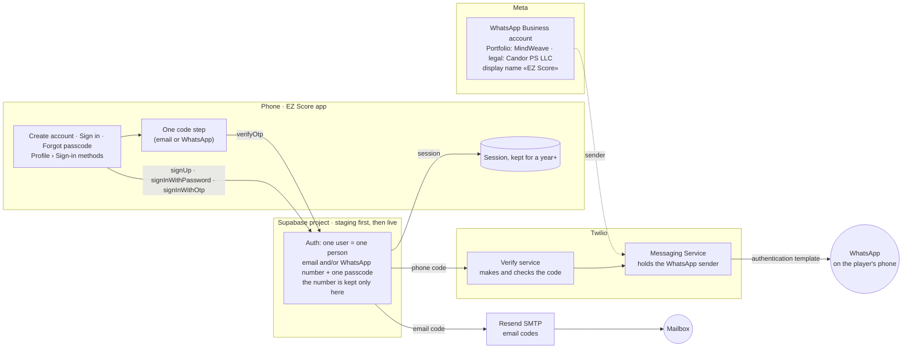
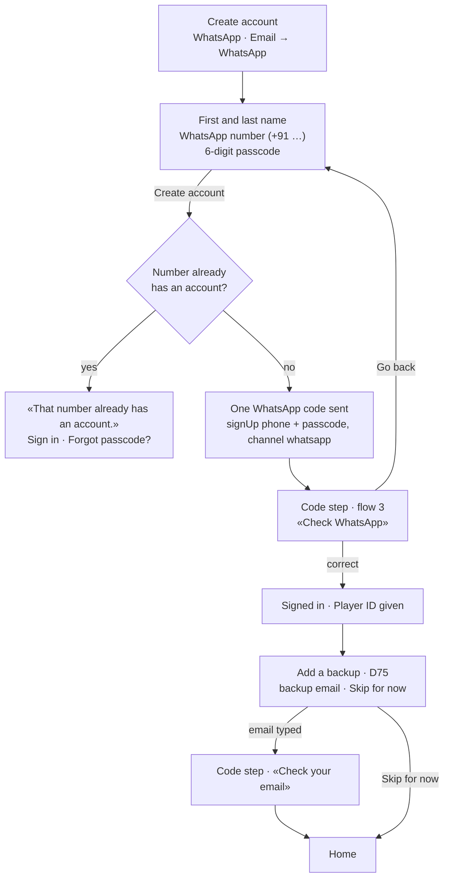
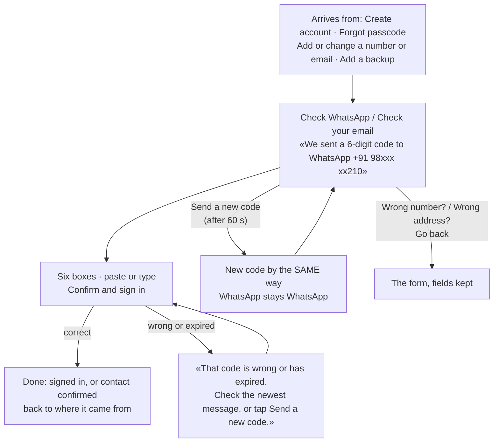
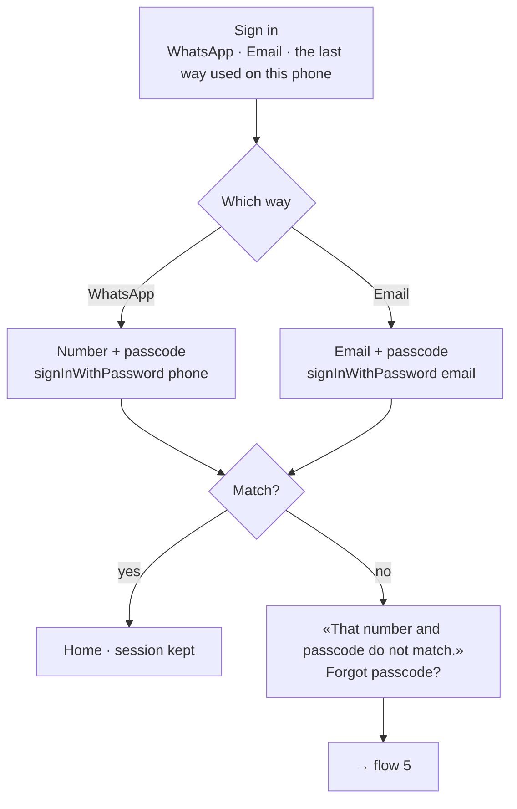
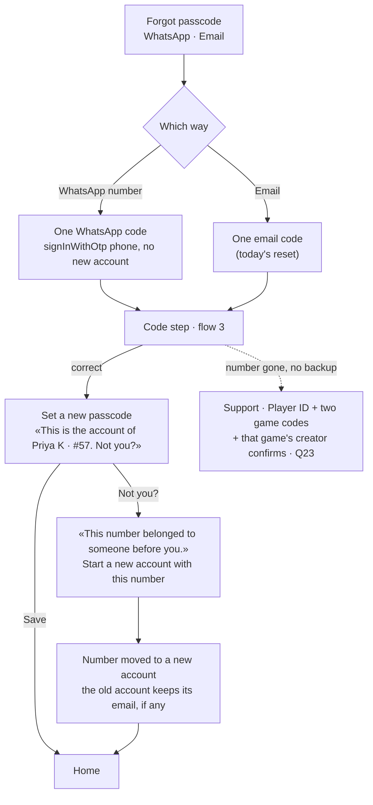
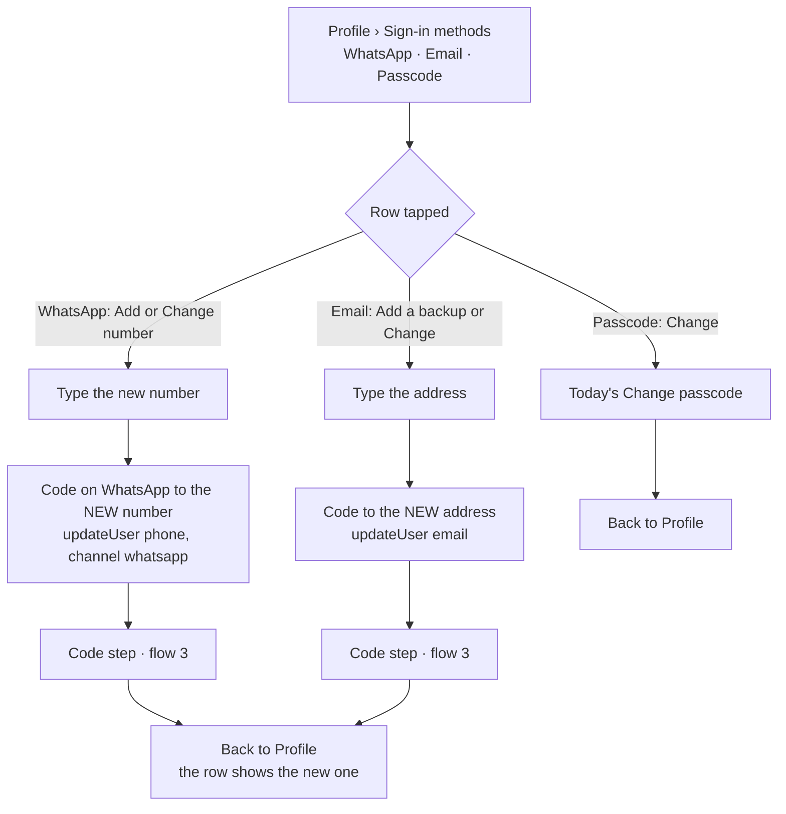
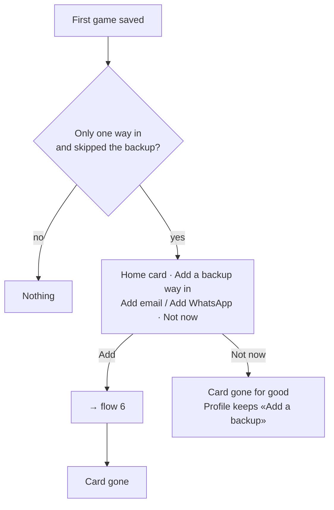
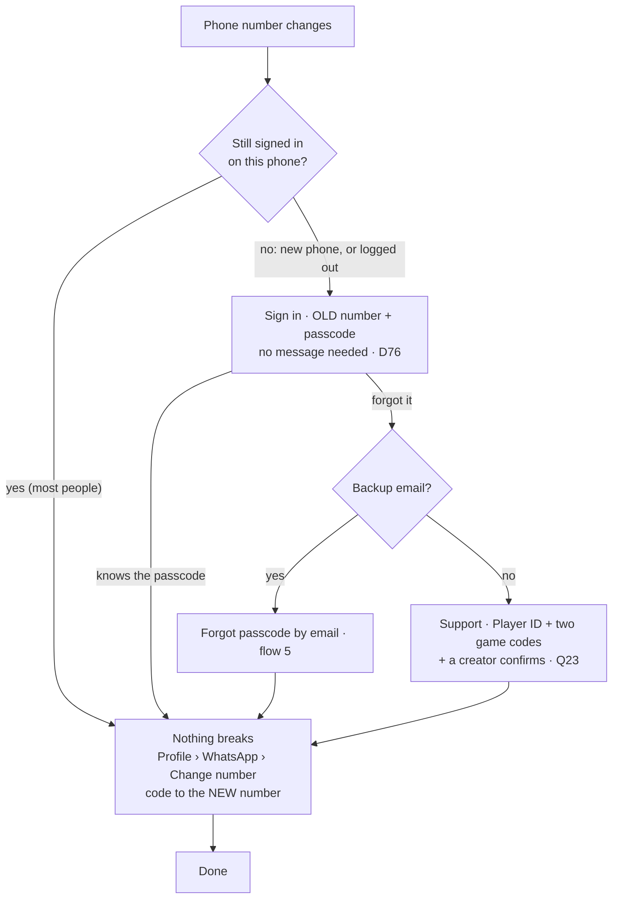
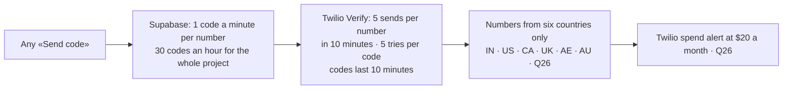

# WhatsApp sign-in — architecture and every flow

**Refreshed Nov 25 (D116).** Companion to `whatsapp-sign-in-design.md` (the reasons, costs, paperwork and decisions).
This file is the picture: what talks to what, and what happens on each screen. GitHub draws the diagrams; the same
source is rendered to `flows-1.png` … `flows-9.png` by `make-flow-images.py`.

What changed since Nov 23: the "Is this you?" step that matched a person by phone number is gone (D113: people are
found and linked only by Player ID). WhatsApp is a way to **sign in**, never a way to be **found**. Every code, email
or WhatsApp, goes through **one code step** (flow 3), the screen the email sign-up already uses (D101).

Decisions these flows follow: D75 (backup at sign-up with Skip, one reminder), D76 (one 6-digit passcode; sign-in sends
no message), D77, D118, D119 (EZ Score / MindWeave / Candor PS LLC), D101 (code typed in the app), D105 (no Player ID
box), D113 (Player ID only; nobody's number shown to anyone else), D116 (build it before the freeze).

## 1. Architecture — what talks to what

Profiles, players and games are unchanged: no phone number is stored there or used to find anyone (D113).

Who is paid: Twilio $0.05 for each code typed correctly; Meta ₹0.115 ($0.0014) for each WhatsApp code delivered to
India, passed through Twilio; Resend free up to 3,000 emails a month. Signing in with a passcode sends nothing (D76).

## 2. Create account — WhatsApp

No matching after the code: a creator who added this person by initials links them later by Player ID (D113).

## 3. The one code step — email and WhatsApp alike (D101)

One screen and one component in the app: only the icon, title, field label and "Wrong number?" differ. Five wrong
tries close a code (Twilio's own rule); the message says to send a new one.

## 4. Sign in — both ways, no message sent (D76)

The number is a username: a dead or changed number still signs in (design §5a, case 2).

## 5. Forgot passcode

"Not you?" is the only guard for a recycled number (India recycles numbers after about 90 days unused). It is one
line on a screen the person already sees, not an extra dialog (D50).

## 6. Profile › Sign-in methods — add or change

There is no Remove: nobody can take away their last way in, and there is no dialog to explain why not (D50).

## 7. Backup reminder — once (D75)

## 8. Number changed — what the person does

## 9. Limits under every flow

No SMS at launch (Q25), so there is no SMS-fraud risk to guard against. The worst a script can do is send the
30-an-hour project limit of WhatsApp codes it cannot read: about ₹83 ($1) a day if they go to Indian numbers, about
$16 a day if they all go to UK numbers (the dearest of the six), and nothing to Twilio, which charges only for codes
typed correctly. The $20 alert fires within the first bad day.
